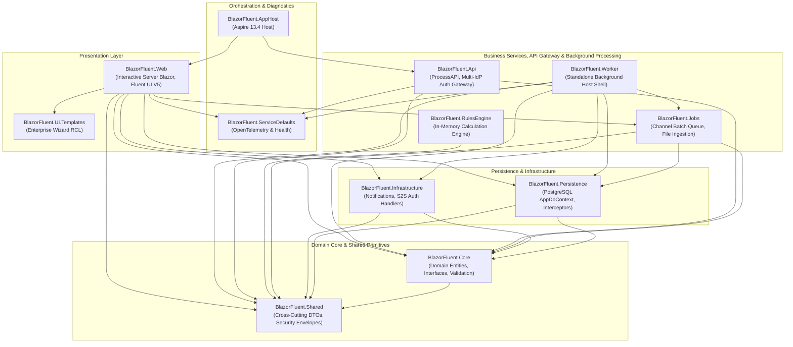
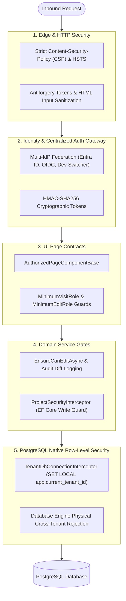
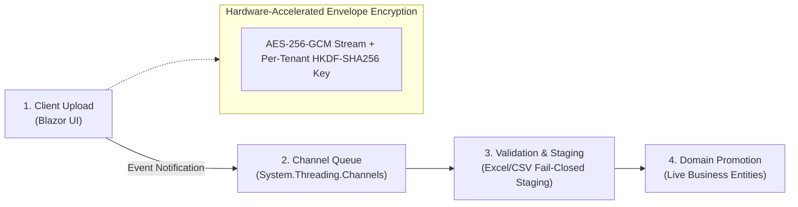

# ⚡ BlazorFluent

> **Enterprise Cloud-Native SaaS Starter Kit & Reference Architecture**  
> Built with **.NET 10**, **Interactive Server Blazor**, **Microsoft Fluent UI Blazor V5**, **EF Core 10**, **PostgreSQL Native RLS**, and **.NET Aspire Orchestration**.

[](https://dotnet.microsoft.com/)
[](https://learn.microsoft.com/dotnet/aspire/)
[](https://www.fluentui-blazor.net/)
[](https://www.postgresql.org/)
[](LICENSE)
[](docs/03-Security-Model-and-Defense-in-Depth.md)

---

## 🎯 What is BlazorFluent?

**BlazorFluent** is an enterprise-grade, security-hardened starter kit and reference architecture designed for organizations building mission-critical multi-tenant SaaS applications, internal portals, and governance platforms. 

Rather than providing simple CRUD templates, BlazorFluent delivers production-grade enterprise subsystems:

- 🐘 **Layer 5 Defense-in-Depth (PostgreSQL Native RLS)**: Tenant isolation is physically guaranteed at the database engine level via `TenantDbConnectionInterceptor` and native PostgreSQL Row-Level Security policies.
- 📐 **Clean Architecture (12-Project Topology)**: Strictly enforced inward dependency direction, separating domain core, persistence, infrastructure, API gateway, standalone worker host, and orchestration.
- ☁️ **.NET Aspire Orchestration**: Turnkey local orchestration with distributed OpenTelemetry tracing, live metrics, and dual-mode database routing (Native Local PostgreSQL vs Docker containerized PostgreSQL/pgAdmin).
- ⚙️ **Dual-Mode Asynchronous Worker Host (`BlazorFluent.Worker`)**: Thin standalone console host shell (`net10.0` Worker SDK) for distributed, horizontally scalable background queues with zero code duplication from `BlazorFluent.Jobs`.
- 🔐 **Zero-Trust Multi-Tenancy Isolation**: Ephemeral 5-minute S2S JWTs signed via private `TenantLicenseKey`, dynamic API key resolver, masked claims (`tid: tnt_...`, zero PII), and cross-tenant quarantine barriers.
- ⚡ **100% In-Memory Rules Engine (`BlazorFluent.RulesEngine`)**: Sub-millisecond calculation pipeline for regulatory, financial, and business rule evaluations with zero database contention.
- 🔐 **Zero-Knowledge Envelope Encryption**: Hardware-accelerated AES-256-GCM authenticated stream encryption with dynamic per-tenant keys derived via HKDF-SHA256.
- ⏱️ **Thread-Isolated Asynchronous Ingestion**: Bounded `System.Threading.Channels` queues with a 4-stage batch pipeline (Ingestion -> Queue -> Validation/Staging -> Domain Promotion).
- 🎨 **Microsoft Fluent UI Blazor V5**: Modern Microsoft Fluent 2 design language with zero legacy V4 tokens, custom design tokens, and automated Roslyn compliance verification.
- 🛡️ **TemplateGuard Governance**: Custom Roslyn Analyzer and AST manifest locking (`.basefiles.json`) that protects core files while enabling downstream customizations via `.Custom.cs` partial classes.

---

## 🏗️ 12-Project Solution Architecture

BlazorFluent strictly follows Clean Architecture dependency boundaries where all dependencies flow inward toward the domain core:



### Solution Project Directory:

| Project | Target Framework | Purpose |
| :--- | :--- | :--- |
| [`BlazorFluent.Shared`](file:///c:/Users/cheri/source/repos/BlazorFluent/src/BlazorFluent.Shared/BlazorFluent.Shared.csproj) | `net10.0` | Cross-cutting domain enums, security DTOs, encryption contracts, and common models. |
| [`BlazorFluent.Core`](file:///c:/Users/cheri/source/repos/BlazorFluent/src/BlazorFluent.Core/BlazorFluent.Core.csproj) | `net10.0` | Pure domain entities, business service interfaces, `OpaqueIdUtility`, and FluentValidation rules. |
| [`BlazorFluent.Persistence`](file:///c:/Users/cheri/source/repos/BlazorFluent/src/BlazorFluent.Persistence/BlazorFluent.Persistence.csproj) | `net10.0` | PostgreSQL AppDbContext, EF Core RLS interceptors, and HybridCache (L1/L2). |
| [`BlazorFluent.Infrastructure`](file:///c:/Users/cheri/source/repos/BlazorFluent/src/BlazorFluent.Infrastructure/BlazorFluent.Infrastructure.csproj) | `net10.0` | S2S `TenantTokenService`, `TenantAuthDelegatingHandler`, notifications (SMTP/Teams), and circuit security. |
| [`BlazorFluent.Jobs`](file:///c:/Users/cheri/source/repos/BlazorFluent/src/BlazorFluent.Jobs/BlazorFluent.Jobs.csproj) | `net10.0` | Bounded Channel batch queue, Cronos periodic schedulers, and 4-stage file ingestion library. |
| [`BlazorFluent.Worker`](file:///c:/Users/cheri/source/repos/BlazorFluent/src/BlazorFluent.Worker/BlazorFluent.Worker.csproj) | `net10.0` | Thin standalone console host shell executing background queues with horizontal scalability. |
| [`BlazorFluent.Web`](file:///c:/Users/cheri/source/repos/BlazorFluent/src/BlazorFluent.Web/BlazorFluent.Web.csproj) | `net10.0` | Web application host, 65+ Fluent UI V5 components, and role authorization contracts. |
| [`BlazorFluent.UI.Templates`](file:///c:/Users/cheri/source/repos/BlazorFluent/src/BlazorFluent.UI.Templates/BlazorFluent.UI.Templates.csproj) | `net10.0` | Decoupled Razor Class Library (RCL) housing the Enterprise Wizard framework. |
| [`BlazorFluent.RulesEngine`](file:///c:/Users/cheri/source/repos/BlazorFluent/src/BlazorFluent.RulesEngine/BlazorFluent.RulesEngine.csproj) | `net10.0` | Company Azure 100% in-memory CPU calculation routines with sub-millisecond execution. |
| [`BlazorFluent.Api`](file:///c:/Users/cheri/source/repos/BlazorFluent/src/BlazorFluent.Api/BlazorFluent.Api.csproj) | `net10.0` | ProcessAPI with dynamic `IssuerSigningKeyResolver`, Multi-IdP Auth Gateway, and Key Vault management. |
| [`BlazorFluent.ServiceDefaults`](file:///c:/Users/cheri/source/repos/BlazorFluent/src/BlazorFluent.ServiceDefaults/BlazorFluent.ServiceDefaults.csproj) | `net10.0` | Shared Aspire OpenTelemetry metrics, distributed tracing, and health checks. |
| [`BlazorFluent.AppHost`](file:///c:/Users/cheri/source/repos/BlazorFluent/src/BlazorFluent.AppHost/BlazorFluent.AppHost.csproj) | `net10.0` | Aspire 13.4 Orchestrator host managing multi-project lifecycles and database routing. |

---

## 🛡️ 5-Layer Defense-in-Depth Security

Security is enforced at every tier of the stack to ensure fail-closed isolation:



---

## ⚡ Asynchronous Ingestion & Stream Encryption Pipeline



---

## 🚀 5-Minute Quickstart

### 1. Prerequisites
- [.NET 10 SDK](https://dotnet.microsoft.com/download/dotnet/10.0) (`net10.0`)
- [PostgreSQL 16+](https://www.postgresql.org/download/) installed locally **OR** [Docker Desktop](https://www.docker.com/products/docker-desktop/)

### 2. Configure Database Routing
BlazorFluent dynamically supports both **Native Local PostgreSQL** and **Docker Containerized PostgreSQL** in [`src/BlazorFluent.AppHost/appsettings.json`](file:///c:/Users/cheri/source/repos/BlazorFluent/src/BlazorFluent.AppHost/appsettings.json):

```json
{
  "Aspire": {
    "UseDockerPostgres": false
  },
  "ConnectionStrings": {
    "DefaultConnection": "Host=localhost;Port=5432;Database=blazorfluent_db;Username=postgres;Password=<your_password>;Pooling=true;"
  }
}
```
- Set `"UseDockerPostgres": false` to run natively on `localhost:5432` with **zero Docker dependencies**.
- Set `"UseDockerPostgres": true` if you prefer Aspire to spin up containerized PostgreSQL and pgAdmin.

### 3. Launch with Aspire Orchestration
Set [`src/BlazorFluent.AppHost`](file:///c:/Users/cheri/source/repos/BlazorFluent/src/BlazorFluent.AppHost/BlazorFluent.AppHost.csproj) as the Startup Project and press **F5** (or **Ctrl+F5** to start without debugging). 

The Aspire Telemetry Dashboard opens automatically, displaying running endpoints, live traces, and metrics. Click on `web` to access the application.

---

## 🛠️ Repository Automation Scripts

| Script | Purpose |
| :--- | :--- |
| **`Rename-Project.ps1`** | Automates rebranding the entire solution, namespaces, directories, and configuration files. |
| **`scripts/build-templateguard.ps1`** | Compiles the TemplateGuard Roslyn analyzer and AST manifest tool. |
| **`scripts/generate-base-manifest.ps1`**| Generates the locked `.basefiles.json` AST fingerprint for template authoring. |
| **`scripts/Generate-DataModelDocs.ps1`**| Rebuilds the interactive HTML data model documentation portal and Markdown reference. |
| **`scripts/verify-fluent-v5.ps1`** | Roslyn AST scanner ensuring 100% compliance with Microsoft Fluent UI Blazor V5. |
| **`scripts/Download-Quill.ps1`** | Bundles air-gapped rich-text editor assets for offline enterprise environments. |

---

## 📚 Documentation Index

For in-depth architectural guides, security specifications, and developer recipes, consult the [**BlazorFluent Documentation Suite**](file:///c:/Users/cheri/source/repos/BlazorFluent/docs/Readme.md):

- [**00 — Overview & Executive Summary**](file:///c:/Users/cheri/source/repos/BlazorFluent/docs/00-Overview-and-Executive-Summary.md): Capabilities matrix, mental model, and personas.
- [**01 — Getting Started & Setup**](file:///c:/Users/cheri/source/repos/BlazorFluent/docs/01-Getting-Started-and-Environment-Setup.md): Prerequisites, Aspire setup, and config dictionary.
- [**02 — Architecture & Project Structure**](file:///c:/Users/cheri/source/repos/BlazorFluent/docs/02-Architecture-and-Project-Structure.md): 11-project Clean Architecture specification.
- [**03 — Security Model & Defense-in-Depth**](file:///c:/Users/cheri/source/repos/BlazorFluent/docs/03-Security-Model-and-Defense-in-Depth.md): PostgreSQL Native RLS, Envelope Encryption, and Auth Gateway.
- [**04 — Enterprise Features & Subsystems**](file:///c:/Users/cheri/source/repos/BlazorFluent/docs/04-Enterprise-Features-and-Subsystems.md): Channel queues, Rules Engine, and Wizard RCL.
- [**05 — Observability & Reliability**](file:///c:/Users/cheri/source/repos/BlazorFluent/docs/05-Observability-and-Reliability.md): Aspire OpenTelemetry, HybridCache, and audit diffs.
- [**06 — UI Conventions (Fluent UI V5)**](file:///c:/Users/cheri/source/repos/BlazorFluent/docs/06-UI-Conventions-and-Fluent-V5.md): 4-tier taxonomy and Fluent 2 design language.
- [**07 — How-To-Extend & Developer Recipes**](file:///c:/Users/cheri/source/repos/BlazorFluent/docs/07-How-To-Extend-and-Developer-Recipes.md): Copy-pasteable step-by-step developer recipes.
- [**08 — Operational Scripts & Tooling**](file:///c:/Users/cheri/source/repos/BlazorFluent/docs/08-Operational-Scripts-and-Tooling.md): Full script catalog and usage guide.
- [**09 — Coding Standards & Project Rules**](file:///c:/Users/cheri/source/repos/BlazorFluent/docs/09-Coding-Standards-and-Project-Rules.md): Human engineering team standards and C# 13 idioms.
- [**10 — AI Agent Governance & Rules**](file:///c:/Users/cheri/source/repos/BlazorFluent/docs/10-AI-Agent-Governance-and-Operational-Rules.md): Strict operational rules and behavioral constraints for AI coding agents.
