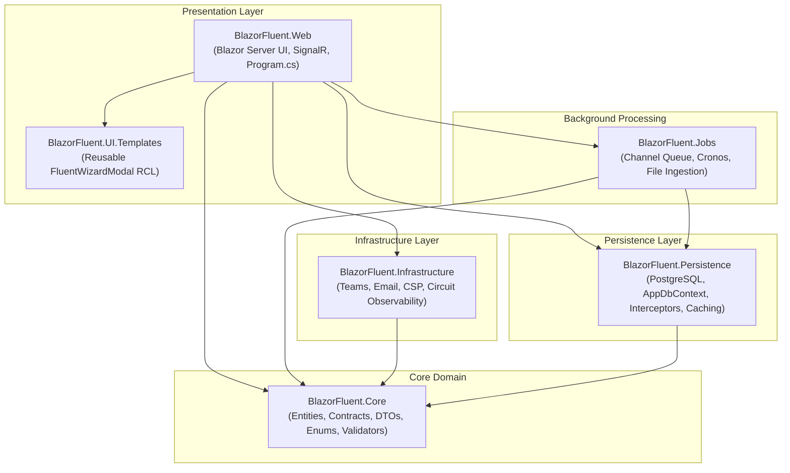

# ⚡ BlazorFluent

> **Enterprise Multi-Tenant Blazor WebApp Starter Kit & Solution Template**  
> Built with **.NET 10**, **Interactive Server Blazor**, **Microsoft Fluent UI Blazor V5**, and **EF Core / PostgreSQL**.

[](https://dotnet.microsoft.com/)
[](https://www.fluentui-blazor.net/)
[](https://www.postgresql.org/)
[](LICENSE)
[](docs/03-Security-Model.md)

---

## 🎯 What is BlazorFluent?

BlazorFluent is a production-grade, security-hardened starter kit designed for enterprise teams building multi-tenant SaaS applications, internal portals, and governance platforms. Instead of boilerplate auth and simple CRUD, it ships with comprehensive architectural systems:

- 🏢 **Fail-Closed Multi-Tenancy**: Tenant-isolated by default with EF Core 10 Named Query Filters, `AuditableEntityInterceptor` write barriers, immutable tenant keys, and zero-knowledge per-tenant AES-256 encryption.
- 🎨 **Microsoft Fluent UI Blazor V5**: Modern Microsoft Fluent 2 design language with zero legacy V4 tokens, strongly-typed component models, and automated compliance verification (`verify-fluent-v5.ps1`).
- ⚡ **Sequential Enterprise Workflows**: Multi-level stage-gated pipelines across Tenant, Program, and Project scopes with constant workflow orchestrators, discrete step owners, delegated subtasks, and admin-only governance.
- 🛡️ **Defense-in-Depth Security**: HMAC-SHA256 user row integrity seals, time-bounded session management with real-time remote circuit freeze (`<SessionRevokedModal />`), and audited SuperAdmin operator impersonation.
- 🚀 **Two-Tier Surgical Caching**: .NET 10 `HybridCache` coordinating sub-microsecond in-process L1 RAM with distributed Redis L2 invalidation buses.
- ⏱️ **Channel-Based Batch Job Engine**: Zero-polling background queueing powered by `System.Threading.Channels` and `Cronos`, featuring automated 3x exponential backoff and interactive Fluent UI V5 dashboard controls.
- 🔍 **Forensic Auditing (Levels 1–3)**: Transactionally consistent property-level diffs with automated credential masking and dedicated schema isolation.

---

## 🏗️ Solution Topology

BlazorFluent follows strict Clean Architecture dependency boundaries where dependencies flow strictly inward toward `Core`:



---

## 🚀 5-Minute Quickstart

### 1. Prerequisites
- [.NET 10 SDK](https://dotnet.microsoft.com/download/dotnet/10.0) (`net10.0`)
- [PostgreSQL 14+](https://www.postgresql.org/download/) running locally or in a container

### 2. Clone and Setup
```bash
git clone https://github.com/your-org/BlazorFluent.git
cd BlazorFluent
```

### 3. Configure Database Connection
Update the development connection string in `src/BlazorFluent.Web/appsettings.Development.json` or configure via `dotnet user-secrets`:
```json
{
  "ConnectionStrings": {
    "DefaultConnection": "Host=localhost;Port=5432;Database=blazorfluent_db;Username=postgres;Password=<your-postgres-password>;Pooling=true;"
  }
}
```

### 4. Apply EF Core Migrations
```bash
dotnet ef database update --project src/BlazorFluent.Persistence --startup-project src/BlazorFluent.Web
```

### 5. Launch the Application
```bash
dotnet run --project src/BlazorFluent.Web
```
Navigate to `https://localhost:7001` (or the configured launch port) in your browser.

---

## 🛠️ Renaming the Template for Your Own App

BlazorFluent includes an automated PowerShell script to rename all projects, namespaces, directories, and configurations in seconds:

```powershell
./Rename-Project.ps1 -NewName "AcmePortal"
```

This updates all solution files, project references, namespaces, Docker configurations, and documentation without broken references.

---

## 📚 Comprehensive Documentation Index

| Guide | Description |
|---|---|
| [**00. Overview & Glossary**](docs/00-Overview-and-Glossary.md) | High-level mental model, role personas, route map, and domain glossary. |
| [**01. Getting Started**](docs/01-Getting-Started.md) | Local development, database migrations, configuration reference, and health checks. |
| [**02. Architecture Deep Dive**](docs/02-Architecture.md) | Clean architecture layers, DI rules, EF Core pipeline, caching, and jobs engine. |
| [**03. Security Model**](docs/03-Security-Model.md) | Defense-in-depth security, tenant write barriers, HMAC seals, session kill switches, and RBAC. |
| [**04. Task Hierarchy & Workflows**](docs/04-Task-Hierarchy-and-Workflows.md) | Multi-level sequential workflows, constant ownership, step sign-offs, and wizard templates. |
| [**05. UI Conventions & Fluent V5**](docs/05-UI-Conventions-Fluent-V5.md) | Component naming taxonomy, Fluent UI Blazor V5 rules, and pitfall avoidance. |
| [**06. How to Extend Recipes**](docs/06-How-To-Extend.md) | Step-by-step guides for adding entities, pages, background jobs, and wizards. |
| [**07. AI Agent Operating Rules**](docs/07-AI-Agent-Rules.md) | Strict operational rules and build/staging constraints for AI pairing assistants. |
| [**Project Rules Reference**](PROJECT_RULES.md) | Canonical standards and architecture constraints. |

---

## 🤝 Contributing

Contributions are welcome! Please read [CONTRIBUTING.md](CONTRIBUTING.md) and review [PROJECT_RULES.md](PROJECT_RULES.md) before submitting pull requests.

## 📄 License

This starter kit is open-source software licensed under the [MIT License](LICENSE).
