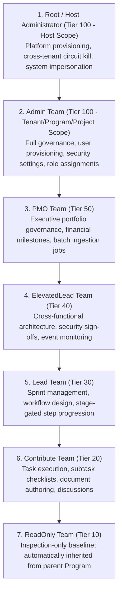
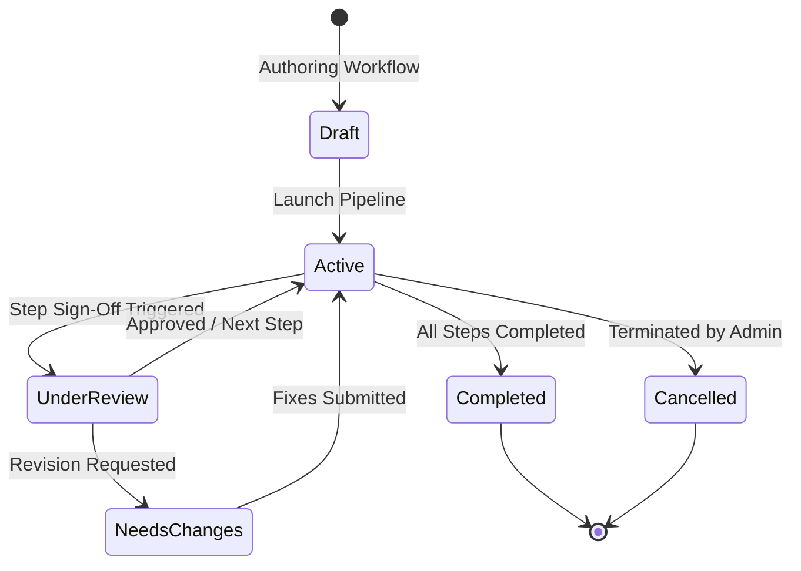
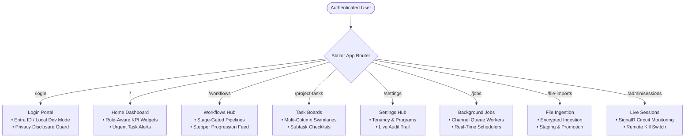

# 00. Overview & Executive Summary

> **Target Audience**: Enterprise Architects, CTOs, Engineering Directors, and Lead Developers evaluating or building upon BlazorEnterprise.  
> **Key Objective**: Deliver a comprehensive executive briefing on platform capabilities, enterprise architecture compliance, domain mental models, and access boundaries.

---

## 🏛️ Executive Summary: Why BlazorEnterprise?

Modern enterprise web initiatives routinely stall due to the massive overhead of wiring multi-tenancy, defense-in-depth security, background queues, audit compliance, and UI design consistency from scratch. 

**BlazorEnterprise** eliminates this multi-month lead time by providing a production-grade, hardened foundation combining **.NET 10**, **Microsoft Fluent UI Blazor V5**, **PostgreSQL Native Row-Level Security (RLS)**, and **.NET Aspire Orchestration**.

```
┌─────────────────────────────────────────────────────────────────────────────────────────┐
│                                BLAZORFLUENT ENTERPRISE VALUE                            │
├──────────────────────────┬─────────────────────────────┬────────────────────────────────┤
│ 🛡️ Zero-Trust Security   │ ⚡ Extreme Performance      │ 📐 Architecture Governance     │
│ • Layer 5 PostgreSQL RLS │ • In-Memory Rules Engine    │ • 11-Project Clean Architecture│
│ • AES-256-GCM Envelope   │ • Bounded Channel Queues    │ • Aspire 13.4 Orchestration    │
│ • Multi-IdP Auth Gateway │ • HybridCache L1/L2 Buses   │ • TemplateGuard Roslyn Analyzer│
│ • Circuit Freeze Guard   │ • Sub-millisecond CPU Exec  │ • .Custom.cs Extension Isolation│
└──────────────────────────┴─────────────────────────────┴────────────────────────────────┘
```

---

## 📊 Enterprise Capabilities Matrix

| Architectural Dimension | BlazorEnterprise Implementation | Enterprise Standards Met |
| :--- | :--- | :--- |
| **Data Multi-Tenancy** | PostgreSQL Native Row-Level Security (RLS) + EF Core Global Query Filters + Connection Interceptors (`TenantDbConnectionInterceptor`). | SOC 2 Type II, ISO 27001 (Multi-tenant partition isolation). |
| **Zero-Trust Tenancy Isolation** | Dual-Token Model: Interactive user tokens (Cloud Master Key) vs Ephemeral S2S tokens (`TenantLicenseKey`), dynamic `IssuerSigningKeyResolver`, GDPR / OWASP ASVS masked claims (`tid`, `cid`, `act`, zero PII), and cross-tenant quarantine guards. | Zero Trust Architecture, OWASP ASVS 4.3 Indirect Reference, GDPR Data Minimization. |
| **Authorization Architecture** | Hybrid Zero-Trust Model combining **HRBAC** (spaced numeric tiers 10–100 with cumulative ranking), **ReBAC** (container graph `Tenant &rarr; Program &rarr; Project` with the Program ReadOnly Floor rule), and **ABAC** (account status, temporal date windows, HMAC-SHA256 tamper seals, mandatory $\ge 1$ role gate, compile-time Roslyn `TG005` route governance, and decoupled `viewTier` / `editTier` attributes). | NIST SP 800-207 Zero Trust, OWASP ASVS V4 Access Control. |
| **Cryptographic Storage** | AES-256-GCM authenticated stream encryption with per-tenant HKDF-SHA256 derived keys. | HIPAA, GDPR Article 32 (Security of processing). |
| **Authentication & IAM** | Centralized Auth Gateway (`BlazorEnterprise.Api`) supporting Multi-IdP federation (Microsoft Entra ID, Azure AD B2C, Okta, Local Dev) with HMAC cryptographic tokens and dynamic key resolution. | OpenID Connect, OAuth 2.0, Zero Trust. |
| **Governance & Anti-Tamper**| `TemplateGuard` Roslyn Analyzer + locked AST base manifest (`.basefiles.json`) enforcing non-breaking downstream `.Custom.cs` partial classes. | Enterprise Release Management, Supply Chain Security. |
| **Business Calculation Engine**| `BlazorEnterprise.RulesEngine` delivering 100% in-memory calculation routines with zero database latency. | Sub-millisecond Financial & Regulatory calculations. |
| **Hybrid Batch Ingestion** | Local streaming SAX parsing, universal `staging.StagedImports` table with `jsonb` payloads and `IsProcessed` tracking, Gzip-compressed chunk transmission, and stateless Cloud API processing with all-or-nothing atomicity and optional proprietary vault at-rest encryption. | Resilient High-Throughput Bulk Processing, Zero-Trust Storage. |
| **Background Processing** | Dual-Mode architecture: Single-node web-hosted queue listener (`BlazorEnterprise.Web`) vs. horizontally scalable standalone worker console host (`BlazorEnterprise.Worker`), sharing 100% batch logic in `BlazorEnterprise.Jobs`. | Enterprise Job Scheduling, Decoupled Worker Scalability. |
| **UI Design System** | Microsoft Fluent UI Blazor V5 adhering strictly to Microsoft Fluent 2 design language with zero legacy V4 tokens. | WCAG 2.1 AA Accessibility, Microsoft 365 Look-and-Feel. |
| **Observability & Diagnostics**| .NET Aspire OpenTelemetry metrics, distributed traces, structured Serilog logging, and forensic audit diffs (`audit.AuditRecords`). | DORA, SRE Observability Standards. |

---

## 👥 Personas & Hierarchical Team Clearance Matrix

BlazorEnterprise structures access across a **Hybrid Zero-Trust Model** (`HRBAC + ReBAC + ABAC`). Instead of flat role strings, permissions are evaluated using **spaced numeric tiers** (`(int)userTier >= (int)requiredTier`) scoped within the structural container graph (`Tenant &rarr; Program &rarr; Project`):



### Cumulative Clearance & ReBAC Container Scoping

| Numeric Tier | Role (`ProjectRole` / `ProgramRole`) | UI Display Label | Scope & ReBAC Inheritance | Cumulative Capability |
| :---: | :--- | :--- | :--- | :--- |
| **100** | `Admin` | Admin Team | Tenant / Program / Project | Complete security, user management, and container administration. |
| **50** | `PMO` | PMO Team | Program / Project Scope | Executive review, background jobs (`/jobs`), contract milestones. |
| **40** | `ElevatedLead` | ElevatedLead Team | Program / Project Scope | Cross-cutting architecture, event audits (`/events`), risk sign-offs. |
| **30** | `Lead` | Lead Team | Program / Project Scope | Workflow progression (`/workflows`), file imports (`/imports`), sprint design. |
| **20** | `Contribute` | Contribute Team | Project Scope | Standard read/write access to tasks, subtask checklists, and deliverables. |
| **10** | `ReadOnly` | ReadOnly Team | Project / Program Baseline | View-only inspection. **Program ReadOnly Floor**: Program membership automatically grants Tier 10 across all child projects. |

> [!NOTE]
> **Cardinality Law**: A user can hold **at most 1 active role** per Program and **at most 1 active role** per Project, strictly enforced at the database level by unique compound indexes (`IX_ProgramUserRoles_Tenant_Program_User` and `IX_ProjectUserRoles_Tenant_Project_User`).


---

## 🧭 Core Mental Model

### 1. Fail-Closed Defense-in-Depth
Every layer independently rejects unauthorized access. If an application developer forgets a LINQ `.Where(x => x.TenantId == tenantId)` query filter, the **PostgreSQL database engine physically rejects the query** because the session variable `app.current_tenant_id` does not match.

### 2. ServiceNow-Style Stage-Gated Workflows
Workflows represent critical governance processes (approvals, release gates, compliance reviews). Unlike simple tasks:
- Workflows have a **constant workflow owner** who maintains accountability throughout the lifecycle.
- Individual steps are assigned to specialized step owners who must record explicit sign-offs.
- Workflows progress through a formal, deterministic state machine.



### 3. Forensic Immutability
Every create, update, and soft-delete produces a transactionally consistent audit record with property-level before/after JSON diffs. Sensitive fields (passwords, tokens, HMAC secrets) are automatically masked before persistence.

---

## 🗺️ Application Route & Feature Map


