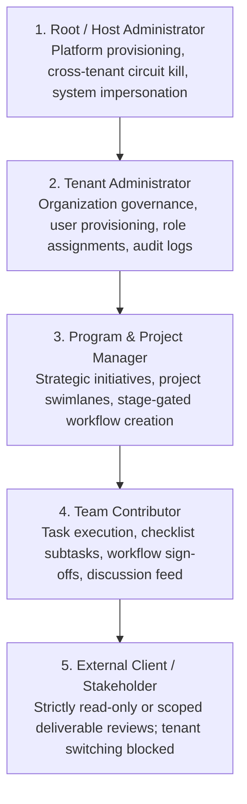
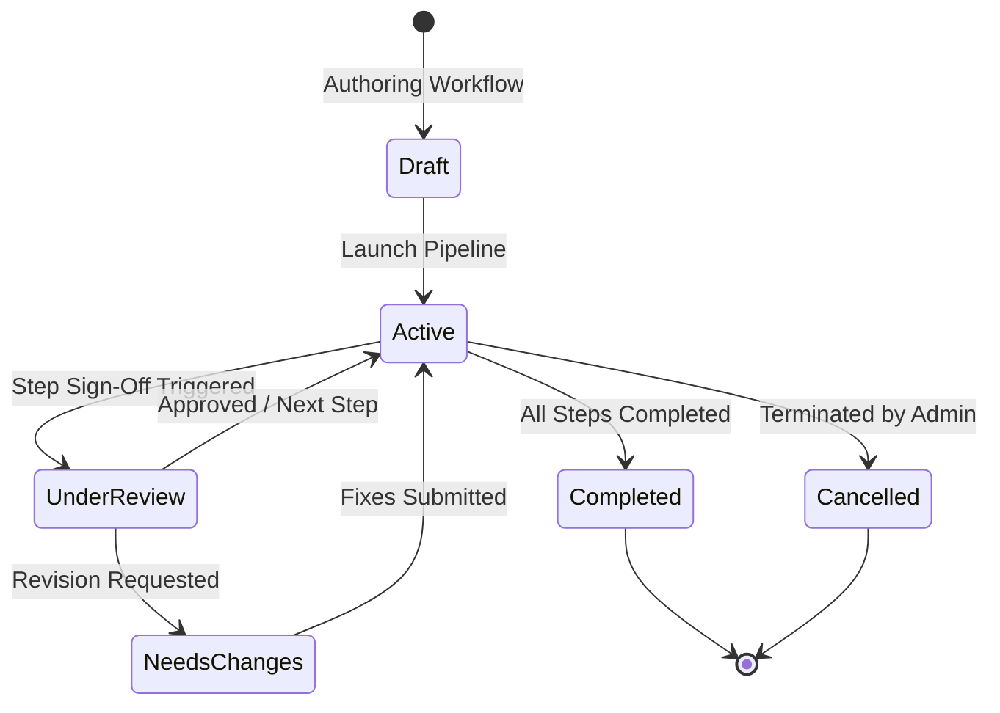

# 00. Overview & Executive Summary

> **Target Audience**: Enterprise Architects, CTOs, Engineering Directors, and Lead Developers evaluating or building upon BlazorFluent.  
> **Key Objective**: Deliver a comprehensive executive briefing on platform capabilities, enterprise architecture compliance, domain mental models, and access boundaries.

---

## 🏛️ Executive Summary: Why BlazorFluent?

Modern enterprise web initiatives routinely stall due to the massive overhead of wiring multi-tenancy, defense-in-depth security, background queues, audit compliance, and UI design consistency from scratch. 

**BlazorFluent** eliminates this multi-month lead time by providing a production-grade, hardened foundation combining **.NET 10**, **Microsoft Fluent UI Blazor V5**, **PostgreSQL Native Row-Level Security (RLS)**, and **.NET Aspire Orchestration**.

```
┌─────────────────────────────────────────────────────────────────────────────────────────┐
│                                BLAZORFLUENT ENTERPRISE VALUE                            │
├──────────────────────────┬─────────────────────────────┬────────────────────────────────┤
│ 🛡️ Zero-Trust Security   │ ⚡ Extreme Performance      │ 📐 Architecture Governance     │
│ • Layer 5 PostgreSQL RLS │ • In-Memory Rules Engine    │ • 11-Project Clean Architecture│
│ • AES-256-GCM Envelope   │ • Bounded Channel Queues    │ • Aspire 13.4 Orchestration    │
│ • Multi-IdP Auth Gateway │ • HybridCache L1/L2 Buses   │ • TemplateGuard Roslyn Analyzer│
│ • Circuit Freeze Guard   │ • Sub-millisecond CPU Exec  │ • .Custom.cs Extension Isolation│
└──────────────────────────┴─────────────────────────────┴────────────────────────────────┘
```

---

## 📊 Enterprise Capabilities Matrix

| Architectural Dimension | BlazorFluent Implementation | Enterprise Standards Met |
| :--- | :--- | :--- |
| **Data Multi-Tenancy** | PostgreSQL Native Row-Level Security (RLS) + EF Core Global Query Filters + Connection Interceptors (`TenantDbConnectionInterceptor`). | SOC 2 Type II, ISO 27001 (Multi-tenant partition isolation). |
| **Cryptographic Storage** | AES-256-GCM authenticated stream encryption with per-tenant HKDF-SHA256 derived keys. | HIPAA, GDPR Article 32 (Security of processing). |
| **Authentication & IAM** | Centralized Auth Gateway (`BlazorFluent.Api`) supporting Multi-IdP federation (Microsoft Entra ID, Azure AD B2C, Okta, Local Dev) with HMAC cryptographic tokens. | OpenID Connect, OAuth 2.0, Zero Trust. |
| **Governance & Anti-Tamper**| `TemplateGuard` Roslyn Analyzer + locked AST base manifest (`.basefiles.json`) enforcing non-breaking downstream `.Custom.cs` partial classes. | Enterprise Release Management, Supply Chain Security. |
| **Business Calculation Engine**| `BlazorFluent.RulesEngine` delivering 100% in-memory calculation routines with zero database latency. | Sub-millisecond Financial & Regulatory calculations. |
| **Asynchronous Ingestion** | `System.Threading.Channels` bounded queues with 4-stage batch pipelines (Ingest -> Queue -> Validation/Staging -> Domain Promotion). | Resilient High-Throughput Bulk Processing. |
| **UI Design System** | Microsoft Fluent UI Blazor V5 adhering strictly to Microsoft Fluent 2 design language with zero legacy V4 tokens. | WCAG 2.1 AA Accessibility, Microsoft 365 Look-and-Feel. |
| **Observability & Diagnostics**| .NET Aspire OpenTelemetry metrics, distributed traces, structured Serilog logging, and forensic audit diffs (`audit.AuditRecords`). | DORA, SRE Observability Standards. |

---

## 👥 Personas & Authorization Matrix

BlazorFluent structures enterprise access across five discrete tiers:



| Persona | Scope | Key Responsibilities | Access Guardrails |
| :--- | :--- | :--- | :--- |
| **Root / Host Administrator** | Cross-Tenant Global | Platform provisioning, tenant lifecycle, circuit session kill-switch, and audited operator impersonation. | Can bypass tenant filters only via audited host context; all mutations logged in `audit.AuditRecords`. |
| **Tenant Administrator** | Single Tenant Boundary | User provisioning, role assignments, program creation, tenant-wide workflow governance, and audit inspection. | Physically blocked from peer tenants by PostgreSQL RLS. Cannot view or mutate other organizations. |
| **Program / Project Manager** | Program / Project Scope | Strategic initiative tracking, project sprint planning, designing sequential workflows, and milestone sign-offs. | Bound to specific `ProgramId` or `ProjectId` within their tenant boundary. |
| **Team Member / Contributor** | Task & Subtask Scope | Executing assigned tasks, checking off subtasks, posting comments, and submitting workflow step completions. | Allowed to view permitted boards and update assigned work items. Page contracts enforce `CanEdit`. |
| **Client / External User** | Scoped Review | External stakeholder reviewing project progress and deliverables. | Hard-blocked from switching tenants (`UserType.ClientUser`), restricted to designated read-only views. |

---

## 🧭 Core Mental Model

### 1. Fail-Closed Defense-in-Depth
Every layer independently rejects unauthorized access. If an application developer forgets a LINQ `.Where(x => x.TenantId == tenantId)` query filter, the **PostgreSQL database engine physically rejects the query** because the session variable `app.current_tenant_id` does not match.

### 2. ServiceNow-Style Stage-Gated Workflows
Workflows represent critical governance processes (approvals, release gates, compliance reviews). Unlike simple tasks:
- Workflows have a **constant workflow owner** who maintains accountability throughout the lifecycle.
- Individual steps are assigned to specialized step owners who must record explicit sign-offs.
- Workflows progress through a formal, deterministic state machine.



### 3. Forensic Immutability
Every create, update, and soft-delete produces a transactionally consistent audit record with property-level before/after JSON diffs. Sensitive fields (passwords, tokens, HMAC secrets) are automatically masked before persistence.

---

## 🗺️ Application Route & Feature Map


