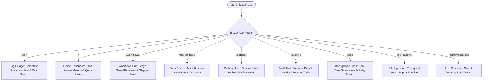

# 00. Overview & Domain Glossary

> **Purpose**: Provides a welcoming, plain-language walkthrough of BlazorFluent's core concepts, persona roles, feature catalog, and domain vocabulary.  
> **Who should read this**: Any developer, architect, or engineering lead exploring this codebase for the first time or onboarding new team members.

---

## 🧭 The Core Mental Model

BlazorFluent is not a generic dashboard or a simple CRUD demo. It is an **enterprise SaaS starter kit** designed around three foundational principles:

1. **Defense-in-Depth Multi-Tenancy**: Data isolation is guaranteed at every tier—from database query filters and write interceptors to browser session tracking and client-side encryption.
2. **ServiceNow-Style Sequential Workflows**: Work items can be linked into stage-gated governance pipelines where a **constant workflow owner** maintains overarching accountability while individual steps and subtasks are assigned to specialized team members.
3. **Operational Transparency**: Every mutation is stamped, every critical change produces forensic property-level JSON diffs (`audit.AuditRecords`), background batch jobs report in real time with retry capabilities, and administrators can freeze compromised circuits on demand.

---

## 👥 Personas & Role Matrix

BlazorFluent models enterprise organizations through five distinct personas:

| Persona | Role Scope | Key Responsibilities | Access Boundaries |
|---|---|---|---|
| **Root / Host Administrator** | Cross-Tenant Global | Platform provisioning, global tenant lifecycle, background job retries, circuit session revocation, and audited operator impersonation. | Can bypass tenant filters via audited host context; manage global settings. |
| **Tenant Administrator** | Single Tenant Boundary | Tenant governance, user provisioning, role assignments, program creation, tenant-level workflow orchestration, and audit log inspection. | Strictly restricted to their own `TenantId`. Cannot view or modify peer tenants. |
| **Program / Project Manager** | Program / Project Scope | Strategic initiative tracking, project sprint planning, designing sequential workflows, and task milestone approvals. | Bound to specific `ProgramId` or `ProjectId` within their assigned tenant. |
| **Team Member / Contributor** | Task & Subtask Scope | Executing assigned tasks, checking off delegated subtasks, logging discussion comments, and submitting step sign-offs. | Allowed to view permitted project boards and update assigned work items. |
| **Client / External User** | Read-Only or Scoped | External stakeholder reviewing project progress and deliverables. | Hard-blocked from switching tenants (`UserType.ClientUser`), restricted to designated views. |

---

## 🗺️ Application Route & Feature Map

The web application exposes a cohesive suite of pages and modules built with **Interactive Server Blazor** and **Microsoft Fluent UI Blazor V5**:

### Detailed Route Inventory

- **`/` (Home Dashboard)**: Consolidated landing view displaying active tasks, overdue items, and assigned workflow alerts tailored to the authenticated user.
- **`/login` (`LoginPage`)**: Corporate login portal featuring mandatory monitoring disclosure acknowledgment, Azure AD / Entra ID federated login, and a development mode switcher for local testing.
- **`/workflows` (`WorkflowsDashboardPage`)**: Multi-level workflow hub with KPI metric cards, scope filtering (Tenant / Program / Project), status filters, real-time steppers (`<WorkflowStepperComp />`), and the centralized design wizard modal (`<CreateWorkflowWizardModal />`).
- **`/project-tasks` (`ProjectTasksBoardPage`)**: Reusable swimlane board (`<FluentSwimlaneBoardComp />`), task dependencies modal, hierarchical subtask checklists, and deadline calendar views.
- **`/settings` (`SettingsPage`)**: Consolidated tabbed administrative control center housing:
  - *Tenants Tab*: Provisioning and deactivating tenant organizations.
  - *Programs & Projects Tabs*: Multi-level portfolio structuring.
  - *Audit Tab*: Searchable forensic property diff logs.
  - *Events Tab*: Domain event timelines.
  - *Jobs Tab*: Background batch scheduler status.
  - *Sessions Tab*: Active circuit management.
  - *User Calendar Tab*: Individual work scheduling and timezones.
- **`/jobs` (`JobsDashboard`)**: Background batch execution monitoring with real-time success/failure badges, duration counters, stack trace drawers, and one-click **"Retry"** / **"Run Now"** triggers.
- **`/auditing` (`AuditTrailDashboard`)**: Searchable repository of Level 2/3 property diffs showing old vs. new values with automatic masking of passwords and secrets.
- **`/file-imports` (`FileImportPage`)**: Multi-file batch upload interface featuring client-side AES-256-GCM encryption, staging validation, and background domain entity promotion.
- **`/admin/sessions` (`ActiveSessionsDashboard`)**: Real-time connected SignalR circuit monitor displaying IP addresses, user agents, and a "Kill Session" button that broadcasts instant circuit freezes.

---

## 📖 Domain Glossary

| Term | Architectural Definition |
|---|---|
| **Tenant (`TenantEntity`)** | The top-level corporate boundary (Company/Organization). Every tenant entity inherits `ITenantEntity` and has a strictly immutable `TenantId`. |
| **Program (`ProgramEntity`)** | A strategic grouping of related projects within a tenant (e.g., "Cloud Migration 2026", "SOC2 Compliance"). |
| **Project (`ProjectEntity`)** | A concrete delivery workspace where tasks and team members collaborate. |
| **Task (`TaskEntity`)** | A primary work item (`BaseTaskEntity`) containing title, description, priority, deadline, assignees, and comments. |
| **SubTask (`SubTaskEntity`)** | A child work item strictly governed under a parent task (maximum hierarchy depth = 1). Can be delegated to individual team members. |
| **Workflow (`WorkflowTaskEntity`)** | A sequential, stage-gated container that groups ordered `TaskEntity` steps into an execution pipeline. |
| **Constant Workflow Owner** | The single orchestrator (`WorkflowOwnerEmail`) accountable for the entire pipeline from initiation to completion. Does **not** change when individual steps advance. |
| **Step Owner** | The assigned specialist responsible for executing and signing off on a specific active step in the workflow. |
| **SubTask Assignee** | An individual team member to whom a subtask within a step is delegated. |
| **HMAC Row Integrity Seal** | A SHA-256 cryptographic signature stored on `UserEntity` ensuring user dates and status cannot be tampered with directly in PostgreSQL. |
| **Session Kill-Switch** | Real-time circuit revocation mechanism that displays `<SessionRevokedModal />` and freezes user interaction when revoked by an administrator. |
| **HybridCache (L1 / L2)** | Two-tier caching where L1 (in-process RAM, ~50ns) stores live C# objects and L2 (Redis / distributed memory, ~1ms) provides cross-node synchronization and atomic tag invalidation. |
| **Zero Trust Gate** | Server-side validation enforcing that permissions are evaluated on every domain service call, not merely through UI visibility checks. |

---

## 🔗 Related Documentation

- [01. Getting Started Guide](01-Getting-Started.md) — Local prerequisites, configuration, migrations, and first-run guide.
- [02. Architecture Deep Dive](02-Architecture.md) — Clean architecture boundaries, dependency graph, and service lifetimes.
- [03. Security Model](03-Security-Model.md) — Complete defense-in-depth specification and security checklist.
- [04. Task Hierarchy & Workflows](04-Task-Hierarchy-and-Workflows.md) — Deep dive into workflow orchestration and wizard templates.
- [05. UI Conventions & Fluent V5](05-UI-Conventions-Fluent-V5.md) — Naming taxonomy and Fluent UI Blazor V5 best practices.
- [06. How to Extend Recipes](06-How-To-Extend.md) — Step-by-step guides for adding entities, pages, and services.
