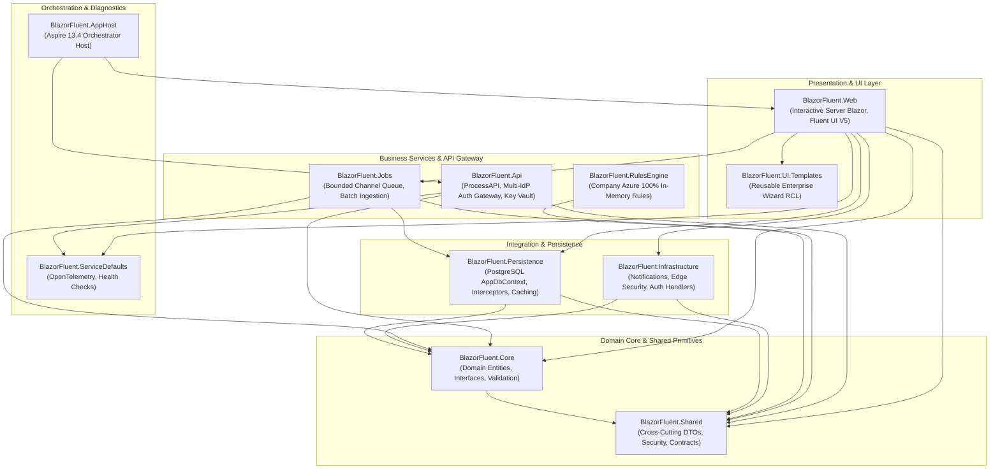
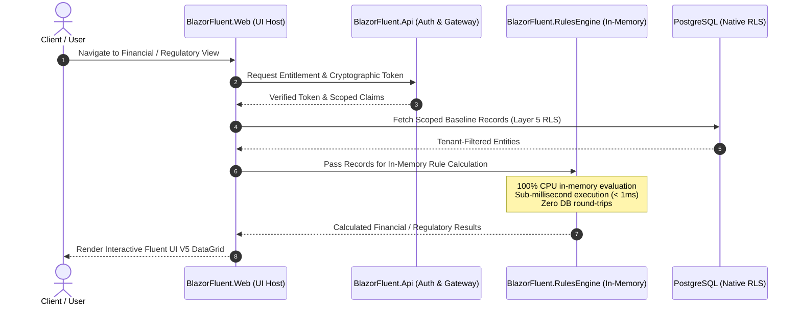

# 02. Architecture & Project Structure

> **Target Audience**: Software Engineers, Solutions Architects, and Technical Leads designing features or evaluating system boundaries.  
> **Key Objective**: Comprehensive architectural specification detailing the complete 11-project solution topology, inward dependency boundaries, Aspire orchestration, and the two-tier hybrid calculation model.

---

## 🏛️ 1. Clean Architecture Layer Topology

BlazorFluent strictly adheres to **Clean Architecture** principles. Dependencies flow strictly inward toward the domain core. Outward or circular references are forbidden at compile time.



---

## 📂 2. Comprehensive 11-Project Solution Topology

The solution is divided into distinct, cohesive architectural domains:

### 1. `BlazorFluent.Shared` (Cross-Cutting Contracts & Primitives)
- **Role**: The universal foundation defining shared DTOs, domain attributes, security models, common response wrappers, and cryptographic contracts.
- **Key Responsibilities**:
  - Domain enums (`TaskStatus`, `ProjectRole`, `WorkflowState`, `UserType`).
  - Cryptographic token models and envelope encryption attributes (`[EncryptedProperty]`).
  - Cross-tier API request/response envelopes.
- **Dependencies**: Zero project references. Clean, portable, framework-agnostic.

### 2. `BlazorFluent.Core` (Enterprise Domain & Contracts)
- **Role**: Pure domain entities, value objects, domain events, and core abstractions. Zero UI or EF Core dependencies.
- **Key Responsibilities**:
  - Domain entities (`TenantEntity`, `ProjectEntity`, `WorkflowEntity`, `TaskEntity`, `AuditRecordEntity`).
  - Core interfaces (`ITenantService`, `IProjectService`, `IWorkflowService`, `IFileIngestionService`).
  - Universal batch staging contracts: `IProprietaryEncryptedEntity` (`SourceRowId`, `IsEncryptedAtRest`, `EncryptedPayloadBytes`) and `StagedImportEntity` (universal `staging.StagedImports` with `jsonb` payloads and `IsProcessed` lifecycle flags).
  - FluentValidation rules (`TaskValidator`, `WorkflowValidator`, `StagedImportEntityValidator`).
- **Dependencies**: `BlazorFluent.Shared`, `FluentValidation`.

### 3. `BlazorFluent.Persistence` (Data Access & Caching)
- **Role**: 100% database access, EF Core configurations, and multi-tier caching.
- **Key Responsibilities**:
  - PostgreSQL `AppDbContext` with schema isolation (`core`, `audit`, `staging`).
  - Staging table `staging.StagedImports` with `jsonb` storage, GIN/B-tree composite indexing, and `IsProcessed` filtering.
  - EF Core Interceptors:
    - `TenantDbConnectionInterceptor`: Injects `SET LOCAL app.current_tenant_id` for Native RLS.
    - `AuditableEntityInterceptor`: Automatically captures forensic property-level JSON diffs.
    - `ProjectSecurityInterceptor`: Fails closed if unauthorized users attempt project mutations.
  - SQLite fallback provider for localized or offline environments.
  - HybridCache implementation combining L1 in-memory RAM with L2 Redis caching.
  - On-demand in-memory decryption for proprietary encrypted entities (`UserTaskService.GetTasksByProjectAsync` / `GetTaskByIdAsync`).
- **Dependencies**: `BlazorFluent.Core`, `BlazorFluent.Shared`, `Npgsql.EntityFrameworkCore.PostgreSQL`, `Microsoft.Extensions.Caching.Hybrid`.

### 4. `BlazorFluent.Infrastructure` (Outbound Integrations & Edge Security)
- **Role**: External service communication, security middleware, and browser interop.
- **Key Responsibilities**:
  - Outbound notification senders (SMTP Email relay, Microsoft Teams incoming webhooks).
  - SignalR circuit monitoring and real-time remote kill-switch service (`CircuitHeartbeatHandler`).
  - HTTP Edge security middleware (CSP headers, CORS, Antiforgery tokens).
  - Client-side AES-256 encryption helpers and viewport breakpoint JS interop.
  - Engine API Gateway (`RemoteEngineGateway` implementing `IEngineClient` for batch transforms and proprietary decryption).
- **Dependencies**: `BlazorFluent.Core`, `BlazorFluent.Shared`, `Microsoft.AspNetCore.App`.

### 5. `BlazorFluent.Jobs` (Asynchronous Processing & Batch Pipeline)
- **Role**: In-process background queueing, Cronos periodic schedulers, and bulk ingestion.
- **Key Responsibilities**:
  - `System.Threading.Channels` thread-isolated bounded batch queue (`ChannelJobEventQueue`).
  - **Hybrid Batch Ingestion Pipeline**:
    - Declarative JSON template loading (`IFileTemplateConfigRepository` reading `config/file-templates/*.json`).
    - Pre-ingestion batch stager resolution (`ILocalBatchStagerResolver`).
    - Local forward-only streaming SAX parsing (`GenericTabularJsonBatchStager`) with dynamic `headerMap` aliasing (`"c1": "Title"`), null omission, and 1,000-row chunking into `staging.StagedImports`.
    - Topological file ordering by `DependsOn` manifest dependencies.
    - Ambient log scopes (`FileType`, `FileImportId`, `BatchId`).
    - Gzip-compressed chunk transmission to the Cloud API with strict all-or-nothing rollback atomicity.
  - Cronos periodic cron schedulers with automated 3x exponential backoff.
- **Dependencies**: `BlazorFluent.Persistence`, `BlazorFluent.Core`, `BlazorFluent.Shared`, `Cronos`, `DocumentFormat.OpenXml`.

### 6. `BlazorFluent.Web` (Presentation & Web Host)
- **Role**: The user-facing web application and DI composition root.
- **Key Responsibilities**:
  - 65+ Interactive Server Blazor components adhering strictly to Microsoft Fluent UI Blazor V5.
  - Page-level compile-time role authorization contracts (`AuthorizedPageComponentBase`).
  - Composition root (`Program.cs`) wiring all layers, logging, and security middleware.
- **Dependencies**: References all solution projects.

### 7. `BlazorFluent.UI.Templates` (Reusable Enterprise Wizard RCL)
- **Role**: Decoupled Razor Class Library (RCL) providing multi-step wizard templates.
- **Key Responsibilities**:
  - `<FluentWizardModal TState>` component providing modal experience, backdrop locking, and dirty form guards.
  - State preservation across transitions (`WizardContext<TState>`).
  - Independent packability as a standalone `.nupkg`.
- **Dependencies**: `BlazorFluent.Core`, `BlazorFluent.Shared`, `Microsoft.FluentUI.AspNetCore.Components`.

### 8. `BlazorFluent.RulesEngine` (Company Azure In-Memory Engine)
- **Role**: Ultra-high-speed calculation, batch transformation, and business rule evaluation engine.
- **Key Responsibilities**:
  - 100% in-memory CPU calculation routines with zero database latency.
  - Stateless C# batch processing strategies (`ICloudProcessingStrategy`, `BaseCloudProcessor`, `TaskCloudProcessor`) with reverse `headerMap` lookup.
  - Strict **all-or-nothing atomicity**: validates all rows in a chunk; if any row fails, rejects the batch with 0 processed rows.
  - `CloudProcessorDispatcher` resolving processors by incoming `FileType`.
- **Dependencies**: `BlazorFluent.Shared`, `DocumentFormat.OpenXml`.

### 9. `BlazorFluent.Api` (ProcessAPI & Auth Gateway)
- **Role**: Centralized backend API, identity broker, stateless processing engine, and Key Vault integration.
- **Key Responsibilities**:
  - Multi-IdP federation (Microsoft Entra ID, Azure AD B2C, Okta, Local Dev).
  - Cryptographic token issuance and HMAC token verification.
  - .NET 10 `HybridCache` (L1 RAM + optional L2 Redis fallback) for transient batch metrics.
  - Batch endpoints:
    - `POST /api/v1/transforms/process-batch`: Decompresses Gzip chunk payloads, dispatches to C# rules engine, and executes optional `ProprietaryStorage:EncryptProcessedDataAtRest` packed `byte[]` AES-256-GCM vault encryption.
    - `POST /api/v1/transforms/decrypt-proprietary`: On-demand in-memory payload decryption for authorized UI display.
- **Dependencies**: `BlazorFluent.RulesEngine`, `BlazorFluent.Shared`.

### 10. `BlazorFluent.ServiceDefaults` (Aspire OpenTelemetry & Health Checks)
- **Role**: Shared Aspire operational defaults for cloud-native telemetry.
- **Key Responsibilities**:
  - OpenTelemetry metrics and distributed tracing (`ActivitySource`).
  - Health checks for database, cache, and external endpoints (`/health`, `/alive`).
- **Dependencies**: `Microsoft.Extensions.ServiceDiscovery`, `OpenTelemetry.Exporter.OpenTelemetryProtocol`.

### 11. `BlazorFluent.AppHost` (.NET Aspire Orchestration Host)
- **Role**: Local orchestrator and container manager.
- **Key Responsibilities**:
  - Coordinates multi-project startup (`Web`, `Api`, and `Dashboard`).
  - Dual-mode database routing (Native Local PostgreSQL vs Docker containerized PostgreSQL/pgAdmin).
- **Dependencies**: `Aspire.AppHost.Sdk/13.4`, references `BlazorFluent.Web` and `BlazorFluent.Api`.

---

## ⚡ 3. Two-Tier Hybrid Architecture

BlazorFluent supports both unified single-host deployments and two-tier hybrid cloud architectures where calculation-intensive rules execute independently:



---

## 🔒 4. Service Scope Lifetime & Captive Dependency Governance

BlazorFluent strictly governs dependency injection lifetimes to prevent concurrency defects:

| Lifetime | Scope Definition | Permitted Services | Forbidden Anti-Patterns |
| :--- | :--- | :--- | :--- |
| **Scoped (`AddScoped`)** | Once per HTTP request or Blazor circuit scope. | `AppDbContext`, domain services (`ITenantService`), EF interceptors, `ICurrentUser`. | Never inject into Singletons! |
| **Singleton (`AddSingleton`)** | Once for the host application lifetime. Must be thread-safe. | In-memory queues (`ChannelJobEventQueue`), time providers, stateless validators. | Must never inject `AppDbContext` or Scoped services directly. |
| **Transient (`AddTransient`)** | Created fresh every time requested. Stateless. | FluentValidation validators, lightweight formatting helpers. | Heavy initialization logic. |

### Captive Dependency Enforcement
In `Program.cs`, the container is configured with:
```csharp
builder.Host.UseDefaultServiceProvider((context, options) => {
    options.ValidateScopes = true;
    options.ValidateOnBuild = true;
});
```
This forces immediate startup failure if any Singleton accidentally captures a Scoped service, eliminating production race conditions.
