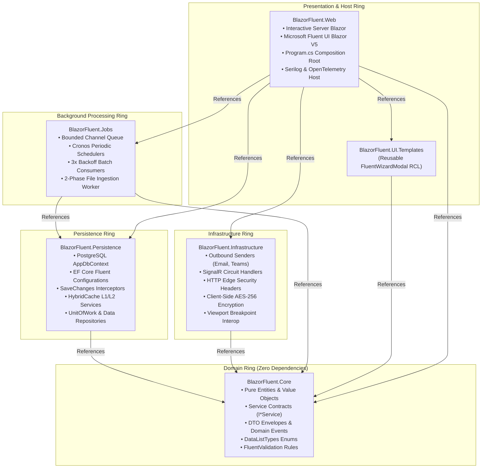
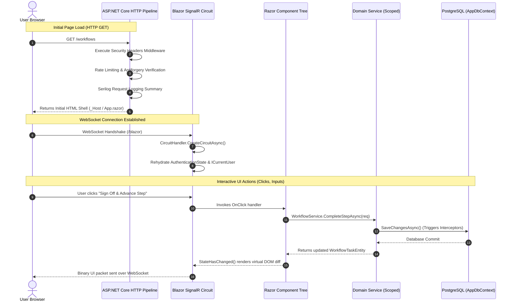
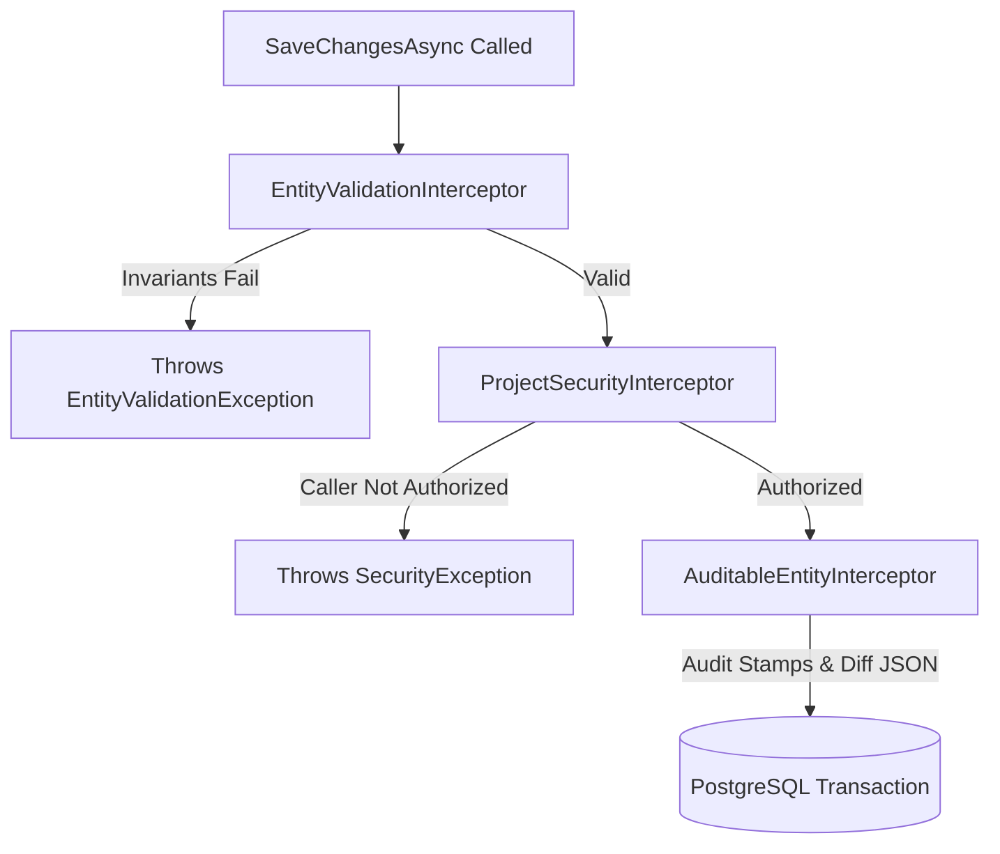

# 02. Architecture Deep Dive

> **Purpose**: Technical architecture specification detailing solution layer boundaries, dependency rules, entity structures, EF Core pipeline, caching topology, and background processing engines.  
> **Who should read this**: Software engineers, solution architects, and technical leads designing features or evaluating system scalability.

---

## 🏛️ 1. Clean Architecture Layer Topology

BlazorFluent strictly adheres to **Clean Architecture** principles. Dependencies flow inward toward `BlazorFluent.Core`. Outward references are strictly forbidden.



### Layer Responsibility & Coupling Rules

| Project | Architectural Role | Permitted Dependencies | Forbidden Inclusions |
|---|---|---|---|
| **`BlazorFluent.Core`** | Innermost domain contracts, models, and business logic. | Zero internal project references. Only `Microsoft.Extensions.Logging.Abstractions` & `FluentValidation`. | No EF Core, no UI libraries, no HTTP clients, no SQL queries. |
| **`BlazorFluent.Persistence`** | 100% database access and data caching layer. | `BlazorFluent.Core`, EF Core, Npgsql, HybridCache, Redis. | No SMTP/Teams senders, no Razor files, no HTML rendering. |
| **`BlazorFluent.Infrastructure`** | External integrations, security middleware, and browser services. | `BlazorFluent.Core`, `Microsoft.AspNetCore.App` framework reference. | Never references `Persistence`. No direct DbContext queries. |
| **`BlazorFluent.Jobs`** | In-process background processing, queueing, and schedulers. | `BlazorFluent.Core`, `BlazorFluent.Persistence`, `Cronos`. | No Razor components, no UI rendering. |
| **`BlazorFluent.UI.Templates`** | Reusable Razor Class Library (RCL) containing generic wizard templates. | `BlazorFluent.Core`, `Microsoft.FluentUI.AspNetCore.Components`. | No direct database access or background worker dependencies. |
| **`BlazorFluent.Web`** | Web host, composition root, and presentation pages. | All solution projects. | No direct SQL queries bypassing persistence contracts. |

---

## 📂 2. Verified Directory Structure

```
src/
├── BlazorFluent.Core/
│   ├── Abstractions/             # Marker interfaces (ITenantEntity, IGlobalEntity, etc.)
│   ├── Common/                   # Result monads, pagination envelopes, query constants
│   ├── Constants/                # Role name constants
│   ├── Contracts/                # All service interfaces (IWorkflowService, IAuditService, etc.)
│   ├── DataListTypes/            # Domain enums with companion display metadata
│   ├── Domain/                   # Domain entities grouped by feature schema (Tasks, Tenancy, Identity, Auditing)
│   ├── Dtos/                     # Command & request payloads
│   ├── Events/                   # Background job events (IJobEvent)
│   └── Validation/               # Tier 1 UI form validators
│
├── BlazorFluent.Persistence/
│   ├── Configurations/           # EF Core IEntityTypeConfiguration<T> Fluent API mappings
│   ├── Context/                  # AppDbContext with named filters
│   ├── Interceptors/             # AuditableEntityInterceptor, ProjectSecurityInterceptor, EntityValidationInterceptor
│   └── Services/                 # WorkflowService, TenantService, AuditService, UnitOfWork
│
├── BlazorFluent.Infrastructure/
│   ├── Notifications/            # EmailNotificationSender, TeamsNotificationSender
│   ├── Observability/            # BlazorCircuitObservabilityHandler
│   ├── Security/                 # SecurityHeadersExtensions, PathAwareAuthorizationHandler, HtmlInputSanitizer
│   └── Storage/                  # ProtectedLocalStorageFormService
│
├── BlazorFluent.Jobs/
│   ├── Abstractions/             # IBatchJobHandler, IJobEventQueue
│   ├── FileImports/              # Two-phase file ingestion handlers (ValidateAndStage, Process)
│   ├── Listeners/                # BatchJobQueueListener background consumer
│   ├── Queue/                    # ChannelJobEventQueue (System.Threading.Channels)
│   └── Schedulers/               # PeriodicBatchScheduler (Cronos)
│
├── BlazorFluent.UI.Templates/
│   └── Wizards/                  # Generic FluentWizardModal and WizardStep templates
│
└── BlazorFluent.Web/
    ├── Components/               # Reusable UI components (*Comp), modals (*Modal), layout (*Layout)
    ├── Modules/                  # Feature slices (Tenancy, Auditing, Catalog, Imports)
    ├── Services/                 # AppCurrentUser, TimeZoneService, AuthenticationStateProvider
    └── Program.cs                # Composition root & middleware pipeline
```

---

## ⏳ 3. Service Scope Lifetimes & Captive Dependency Governance

To eliminate multi-threading concurrency exceptions and captive dependency bugs, `Program.cs` activates strict container validation:

```csharp
builder.Host.UseDefaultServiceProvider((context, options) =>
{
    options.ValidateScopes = true;
    options.ValidateOnBuild = true;
});
```

### Lifetime Rules Matrix

| Lifetime | Registered Types | Threading & Isolation Rule |
|---|---|---|
| **`Scoped`** | `AppDbContext`, EF interceptors, domain services (`WorkflowService`, `TenantService`, `AuditService`), UI state providers (`ICurrentUser`, `CurrentUserAuthenticationStateProvider`). | Created once per HTTP request or Blazor circuit. **Never inject into a Singleton.** |
| **`Singleton`** | In-memory queues (`ChannelJobEventQueue`, `NotificationChannelQueue`), sanitizers (`HtmlInputSanitizer`), schedulers (`PeriodicBatchScheduler`). | Thread-safe, exists for process lifetime. Must consume scoped services via `IServiceScopeFactory`. |
| **`Transient`** | Validators (`IValidator<T>`), lightweight calculation helpers. | Stateless, instantiated on demand. |

### The `IServiceScopeFactory` Pattern for Background Workers

Background services (`BackgroundService`, `IHostedService`, channel consumers) needing database access MUST create explicit scopes:

```csharp
public async Task ProcessEventAsync(IJobEvent jobEvent, CancellationToken ct)
{
    // Create an isolated scope for the execution unit
    using var scope = _scopeFactory.CreateScope();
    
    var tenantContext = scope.ServiceProvider.GetRequiredService<ITenantContext>();
    tenantContext.Initialize(jobEvent.TenantId); // Restore tenant boundary

    var dbContext = scope.ServiceProvider.GetRequiredService<AppDbContext>();
    // Execute unit of work safely...
}
```

---

## 🔄 4. Request Flow: HTTP Pipeline vs. SignalR Circuit Lifecycle

Understanding Blazor Server requires recognizing two separate execution environments:



### Why MVC Action Filters Do Not Apply to Blazor Server
In Blazor Server, once the initial HTML page loads, button clicks, form inputs, and tab switches **do not execute HTTP requests**. They travel across an active WebSocket circuit directly to component C# event handlers.

- **For HTTP Edge Security**: Use ASP.NET Core Middleware in `Program.cs` (`UseSecurityHeaders`, `UseRateLimiter`, `UseAntiforgery`).
- **For Circuit Lifecycle Observability**: Use `CircuitHandler` (`BlazorCircuitObservabilityHandler`).
- **For Component UI Authorization**: Use `AuthorizedPageComponentBase` and `<AuthorizeView>`.
- **For Unhandled Component Exceptions**: Use `<AppErrorBoundaryComp>` and `<ObservabilityErrorBoundaryComp>`.

---

## 🧩 5. Domain Entity Architecture & Decision Framework

All domain entities in `BlazorFluent.Core/Domain/` adhere to a composable 3-step architecture:

### Step 1: Base Class Inheritance
- **`TenantAuditableEntity`** (90% of business entities): Grants a sequential UUIDv7 `Id`, audit tracking (`Created`, `CreatedBy`, `Updated`, `UpdatedBy`), and multi-tenant scoping (`TenantId`).
- **`AuditableEntity`**: Used for host-wide or system entities that require audit stamps but cross tenant boundaries (e.g., `UserEntity`, `TenantEntity`).
- **`BaseEntity`**: Used for lightweight internal records needing only a UUIDv7 `Id` (e.g., keyrings, caches).

### Step 2: Multi-Tenancy Boundary Enforcement
Every entity MUST declare its boundary:
- **`ITenantEntity`**: Scoped strictly to a tenant. Isolated by default via EF Core named query filters.
- **`IGlobalEntity`**: Explicit opt-out for cross-tenant tables.
- **Startup Guard**: On application boot, `AppDbContext` reflects over all registered entities. If an entity implements neither `ITenantEntity` nor `IGlobalEntity`, the application terminates immediately with a fail-closed exception.

### Step 3: Composable Marker Interfaces

| Marker Interface | Architectural Behavior Enabled |
|---|---|
| **`ISoftDeletableEntity`** | Interceptor transforms `.Remove()` into an `UPDATE IsDeleted = true`. Isolated automatically by `QueryFilters.SoftDelete`. |
| **`IProjectScopedEntity`** | Validated by `ProjectSecurityInterceptor` during `SaveChanges` to verify project role permissions. |
| **`IEffectiveDatedEntity`** | Adds `StartDate` and `EndDate?`. Interceptor guarantees `EndDate >= StartDate`. |
| **`IVersionedEntity`** | Adds `VerNum` and `SetVersionNumber(newVer)`. Interceptor enforces `VerNum >= 1`. |
| **`IAuditExemptEntity`** | Prevents recursive diff logging in `audit.AuditRecords`. |
| **`IValidationExemptEntity`** | Exempts internal system tables from mandatory FluentValidation checks. |

---

## 💾 6. Persistence & EF Core 10 Standards

### Global No-Tracking Query Policy
In `PersistenceExtensions.cs`, `AppDbContext` is globally configured with `QueryTrackingBehavior.NoTracking`. All LINQ queries execute without tracking overhead. Any service method modifying an entity MUST explicitly append `.AsTracking()`:

```csharp
var workflow = await _dbContext.WorkflowTasks
    .AsTracking()
    .Include(w => w.Steps)
    .FirstOrDefaultAsync(w => w.Id == id, ct);
```

### EF Core 10 Named Query Filters
Configured centrally in `AppDbContext.OnModelCreating`:
- **`QueryFilters.Tenant`**: Evaluates `e.TenantId == CurrentTenantId` (bypassed only when `IsHost == true`).
- **`QueryFilters.SoftDelete`**: Evaluates `!e.IsDeleted`.
- **Selective Filter Bypass**: Queries can safely ignore soft-deletes without dropping tenant isolation:
  ```csharp
  // Ignores soft-delete while preserving strict multi-tenant isolation!
  var record = await _dbContext.Tasks
      .IgnoreQueryFilters(QueryFilters.SoftDelete)
      .FirstOrDefaultAsync(t => t.Id == id);
  ```

### SaveChanges Interceptors Pipeline
Before any SQL statement reaches PostgreSQL, changes pass through three chained interceptors:



1. **`EntityValidationInterceptor`**: Validates all entity business invariants via registered `IValidator<TEntity>`.
2. **`ProjectSecurityInterceptor`**: Validates that the active user possesses edit rights on any modified `IProjectScopedEntity`.
3. **`AuditableEntityInterceptor`**:
   - Injects timestamps (`DateTime.UtcNow`) and actor identifiers (`CurrentUser.Email`).
   - Translates soft-deletes into `IsDeleted = true`.
   - Computes HMAC-SHA256 row signatures on `UserEntity`.
   - Generates Level 2 property-level JSON diffs (`OldValue` vs `NewValue`) with automatic masking of sensitive keywords (`password`, `secret`, `token`, `key`).
   - Enforces **TenantId Immutability** (rejects modifications to existing `TenantId` values).

---

## ⚡ 7. Surgical Caching: L1 In-Memory vs. L2 Distributed

BlazorFluent leverages .NET 10 `HybridCache` (`Microsoft.Extensions.Caching.Hybrid`) following the **Surgical Caching Pattern**:

```
                       Azure App Service / Host Node
         ┌─────────────────────────────────────────────────────────┐
         │ L1 Cache: In-Process Memory Heap (~50-100 nanoseconds)  │
         │ • Stores live, unserialized C# object references        │
         │ • Managed by LocalCacheExpirationMinutes (15 min)       │
         └────────────────────────────┬────────────────────────────┘
                                      │
                         Redis Pub/Sub Eviction Bus
                                      │
         ┌────────────────────────────▼────────────────────────────┐
         │ L2 Cache: Azure Cache for Redis (~0.8-1.5 milliseconds) │
         │ • Serialized shared byte payloads                       │
         │ • Managed by DefaultExpirationMinutes (60 min)          │
         │ • Atomic Tag Invalidation (RemoveByTagAsync)            │
         └─────────────────────────────────────────────────────────┘
```

### Surgical Inventory: What is Cached vs. Excluded

| Cache Scope | Key Pattern | Payload Type | Invalidation Trigger |
|---|---|---|---|
| **Global Directory** | `g:tenants:all` | `IReadOnlyList<TenantEntity>` | Tenant created, edited, or deactivated |
| **Tenant Permissions** | `t:{tenantId}:permissions:{userId}` | `IReadOnlyList<string>` | User role modified or revoked |
| **Tenant Settings** | `t:{tenantId}:settings` | `TenantSettingsDto` | Tenant theme or settings updated |

> [!NOTE]
> **Intentionally Non-Cached Entities**: Business entities (`Tasks`, `Workflows`, `Products`) and audit trails are queried directly from PostgreSQL using `.AsNoTracking()`. PostgreSQL executes indexed queries in **1–3ms**, eliminating stale data hazards.

---

## 🔗 Related Documentation

- [00. Overview & Glossary](00-Overview-and-Glossary.md) — Personas, routes, and domain glossary.
- [01. Getting Started Guide](01-Getting-Started.md) — Local setup, migrations, and troubleshooting.
- [03. Security Model](03-Security-Model.md) — Multi-tenant write barriers, HMAC seals, and session controls.
- [04. Task Hierarchy & Workflows](04-Task-Hierarchy-and-Workflows.md) — Workflow orchestration and wizard models.
- [05. UI Conventions & Fluent V5](05-UI-Conventions-Fluent-V5.md) — Component naming taxonomy and V5 guidelines.
- [06. How to Extend Recipes](06-How-To-Extend.md) — Step-by-step feature development recipes.
- [07. AI Agent Operating Rules](07-AI-Agent-Rules.md) — Operational guidelines for AI coding assistants.
