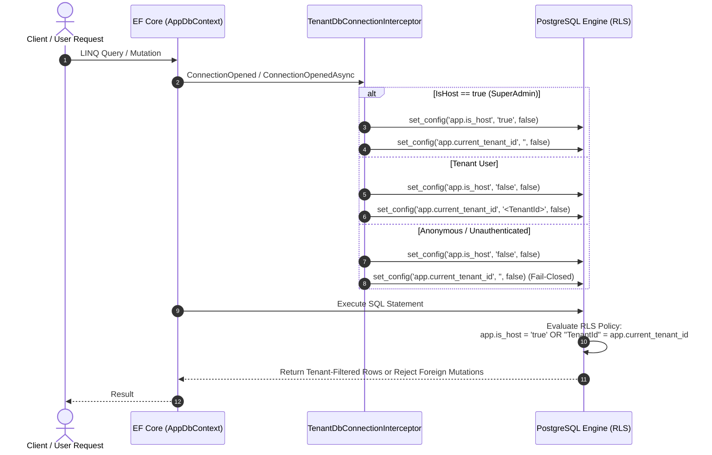
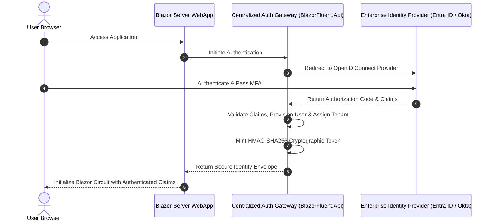
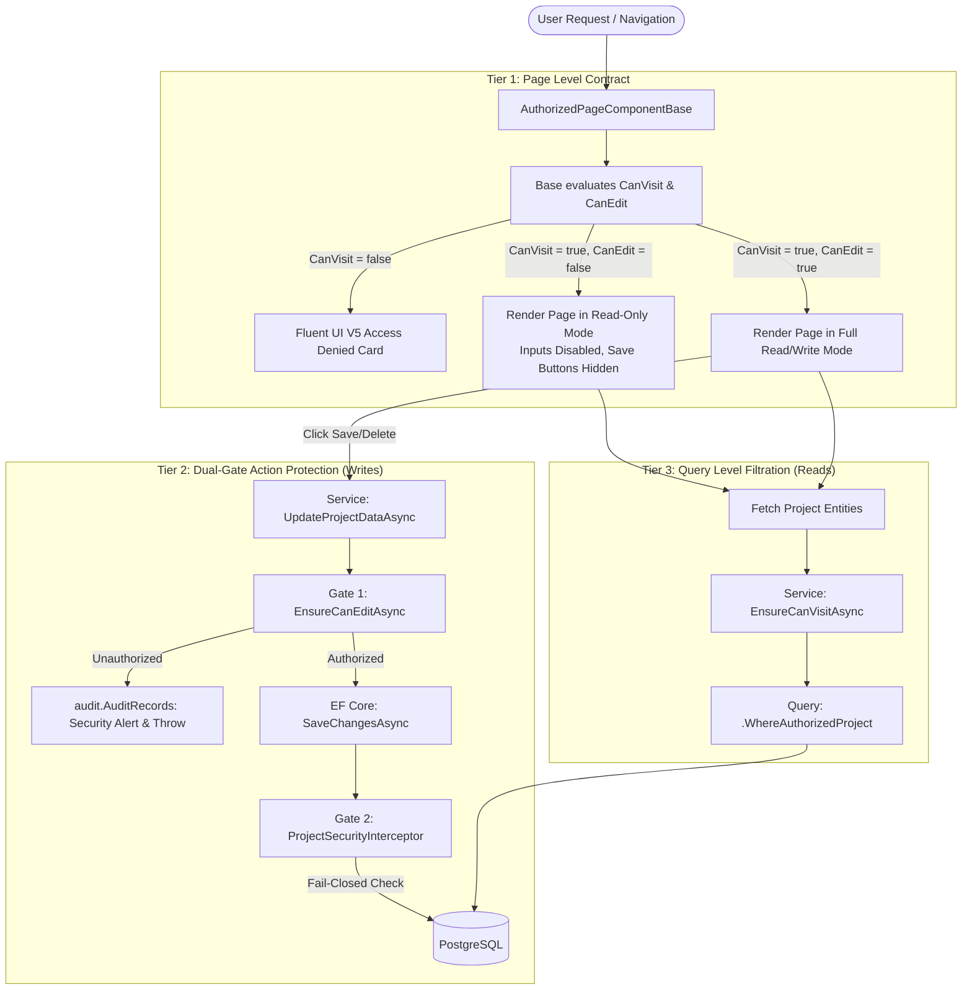
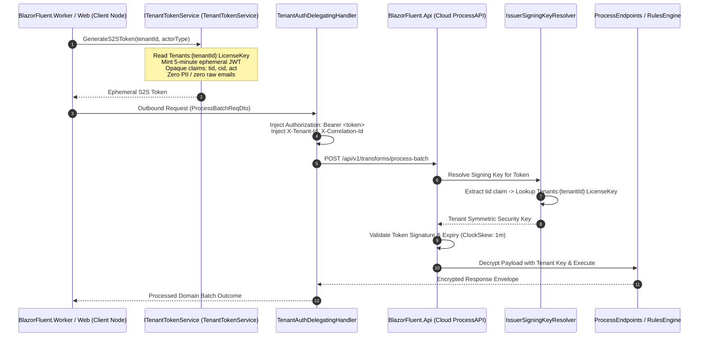

# 03. Security Model & Defense-in-Depth

> **Target Audience**: Security Engineers, Solutions Architects, Compliance Officers, and Lead Developers.  
> **Key Objective**: Comprehensive security specification detailing the 5-layer defense-in-depth architecture, PostgreSQL Native Row-Level Security (RLS), application-level envelope encryption, multi-IdP authentication, and real-time circuit session revocation.

---

## 🛡️ 1. The 5-Layer Defense-in-Depth Model

BlazorFluent implements a strict **Fail-Closed Zero-Trust** security architecture. Security is never assumed to be solved at a single boundary; each layer independently verifies identity, tenant context, and authorization:


---

## 🐘 2. Layer 5: PostgreSQL Native Row-Level Security (RLS)

While most web applications rely solely on C# LINQ query filters (which can be accidentally bypassed via `.IgnoreQueryFilters()` or raw SQL), BlazorFluent enforces tenant isolation at the **PostgreSQL database engine level**:



### PostgreSQL Superuser Bypass Rule
In PostgreSQL, database superusers (`postgres`) and roles with the `BYPASSRLS` attribute inherently bypass RLS policies even when `FORCE ROW LEVEL SECURITY` is applied. 

To guarantee physical RLS enforcement:
- Application runtime queries execute under a dedicated non-superuser role (`blazorfluent_app`).
- The `postgres` superuser is strictly reserved for database creation, schema migrations, and administrative maintenance.

---

## 🔐 3. Application-Level Envelope Encryption (AES-256-GCM + HKDF)

For sensitive attachments, imported spreadsheets, and tenant documents, BlazorFluent utilizes **Zero-Knowledge Envelope Encryption**:


### Key Security Properties:
1. **Per-Tenant Cryptographic Partitioning**: Tenant A's derived key mathematically cannot decrypt Tenant B's files, even if storage files are exfiltrated.
2. **Authenticated Encryption (AEAD)**: AES-256-GCM detects any ciphertext tampering or bit-flipping prior to decryption.
3. **Streaming Hardware Acceleration**: Employs Intel AES-NI / ARM Crypto instructions for minimal CPU overhead.

---

## 🔑 4. Centralized Authentication Gateway & Multi-IdP Support

`BlazorFluent.Api` acts as a centralized authentication broker supporting enterprise federation:



---

## 🚦 5. Project-Level 3-Tier Role Authorization & Write Guards

BlazorFluent enforces authorization through a 3-tier model combining compile-time page contracts with service and database write guards:



### Discrete Project Roles (`ProjectRole`):
- `ReadOnly = 1`: View-only access to project boards and deliverables.
- `QA = 2`: Read/write access for test and validation scenarios.
- `Dev = 3`: Full read/write access for feature development.
- `Admin = 4`: Full project control and team role management.

---

## ⚡ 6. Real-Time Circuit Monitoring & Remote Session Kill-Switch

Blazor Server circuits maintain persistent WebSocket connections. In enterprise threat scenarios (compromised employee credentials, urgent offboarding), traditional cookie expiration is too slow:
1. `CircuitHeartbeatHandler` periodically audits active circuits against the database user revocation status.
2. If an administrator terminates a session at `/admin/sessions`, the remote user's circuit is instantly frozen via `<SessionRevokedModal />`, severing their connection in real time.

---

## 🛡️ 7. Zero-Trust Multi-Tenancy Isolation & S2S Token Security

In multi-tenant SaaS and distributed hybrid deployments, boundary isolation must prevent cross-tenant enumeration, privilege escalation, and credential exfiltration. BlazorFluent enforces a comprehensive **Zero-Trust Multi-Tenancy Isolation Model**:



### Core Zero-Trust Architectural Principles:

#### 1. Dual-Token Model
- **Interactive User Tokens**: Minted by enterprise IdPs (Entra ID, OIDC) or the Centralized Auth Gateway for human interactive sessions. Signed using the Cloud Master Key.
- **Ephemeral S2S Tokens**: Minted by WebApp or Worker nodes for asynchronous batch operations, streaming ingestion, and scheduled jobs. Signed **strictly** using `Tenants:{tenantId}:LicenseKey` (5-minute lifespan).

#### 2. Dynamic Key Resolution (`IssuerSigningKeyResolver`)
In `BlazorFluent.Api/Program.cs`, `JwtBearerOptions` registers a dynamic `IssuerSigningKeyResolver`:
- Extracts the incoming token's `tenant_id` or `tid` claim.
- Resolves the private tenant key from `Tenants:{tenantId}:LicenseKey`.
- Admits the Cloud Master Key for user tokens.
- **Strict Fail-Closed**: If a tenant has no configured license key, fallback to a shared key is strictly prohibited, terminating the request with `401 Unauthorized` / `403 Forbidden`.

#### 3. GDPR Data Minimization & OWASP ASVS Indirect Reference Masking
In compliance with GDPR Article 5(1)(c) and OWASP ASVS 4.3:
- S2S tokens transmitted across network boundaries contain **zero plain user emails, display names, or raw database primary keys**.
- Tokens carry only masked, opaque claims:
  - `tid`: Non-descriptive tenant reference slug (e.g., `tnt_8f3a1b2c4d5e`).
  - `tenant_id`: Scoped tenant identifier.
  - `cid`: Distributed correlation identifier linking logs across WebApp, Worker, and API.
  - `act`: Actor role (`BatchWorker` or `SystemDaemon`).
- Cryptographic utility [`OpaqueIdUtility`](file:///c:/Users/cheri/source/repos/BlazorFluent/src/BlazorFluent.Core/Security/OpaqueIdUtility.cs):
  - `GenerateSecureLicenseKey()`: Cryptographically secure 256-bit (32-byte) random Base64 key generator.
  - `GenerateTenantRefId()`: Non-correlatable tenant reference slugs.
  - `MaskGuid(id, salt)`: Salted HMAC-SHA256 indirect reference handles.

#### 4. Strict Key Separation & Cloud Vault Isolation
- Client WebApp and Worker nodes installed on client infrastructure **never possess Azure Key Vault credentials or master signing keys**.
- Client software possesses only its own `TenantLicenseKey`.
- Azure Key Vault is strictly accessible by Azure-hosted services (`BlazorFluent.Api`).

#### 5. Compound Query Scoping & Cross-Tenant Quarantine Guards
- Even with EF Core global query filters active, all background batch handlers enforce explicit compound LINQ queries:
  ```csharp
  var files = await _dbContext.ImportFiles
      .Where(f => f.TenantId == jobEvent.TenantId && f.ImportId == jobEvent.ImportId && !f.IsDeleted)
      .ToListAsync(ct);
  ```
- Cross-tenant quarantine guard in [`GenericFileImportBatchJobHandler`](file:///c:/Users/cheri/source/repos/BlazorFluent/src/BlazorFluent.Jobs/FileImports/GenericFileImportBatchJobHandler.cs):
  ```csharp
  if (file.TenantId != jobEvent.TenantId)
  {
      _logger.LogCritical("Zero-Trust Security Violation: ImportFile {FileId} belongs to tenant '{FileTenantId}' but batch was triggered for '{JobTenantId}'. Aborting.", file.Id, file.TenantId, jobEvent.TenantId);
      throw new InvalidOperationException("Cross-tenant data access detected. Execution halted.");
  }
  ```
- Strict fail-closed background listener: [`BatchJobQueueListener`](file:///c:/Users/cheri/source/repos/BlazorFluent/src/BlazorFluent.Jobs/Listeners/BatchJobQueueListener.cs) aborts processing immediately if `jobEvent.TenantId` is missing, preventing silent fallback to default tenant slugs.
