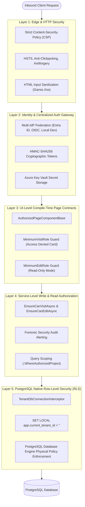
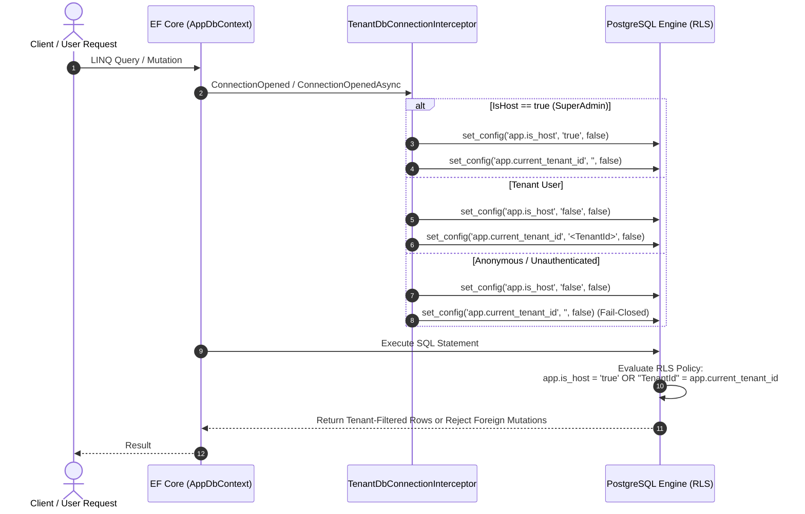
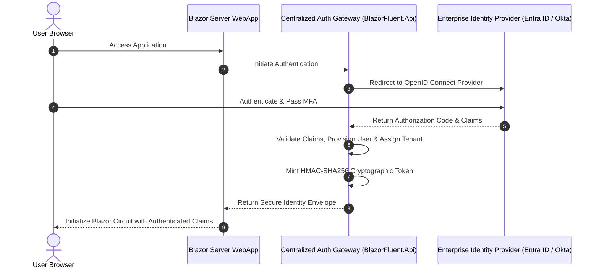
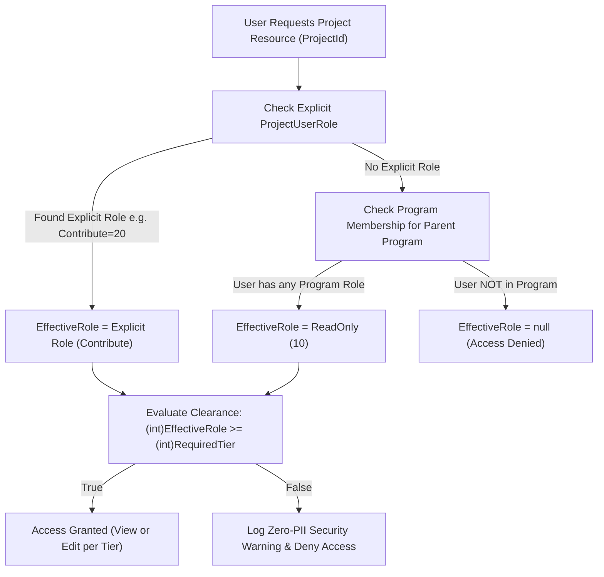
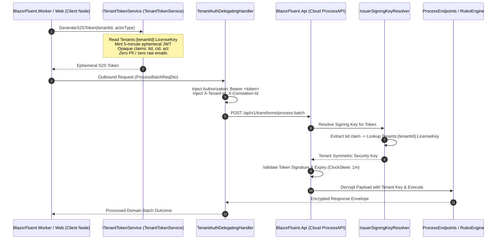

# 03. Security Model & Defense-in-Depth

> **Target Audience**: Security Engineers, Solutions Architects, Compliance Officers, and Lead Developers.  
> **Key Objective**: Comprehensive security specification detailing the 5-layer defense-in-depth architecture, PostgreSQL Native Row-Level Security (RLS), application-level envelope encryption, multi-IdP authentication, and real-time circuit session revocation.

---

## 🛡️ 1. The 5-Layer Defense-in-Depth Model

BlazorFluent implements a strict **Fail-Closed Zero-Trust** security architecture. Security is never assumed to be solved at a single boundary; each layer independently verifies identity, tenant context, and authorization:



---

## 🐘 2. Layer 5: PostgreSQL Native Row-Level Security (RLS)

While most web applications rely solely on C# LINQ query filters (which can be accidentally bypassed via `.IgnoreQueryFilters()` or raw SQL), BlazorFluent enforces tenant isolation at the **PostgreSQL database engine level**:



### PostgreSQL Superuser Bypass Rule
In PostgreSQL, database superusers (`postgres`) and roles with the `BYPASSRLS` attribute inherently bypass RLS policies even when `FORCE ROW LEVEL SECURITY` is applied. 

To guarantee physical RLS enforcement:
- Application runtime queries execute under a dedicated non-superuser role (`blazorfluent_app`).
- The `postgres` superuser is strictly reserved for database creation, schema migrations, and administrative maintenance.

---

## 🔐 3. Application-Level Envelope Encryption (AES-256-GCM + HKDF)

For sensitive attachments, imported spreadsheets, and tenant documents, BlazorFluent utilizes **Zero-Knowledge Envelope Encryption**:


### Key Security Properties:
1. **Per-Tenant Cryptographic Partitioning**: Tenant A's derived key mathematically cannot decrypt Tenant B's files, even if storage files are exfiltrated.
2. **Authenticated Encryption (AEAD)**: AES-256-GCM detects any ciphertext tampering or bit-flipping prior to decryption.
3. **Streaming Hardware Acceleration**: Employs Intel AES-NI / ARM Crypto instructions for minimal CPU overhead.

---

## 🔑 4. Centralized Authentication Gateway & Multi-IdP Support

`BlazorFluent.Api` acts as a centralized authentication broker supporting enterprise federation:



### User Account Validity & Mandatory Role Provisioning Gate
```mermaid
flowchart TD
    UserArrival["User Requests Any Authenticated Page (Home, Settings, Projects)"] --> CheckAuth["Is Authenticated?"]
    CheckAuth -->|No| RedirLogin["Redirect to /login"]
    CheckAuth -->|Yes| CheckActive{"IsActive == true?"}
    
    CheckActive -->|No| Lockout["Evict Circuit -> Redirect to /auth-error?reason=deactivated"]
    CheckActive -->|Yes| CheckDates{"now between StartDateUtc & EndDateUtc?"}
    
    CheckDates -->|Expired / Not Started| LockoutDate["Evict Circuit -> Redirect to /auth-error?reason=expired"]
    CheckDates -->|Valid Window| CheckHMAC{"HMAC Signature Valid?"}
    
    CheckHMAC -->|Tampered| LockoutTamper["Evict Circuit -> Log Critical Tamper Security Alert"]
    CheckHMAC -->|Valid| CheckRootAdmin{"Is Root Admin?"}
    
    CheckRootAdmin -->|Yes| FullAccess["Grant Access (Governs Entire Host)"]
    CheckRootAdmin -->|No| CheckMinRoles{"Has >= 1 Project Role OR >= 1 Program Role?"}
    
    CheckMinRoles -->|No Roles Assigned| Unprovisioned["Lockout -> Redirect to /auth-error?reason=no_assigned_roles"]
    CheckMinRoles -->|Yes (>= 1 Role)| AllowEntry["Allow Entry to Base App (Home / Personal Settings)"]
    
    AllowEntry --> RouteGate["Route Clearance Gate (Checks RequiredClearance Tier)"]
```

---

## 🚦 5. Hierarchical Team Clearance & Zero-Trust Governance

BlazorFluent enforces authorization through a pure **Zero-Trust Hierarchical Team Clearance Model** with compile-time route verification, ambient component gating, and service mutation guards:

```mermaid
flowchart TD
    subgraph Layer1["1. Compile-Time Governance"]
        TG["Roslyn Analyzer TG005"] -->|Enforces @attribute on @page| RazorBuild["dotnet build Verification"]
    end

    subgraph Layer2["2. Presentation Layer (Blazor Circuit)"]
        Routes["Routes.razor / AuthorizeRouteView"] -->|If Not Authenticated| RedirLogin["Redirect to /login"]
        Routes -->|If Authenticated| PageBase["AuthorizedPageComponentBase"]
        PageBase -->|Check (int)role >= (int)viewTier| ViewAccess{"Has View Clearance?"}
        ViewAccess -->|No| AccessDenied["403 Access Denied Card"]
        ViewAccess -->|Yes| RenderPage["Render Page"]
        RenderPage --> SubGates["<ClearanceGate MinTier=...>"]
    end

    subgraph Layer3["3. API Transport Layer"]
        ApiReq["HTTP API Request"] --> ApiFilter[".RequireClearance(minTier)"]
        ApiFilter -->|Role < minTier| Res403["403 Forbidden Response"]
        ApiFilter -->|Role >= minTier| Endpoints["Minimal API Route Handler"]
    end

    subgraph Layer4["4. Domain Service Layer"]
        Endpoints --> SvcCall["Service Method Mutation"]
        RenderPage --> SvcCall
        SvcCall --> EnsureClearance["EnsureHasProjectClearanceAsync(projectId, requiredTier)"]
        EnsureClearance -->|Unauthorized| ThrowsSecurity["Throw SecurityException"]
        EnsureClearance -->|Authorized| DbExecute["Execute EF Core Mutation"]
    end

    subgraph Layer5["5. Persistence & Multi-Tenancy"]
        DbExecute --> GQF["EF Core Global Query Filters (TenantId)"]
        GQF --> Interceptor["AuditableEntityInterceptor (Tenant Immutability & Seals)"]
        Interceptor --> Postgres[("PostgreSQL Database")]
    end
```

### Symmetrical Cumulative Tiers (Program & Project)
Both scopes share identical spaced numeric rankings:

| Numeric Tier | Project Role (`ProjectRole`) | Program Role (`ProgramRole`) | UI Display Label | Cumulative Capability |
| :---: | :--- | :--- | :--- | :--- |
| **10** | `ReadOnly` | `ReadOnly` | ReadOnly Team | View-only inspection of dashboards, tasks, milestones |
| **20** | `Contribute` | `Contribute` | Contribute Team | Standard read/write to tasks, deliverables, documentation |
| **30** | `Lead` | `Lead` | Lead Team | Sprint design, approvals, release coordination, workflows |
| **40** | `ElevatedLead` | `ElevatedLead` | ElevatedLead Team | Cross-functional architecture, security review, and risk |
| **50** | `PMO` | `PMO` | PMO Team | Financials, contract milestones, batch jobs, executive review |
| **100**| `Admin` | `Admin` | Admin Team | Full administrative, membership, and security management |

### The "ReadOnly Floor" Program Resolution Rule


### Strict Zero-PII Security Audit Logging
Whenever a user with insufficient privileges attempts to access a restricted resource, the system logs a **Warning-level Security Audit Record** without personal names or email addresses:

```json
{
  "timestampUtc": "2026-10-18T20:30:00Z",
  "eventType": "Security",
  "severity": "Warning",
  "action": "ClearanceDenied",
  "userId": "d3b07384-d113-4e8a-bf94-d4b68e7c102a",
  "tenantId": "c4a08193-e221-4f9b-a012-e5c79f8b213b",
  "projectId": "e2f1a923-b184-4672-9112-a1b2c3d4e5f6",
  "resource": "/workflows",
  "requiredTier": "Lead (30)",
  "actualTier": "Contribute (20)",
  "details": "Insufficient clearance tier for requested resource."
}
```

---

## ⚡ 6. Real-Time Circuit Monitoring & Remote Session Kill-Switch

Blazor Server circuits maintain persistent WebSocket connections. In enterprise threat scenarios (compromised employee credentials, urgent offboarding), traditional cookie expiration is too slow:
1. `CircuitHeartbeatHandler` periodically audits active circuits against the database user revocation status.
2. If an administrator terminates a session at `/admin/sessions`, the remote user's circuit is instantly frozen via `<SessionRevokedModal />`, severing their connection in real time.

---

## 🛡️ 7. Zero-Trust Multi-Tenancy Isolation & S2S Token Security

In multi-tenant SaaS and distributed hybrid deployments, boundary isolation must prevent cross-tenant enumeration, privilege escalation, and credential exfiltration. BlazorFluent enforces a comprehensive **Zero-Trust Multi-Tenancy Isolation Model**:



### Core Zero-Trust Architectural Principles:

#### 1. Dual-Token Model
- **Interactive User Tokens**: Minted by enterprise IdPs (Entra ID, OIDC) or the Centralized Auth Gateway for human interactive sessions. Signed using the Cloud Master Key.
- **Ephemeral S2S Tokens**: Minted by WebApp or Worker nodes for asynchronous batch operations, streaming ingestion, and scheduled jobs. Signed **strictly** using `Tenants:{tenantId}:LicenseKey` (5-minute lifespan).

#### 2. Dynamic Key Resolution (`IssuerSigningKeyResolver`)
In `BlazorFluent.Api/Program.cs`, `JwtBearerOptions` registers a dynamic `IssuerSigningKeyResolver`:
- Extracts the incoming token's `tenant_id` or `tid` claim.
- Resolves the private tenant key from `Tenants:{tenantId}:LicenseKey`.
- Admits the Cloud Master Key for user tokens.
- **Strict Fail-Closed**: If a tenant has no configured license key, fallback to a shared key is strictly prohibited, terminating the request with `401 Unauthorized` / `403 Forbidden`.

#### 3. GDPR Data Minimization & OWASP ASVS Indirect Reference Masking
In compliance with GDPR Article 5(1)(c) and OWASP ASVS 4.3:
- S2S tokens transmitted across network boundaries contain **zero plain user emails, display names, or raw database primary keys**.
- Tokens carry only masked, opaque claims:
  - `tid`: Non-descriptive tenant reference slug (e.g., `tnt_8f3a1b2c4d5e`).
  - `tenant_id`: Scoped tenant identifier.
  - `cid`: Distributed correlation identifier linking logs across WebApp, Worker, and API.
  - `act`: Actor role (`BatchWorker` or `SystemDaemon`).
- Cryptographic utility [`OpaqueIdUtility`](file:///c:/Users/cheri/source/repos/BlazorFluent/src/BlazorFluent.Core/Security/OpaqueIdUtility.cs):
  - `GenerateSecureLicenseKey()`: Cryptographically secure 256-bit (32-byte) random Base64 key generator.
  - `GenerateTenantRefId()`: Non-correlatable tenant reference slugs.
  - `MaskGuid(id, salt)`: Salted HMAC-SHA256 indirect reference handles.

#### 4. Strict Key Separation & Cloud Vault Isolation
- Client WebApp and Worker nodes installed on client infrastructure **never possess Azure Key Vault credentials or master signing keys**.
- Client software possesses only its own `TenantLicenseKey`.
- Azure Key Vault is strictly accessible by Azure-hosted services (`BlazorFluent.Api`).

#### 5. Compound Query Scoping & Cross-Tenant Quarantine Guards
- Even with EF Core global query filters active, all background batch handlers enforce explicit compound LINQ queries:
  ```csharp
  var files = await _dbContext.ImportFiles
      .Where(f => f.TenantId == jobEvent.TenantId && f.ImportId == jobEvent.ImportId && !f.IsDeleted)
      .ToListAsync(ct);
  ```
- Cross-tenant quarantine guard in [`GenericFileImportBatchJobHandler`](file:///c:/Users/cheri/source/repos/BlazorFluent/src/BlazorFluent.Jobs/FileImports/GenericFileImportBatchJobHandler.cs):
  ```csharp
  if (file.TenantId != jobEvent.TenantId)
  {
      _logger.LogCritical("Zero-Trust Security Violation: ImportFile {FileId} belongs to tenant '{FileTenantId}' but batch was triggered for '{JobTenantId}'. Aborting.", file.Id, file.TenantId, jobEvent.TenantId);
      throw new InvalidOperationException("Cross-tenant data access detected. Execution halted.");
  }
  ```
- Strict fail-closed background listener: [`BatchJobQueueListener`](file:///c:/Users/cheri/source/repos/BlazorFluent/src/BlazorFluent.Jobs/Listeners/BatchJobQueueListener.cs) aborts processing immediately if `jobEvent.TenantId` is missing, preventing silent fallback to default tenant slugs.

---

## 🔒 8. Enterprise Strict Content Security Policy (CSP) & Nonce Architecture

Enterprise penetration tests and corporate InfoSec teams enforce zero tolerance against `'unsafe-inline'` and `'unsafe-eval'` in HTTP response headers.

### Why Legacy Component Frameworks (e.g. MudBlazor) Fail InfoSec Audits
Many teams hit complete InfoSec approval roadblocks when using frameworks like MudBlazor because:
1. **Dynamic Style Injection**: `MudThemeProvider` injects un-nonced `<style>` elements directly into `<head>` at runtime, breaking immediately if `style-src` excludes `'unsafe-inline'`.
2. **Runtime `eval()`**: MudBlazor relies on runtime JavaScript evaluation (`eval` or `Function`) for popovers, resize observers, and scroll listeners.
3. **No Nonce Integration**: Forces teams to run `script-src 'unsafe-inline' 'unsafe-eval'`, failing automated DAST/SAST scanners with zero exceptions.

### How BlazorFluent & Microsoft Fluent UI Blazor V5 Comply
BlazorFluent leverages **Microsoft Fluent UI Blazor V5 (`Microsoft.FluentUI.AspNetCore.Components`)**:
- **Native Shadow DOM**: Styles are encapsulated inside Shadow DOM roots via native `CSSStyleSheet` (`adoptedStyleSheets`), eliminating runtime `<head>` stylesheet injection.
- **Zero `eval()`**: Requires zero `eval()` or `Function()` calls.
- **Pure External Scripts**: All client-side JavaScript (`blazor.web.js`, `responsive-interop.js`, `session-tracker.js`, `ReconnectModal.razor.js`) reside in static `.js` files.

### Cryptographic Nonce Pipeline

1. **Per-Request Nonce Generation**:
   [`SecurityHeadersExtensions.cs`](file:///c:/Users/cheri/source/repos/BlazorFluent/src/BlazorFluent.Infrastructure/Security/SecurityHeadersExtensions.cs) generates a 128-bit (16-byte) random nonce using `RandomNumberGenerator.GetBytes(16)` on every HTTP request and stores it in `HttpContext.Items["CspNonce"]`.
2. **Strict Directive Enforcement**:
   - `script-src 'self' 'nonce-{nonce}' 'strict-dynamic'`: **Zero occurrences of `'unsafe-inline'` or `'unsafe-eval'`**.
   - `style-src 'self' 'nonce-{nonce}'`: Enforces cryptographic nonces on all `<link rel="stylesheet">` elements and style blocks.
3. **Razor Host Tagging**:
   [`App.razor`](file:///c:/Users/cheri/source/repos/BlazorFluent/src/BlazorFluent.Web/Components/App.razor) and [`ReconnectModal.razor`](file:///c:/Users/cheri/source/repos/BlazorFluent/src/BlazorFluent.Web/Components/Layout/ReconnectModal.razor) dynamically resolve the nonce and tag all `<script>`, `<link>`, and `<ImportMap>` elements.
4. **Configurable Enterprise Profiles ([`CspOptions.cs`](file:///c:/Users/cheri/source/repos/BlazorFluent/src/BlazorFluent.Core/Configuration/CspOptions.cs))**:
   - `PureStrict`: Complete eradication of `'unsafe-inline'` from both script and style directives.
   - `Level3Isolated`: Strict nonced scripts with CSP Level 3 `style-src-elem` nonces and `style-src-attr 'unsafe-inline'` for element layout attributes.
   - `ReportOnly`: Supports testing in staging environments before hard enforcement.
