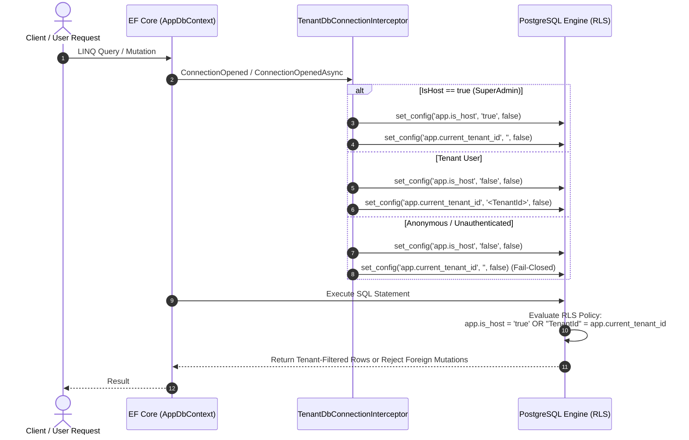
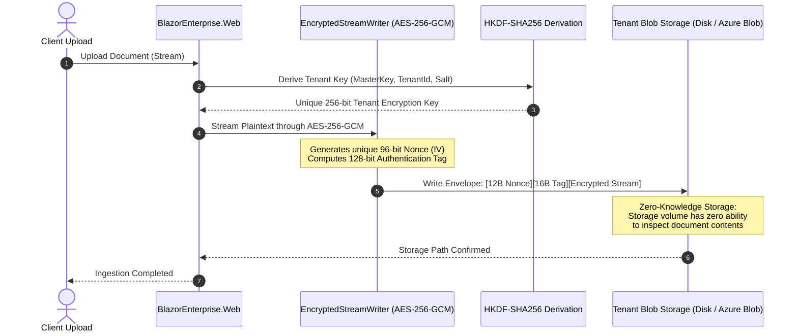
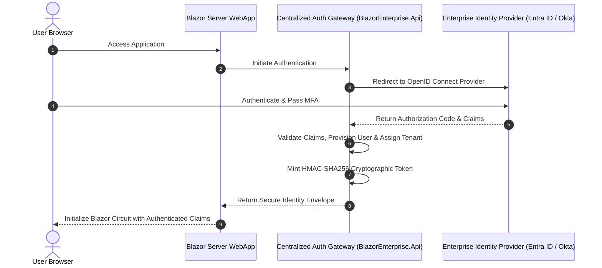
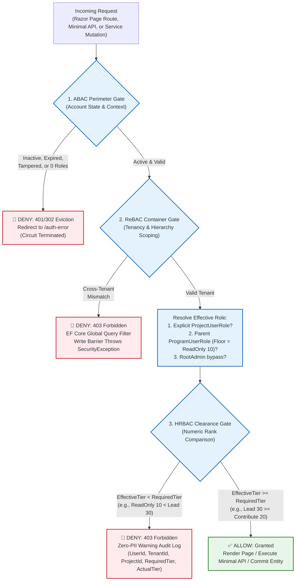
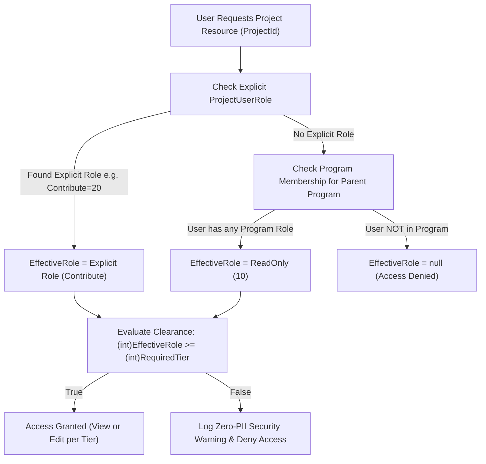
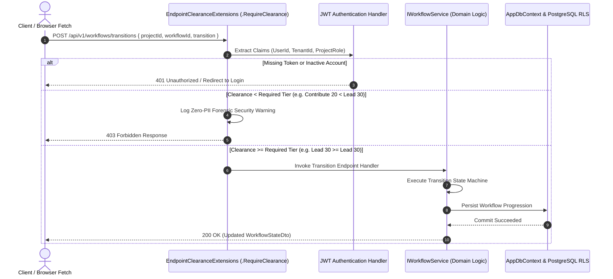
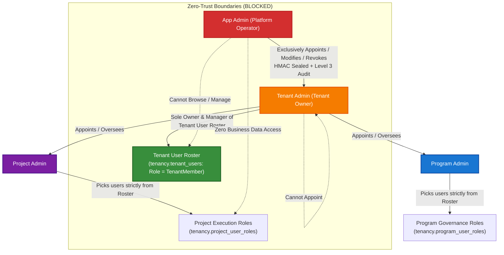

# 03. Security Model & Defense-in-Depth

> **Target Audience**: Security Engineers, Solutions Architects, Compliance Officers, and Lead Developers.  
> **Key Objective**: Comprehensive security specification detailing the 5-layer defense-in-depth architecture, PostgreSQL Native Row-Level Security (RLS), application-level envelope encryption, multi-IdP authentication, and real-time circuit session revocation.

---

## 🛡️ 1. The 5-Layer Defense-in-Depth Model

BlazorEnterprise implements a strict **Fail-Closed Zero-Trust** security architecture. Security is never assumed to be solved at a single boundary; each layer independently verifies identity, tenant context, and authorization:

```mermaid
flowchart TD
    Req([Inbound Client Request / Blazor Circuit]) --> L1
    
    subgraph L1 ["Layer 1: Compile-Time Governance & Edge HTTP Security"]
        L1a["Roslyn Analyzer TG005 (Compile-Time @page Attribute Enforcement)"]
        L1b["Strict Content-Security-Policy (Cryptographic Nonces, Zero Unsafe-Inline)"]
        L1c["HSTS, Anti-Clickjacking, Antiforgery Tokens, Ganss.Xss Sanitization"]
    end
    
    L1 --> L2
    subgraph L2 ["Layer 2: Identity & Centralized Auth Gateway"]
        L2a["Multi-IdP Federation (Entra ID, OIDC, Local Dev Mode)"]
        L2b["HMAC-SHA256 Cryptographic Tokens & Anti-Tamper User Seals"]
        L2c["ABAC Perimeter Gate: IsActive, Temporal Window, Mandatory Role Assignment"]
    end
    
    L2 --> L3
    subgraph L3 ["Layer 3: UI Presentation Layer (Blazor Circuit)"]
        L3a["AuthorizeRouteView & AuthorizedPageComponentBase"]
        L3b["Dual-Tier Route Clearance: @attribute [RequiredClearance(viewTier, editTier)]"]
        L3c["Ambient Clearance Gates (<ClearanceGate>) & ProjectAccessDeniedCardComp"]
    end
    
    L3 --> L4
    subgraph L4 ["Layer 4: API Transport & Domain Service Clearance"]
        L4a["Minimal API Endpoint Filters: .RequireClearance(minTier)"]
        L4b["Service Mutation Guards: EnsureHasProjectClearanceAsync"]
        L4c["Zero-PII Security Audit Forensic Alerting (Opaque GUIDs)"]
    end
    
    L4 --> L5
    subgraph L5 ["Layer 5: PostgreSQL Native Row-Level Security & Persistence"]
        L5a["TenantDbConnectionInterceptor (SET LOCAL app.current_tenant_id)"]
        L5b["PostgreSQL Database Engine Physical Policy Enforcement"]
        L5c["EF Core Global Query Filters & AuditableEntityInterceptor Write Barrier"]
    end
    
    L5 --> DB[(PostgreSQL Database)]
```




---

## 🐘 2. Layer 5: PostgreSQL Native Row-Level Security (RLS)

While most web applications rely solely on C# LINQ query filters (which can be accidentally bypassed via `.IgnoreQueryFilters()` or raw SQL), BlazorEnterprise enforces tenant isolation at the **PostgreSQL database engine level**:



### PostgreSQL Superuser Bypass Rule
In PostgreSQL, database superusers (`postgres`) and roles with the `BYPASSRLS` attribute inherently bypass RLS policies even when `FORCE ROW LEVEL SECURITY` is applied. 

To guarantee physical RLS enforcement:
- Application runtime queries execute under a dedicated non-superuser role (`blazorenterprise_app`).
- The `postgres` superuser is strictly reserved for database creation, schema migrations, and administrative maintenance.

---

## 🔐 3. Application-Level Envelope Encryption (AES-256-GCM + HKDF)

For sensitive attachments, imported spreadsheets, and tenant documents, BlazorEnterprise utilizes **Zero-Knowledge Envelope Encryption**:



### Key Security Properties:
1. **Per-Tenant Cryptographic Partitioning**: Tenant A's derived key mathematically cannot decrypt Tenant B's files, even if storage files are exfiltrated.
2. **Authenticated Encryption (AEAD)**: AES-256-GCM detects any ciphertext tampering or bit-flipping prior to decryption.
3. **Streaming Hardware Acceleration**: Employs Intel AES-NI / ARM Crypto instructions for minimal CPU overhead.

### 3.1 Field-Level Zero-Knowledge Entity Encryption (`IEncryptedPayloadEntity`) & Lineage (`ISourceTrackedEntity`)

For domain entities that hold sensitive business data or intellectual property (e.g. `BaseTaskEntity`), the system adheres to the **Interface Segregation Principle (ISP)** by separating encryption from data lineage:
- **`ISourceTrackedEntity`**: Defines `Guid? SourceRowId` for end-to-end audit lineage linking back to raw ingested records in `staging.StagedImports`.
- **`IEncryptedPayloadEntity`**: Defines `bool IsEncryptedAtRest` and `byte[]? EncryptedPayloadBytes` for zero-knowledge field protection.

#### ⚠️ Cryptographic & Architectural Specification
> [!NOTE]
> The system exclusively uses standard, NIST-approved **AES-256-GCM** with 12-byte nonces and 16-byte authentication tags. The contract `IEncryptedPayloadEntity` protects confidential business payloads, intellectual property, and trade secrets within zero-knowledge database storage.

#### Decision Matrix: When to Use vs. When NOT to Use

| Dimension | ✅ When to Use `IEncryptedPayloadEntity` | ❌ When NOT to Use `IEncryptedPayloadEntity` |
| :--- | :--- | :--- |
| **Data Sensitivity** | High-value intellectual property, sensitive task deliverables, executive commentary, or trade secrets. | Standard operational data, timestamps, statuses, assignees, or non-confidential descriptions. |
| **Database Protection** | Organizations requiring zero-knowledge storage where DBAs or storage snapshots cannot view cleartext. | Systems where PostgreSQL transparent disk encryption (TDE) and TLS in transit are sufficient. |
| **Queryability** | Data does **not** need to be searched, filtered, indexed, or sorted in SQL queries (`WHERE`, `ORDER BY`). | Fields that must be queried, aggregated, or indexed (e.g., `Status`, `DueDate`, `TenantId`, `Priority`). |
| **Data Lineage** | Entities requiring batch file provenance should also implement `ISourceTrackedEntity` (`SourceRowId`). | Interactive entities created directly by users do not need `ISourceTrackedEntity`. |
| **Latency Tolerance** | Screen views that can tolerate the roundtrip to `/api/v1/transforms/decrypt-proprietary` for in-memory decryption. | High-frequency operational dashboards, real-time telemetry, or high-throughput batch list views. |

---

## 🔑 4. Centralized Authentication Gateway & Multi-IdP Support

`BlazorEnterprise.Api` acts as a centralized authentication broker supporting enterprise federation:



### User Account Validity & Mandatory Role Provisioning Gate
```mermaid
flowchart TD
    UserArrival["User Requests Any Authenticated Page (Home, Settings, Projects)"] --> CheckAuth["Is Authenticated?"]
    CheckAuth -->|No| RedirLogin["Redirect to /login"]
    CheckAuth -->|Yes| CheckActive{"IsActive == true?"}
    
    CheckActive -->|No| Lockout["Evict Circuit -> Redirect to /auth-error?reason=deactivated"]
    CheckActive -->|Yes| CheckDates{"now between StartDateUtc & EndDateUtc?"}
    
    CheckDates -->|Expired / Not Started| LockoutDate["Evict Circuit -> Redirect to /auth-error?reason=expired"]
    CheckDates -->|Valid Window| CheckHMAC{"HMAC Signature Valid?"}
    
    CheckHMAC -->|Tampered| LockoutTamper["Evict Circuit -> Log Critical Tamper Security Alert"]
    CheckHMAC -->|Valid| CheckRootAdmin{"Is Root Admin?"}
    
    CheckRootAdmin -->|Yes| FullAccess["Grant Access (Governs Entire Host)"]
    CheckRootAdmin -->|No| CheckMinRoles{"Has >= 1 Project Role OR >= 1 Program Role?"}
    
    CheckMinRoles -->|No Roles Assigned| Unprovisioned["Lockout -> Redirect to /auth-error?reason=no_assigned_roles"]
    CheckMinRoles -->|Yes (>= 1 Role)| AllowEntry["Allow Entry to Base App (Home / Personal Settings)"]
    
    AllowEntry --> RouteGate["Route Clearance Gate (Checks RequiredClearance Tier)"]
```

---

## 🚦 5. Hierarchical Team Clearance & Zero-Trust Governance

### 5.1 Authorization Paradigm: Hybrid HRBAC + ReBAC + ABAC

A frequent architectural question is: **"Is BlazorEnterprise using RBAC (Role-Based Access Control)?"**

**Answer**: The platform does **not** rely on simple/flat RBAC. Instead, it implements a modern **Zero-Trust Hybrid Authorization Model** integrating three complementary industry standards:

1. **Hierarchical RBAC (HRBAC)**: Permissions are modeled as directional, cumulative numeric tiers (`ReadOnly = 10` up to `Admin = 100`). Clearance is evaluated as `(int)userTier >= (int)requiredTier`. Any tier equal to or above the requirement automatically satisfies the gate, allowing intermediate roles (e.g. `ElevatedLead = 40`) to be inserted without breaking existing gates.
2. **Relationship-Based Access Control (ReBAC)**: Permissions are never global; they are strictly scoped within the structural container graph (`Tenant &rarr; Program &rarr; Project`). Relationships determine inherited access: holding any role on a parent Program automatically establishes a baseline `ReadOnly (10)` clearance across all member child projects (**Program ReadOnly Floor Rule**).
3. **Attribute-Based Access Control (ABAC)**: Contextual, environmental, and cryptographic attributes are evaluated before any role clearance is granted. Even an Admin user is denied if their account is deactivated (`IsActive == false`), their temporal date window has expired (`now > EndDateUtc`), their database record fails HMAC-SHA256 anti-tamper verification, or they attempt cross-tenant mutation.

#### End-to-End Decision Flow



#### Traditional Flat RBAC vs. Our Hybrid Architecture

| Dimension | Traditional Flat RBAC | Our Hybrid Architecture (`HRBAC + ReBAC + ABAC`) |
| :--- | :--- | :--- |
| **Role Representation** | Flat string arrays (e.g. `roles: ["Developer", "QA"]`). | **Spaced numeric tiers** (`ReadOnly=10`, `Contribute=20`, `Lead=30`, `ElevatedLead=40`, `PMO=50`, `Admin=100`). |
| **Permission Checks** | Equality matching (`User.IsInRole("Developer")`). Broken if new intermediate roles are introduced. | **Cumulative threshold evaluation** (`(int)userRole >= (int)requiredRole`). New intermediate roles (e.g., `ElevatedLead = 40`) seamlessly fit into the hierarchy. |
| **Structural Scoping (ReBAC)** | Roles are usually global across the whole application. | **Graph container hierarchy**: Roles exist strictly within `Tenant &rarr; Program &rarr; Project`. Maximum 1 active role per user per container (enforced by DB unique indexes). |
| **Cross-Container Inheritance** | None. Roles must be manually duplicated on every single resource. | **Program ReadOnly Floor Rule**: Membership on a parent Program establishes baseline `ReadOnly (10)` access to all child projects; explicit project roles elevate permissions. |
| **Environmental Context (ABAC)** | None. If user has the role string, access is granted indefinitely. | **Contextual Gates**: Gated by `StartDateUtc <= now <= EndDateUtc`, `IsActive == true`, HMAC-SHA256 database row tamper seal, and mandatory $\ge 1$ role assignment. |
| **Route Decoupling** | Single monolithic attribute (`[Authorize(Roles = "...")]`). | **Dual-Tier Clearance**: `@attribute [RequiredClearance(viewTier: Lead, editTier: PMO)]` separating read visibility from write mutations on the same screen. |
| **Audit & Forensics** | Standard exception or generic log (often leaking emails/names). | **Zero-PII Forensic Security Logs**: Logs strictly opaque GUIDs (`UserId`, `TenantId`, `ProjectId`), operation route, and numeric tiers (`RequiredTier`, `ActualTier`). |

### 5.2 The 5-Layer Defense-in-Depth Implementation

BlazorEnterprise enforces authorization through compile-time route verification, ambient component gating, API filters, service mutation guards, and persistence write barriers:

```mermaid
flowchart TD
    subgraph Layer1["1. Compile-Time Governance"]
        TG["Roslyn Analyzer TG005"] -->|Enforces @attribute on @page| RazorBuild["dotnet build Verification"]
    end

    subgraph Layer2["2. Presentation Layer (Blazor Circuit)"]
        Routes["Routes.razor / AuthorizeRouteView"] -->|If Not Authenticated| RedirLogin["Redirect to /login"]
        Routes -->|If Authenticated| PageBase["AuthorizedPageComponentBase"]
        PageBase -->|Check (int)role >= (int)viewTier| ViewAccess{"Has View Clearance?"}
        ViewAccess -->|No| AccessDenied["403 Access Denied Card"]
        ViewAccess -->|Yes| RenderPage["Render Page"]
        RenderPage --> SubGates["<ClearanceGate MinTier=...>"]
    end

    subgraph Layer3["3. API Transport Layer"]
        ApiReq["HTTP API Request"] --> ApiFilter[".RequireClearance(minTier)"]
        ApiFilter -->|Role < minTier| Res403["403 Forbidden Response"]
        ApiFilter -->|Role >= minTier| Endpoints["Minimal API Route Handler"]
    end

    subgraph Layer4["4. Domain Service Layer"]
        Endpoints --> SvcCall["Service Method Mutation"]
        RenderPage --> SvcCall
        SvcCall --> EnsureClearance["EnsureHasProjectClearanceAsync(projectId, requiredTier)"]
        EnsureClearance -->|Unauthorized| ThrowsSecurity["Throw SecurityException"]
        EnsureClearance -->|Authorized| DbExecute["Execute EF Core Mutation"]
    end

    subgraph Layer5["5. Persistence & Multi-Tenancy"]
        DbExecute --> GQF["EF Core Global Query Filters (TenantId)"]
        GQF --> Interceptor["AuditableEntityInterceptor (Tenant Immutability & Seals)"]
        Interceptor --> Postgres[("PostgreSQL Database")]
    end
```

### 5.3 Symmetrical Cumulative Tiers (Program & Project)
Both scopes share identical spaced numeric rankings:

| Numeric Tier | Project Role (`ProjectRole`) | Program Role (`ProgramRole`) | UI Display Label | Cumulative Capability |
| :---: | :--- | :--- | :--- | :--- |
| **10** | `ReadOnly` | `ReadOnly` | ReadOnly Team | View-only inspection of dashboards, tasks, milestones |
| **20** | `Contribute` | `Contribute` | Contribute Team | Standard read/write to tasks, deliverables, documentation |
| **30** | `Lead` | `Lead` | Lead Team | Sprint design, approvals, release coordination, workflows |
| **40** | `ElevatedLead` | `ElevatedLead` | ElevatedLead Team | Cross-functional architecture, security review, and risk |
| **50** | `PMO` | `PMO` | PMO Team | Financials, contract milestones, batch jobs, executive review |
| **100**| `Admin` | `Admin` | Admin Team | Full administrative, membership, and security management |

### 5.4 The "ReadOnly Floor" Program Resolution Rule


### 5.5 Strict Zero-PII Security Audit Logging
Whenever a user with insufficient privileges attempts to access a restricted resource, the system logs a **Warning-level Security Audit Record** without personal names or email addresses:

```json
{
  "timestampUtc": "2026-10-18T20:30:00Z",
  "eventType": "Security",
  "severity": "Warning",
  "action": "ClearanceDenied",
  "userId": "d3b07384-d113-4e8a-bf94-d4b68e7c102a",
  "tenantId": "c4a08193-e221-4f9b-a012-e5c79f8b213b",
  "projectId": "e2f1a923-b184-4672-9112-a1b2c3d4e5f6",
  "resource": "/workflows",
  "requiredTier": "Lead (30)",
  "actualTier": "Contribute (20)",
  "details": "Insufficient clearance tier for requested resource."
}
```

### 5.6 Dual-Tier Clearance & Route Decoupling (`viewTier` vs `editTier`)

Enterprise UIs frequently require different privilege levels for viewing a screen versus performing mutating actions on it. Rather than forcing developers to author duplicate pages or complex conditional UI blocks, BlazorEnterprise provides decoupled dual-tier route attributes:

```razor
@attribute [RequiredClearance(viewTier: ProjectRole.Lead, editTier: ProjectRole.PMO)]
```

* **Read Inspection Gate (`viewTier = Lead (30)`)**: Any user with `(int)role >= 30` (`Lead`, `ElevatedLead`, `PMO`, `Admin`) passes the presentation gate. `AuthorizedPageComponentBase` initializes the page and sets `CanVisit = true`.
* **Mutation Gate (`editTier = PMO (50)`)**: Only users with `(int)role >= 50` (`PMO`, `Admin`) receive `CanEdit = true`. All submission buttons, form inputs, and launch modals remain enabled for them.
* **Read-Only Degradation**: For users holding `Lead` (30) or `ElevatedLead` (40), `CanVisit` is `true` but `CanEdit` is `false`. Mutation controls are conditionally disabled or hidden, and backend services reject unauthorized submissions.
* **Strict Lockout (403)**: For users holding `ReadOnly` (10) or `Contribute` (20), `CanVisit` evaluates to `false`. The page never renders child components, and `ProjectAccessDeniedCardComp` is displayed.

### 5.7 Minimal API Transport Clearance Gate & Workflow State Transitions

In addition to Blazor circuit protection, HTTP endpoints exposed by `BlazorEnterprise.Web` (such as workflow lifecycle progression, transition triggers, and batch exports) enforce transport-level clearance:



Minimal API routes declare required clearance tiers fluently on route groups or single endpoints:

```csharp
app.MapPost("/api/v1/workflows/transitions", async (WorkflowTransitionDto dto, IWorkflowService service) =>
{
    var result = await service.ExecuteTransitionAsync(dto);
    return Results.Ok(result);
})
.RequireClearance(ProjectRole.Lead);
```

### 5.8 Compile-Time Route Governance (Roslyn Analyzer `TG005`)

Human error is the leading cause of authorization bypasses. In a fast-moving codebase, developers may accidentally add a new Razor page (`@page "/new-feature"`) and forget to apply `@attribute [Authorize]` or `@attribute [RequiredClearance]`.

To eliminate this vulnerability at compile time, the `TemplateGuard.Analyzers` Roslyn package enforces rule **`TG005`**:

```
Error TG005: Page 'NewFeaturePage.razor' declares route '@page "/new-feature"' 
without declaring an explicit authorization attribute ([Authorize], [RequiredClearance], or [AllowAnonymous]).
```

* **Default-Deny Build Law**: If any Razor file declaring `@page` lacks an explicit security attribute, `dotnet build` fails with an analyzer compilation error.
* **Strict AllowAnonymous Allowlist**: The analyzer restricts `@attribute [AllowAnonymous]` strictly to four public landing routes:
  1. `LoginPage.razor` (`/login`)
  2. `ErrorPage.razor` (`/Error`)
  3. `AuthErrorPage.razor` (`/auth-error`)
  4. `NotFoundPage.razor` (`/not-found`)
* **Zero Runtime Leaks**: Because route governance is enforced by the compiler's Abstract Syntax Tree (AST), unauthorized routes can never be deployed to staging or production environments.

### 5.9 Master Page Inventory & Security Classification

Every application page in `BlazorEnterprise.Web` adheres strictly to compile-time route governance:

| Page Component | Route | Security Classification | Required Attribute | Effective Clearance |
| :--- | :--- | :--- | :--- | :--- |
| `LoginPage.razor` | `/login` | Public Authentication | `@attribute [AllowAnonymous]` | Public (Unauthenticated) |
| `ErrorPage.razor` | `/Error` | Public Error Display | `@attribute [AllowAnonymous]` | Public (Unauthenticated) |
| `AuthErrorPage.razor` | `/auth-error` | Public Security Eviction | `@attribute [AllowAnonymous]` | Public (Unauthenticated) |
| `NotFoundPage.razor` | `/not-found` | Public 404 Display | `@attribute [AllowAnonymous]` | Public (Unauthenticated) |
| `HomePage.razor` | `/` | Authenticated Landing | `@attribute [Authorize]` | Any Active Assigned User ($\ge 1$ role) |
| `SettingsPage.razor` | `/settings` | Authenticated Self-Service | `@attribute [Authorize]` | Any Active Assigned User ($\ge 1$ role) |
| `ProjectTasksBoardPage.razor` | `/projects/{id}/tasks` | Universal Project Board | `@attribute [RequiredClearance(ProjectRole.ReadOnly)]` | ReadOnly (10) view / Contribute (20) edit |
| `ProjectsDashboardPage.razor` | `/tenancy/projects` | Universal Project List | `@attribute [RequiredClearance(ProjectRole.ReadOnly)]` | ReadOnly (10) view / Contribute (20) edit |
| `CatalogDashboardPage.razor` | `/catalog` | Universal Catalog View | `@attribute [RequiredClearance(ProjectRole.ReadOnly)]` | ReadOnly (10) view / Contribute (20) edit |
| `KnowledgeArticlesListPage.razor`| `/knowledge` | Universal Knowledge View | `@attribute [RequiredClearance(ProjectRole.ReadOnly)]` | ReadOnly (10) view / Contribute (20) edit |
| `KnowledgeArticleViewPage.razor` | `/knowledge/{id}` | Universal Article View | `@attribute [RequiredClearance(ProjectRole.ReadOnly)]` | ReadOnly (10) view / Contribute (20) edit |
| `KnowledgeArticleEditPage.razor` | `/knowledge/{id}/edit` | Contributor Write Area | `@attribute [RequiredClearance(ProjectRole.Contribute)]` | Contribute (20) or higher |
| `WorkflowsDashboardPage.razor` | `/workflows` | Lead Governance (Pipelines) | `@attribute [RequiredClearance(ProjectRole.Lead)]` | Lead (30) or higher |
| `FileImportPage.razor` | `/imports` | Lead Ingestion Area | `@attribute [RequiredClearance(ProjectRole.Lead)]` | Lead (30) or higher |
| `EventTrackerDashboardPage.razor`| `/events` | Elevated Lead Monitoring | `@attribute [RequiredClearance(ProjectRole.ElevatedLead)]`| ElevatedLead (40) or higher |
| `JobsDashboardPage.razor` | `/jobs` | PMO Executive Governance | `@attribute [RequiredClearance(ProjectRole.PMO)]` | PMO (50) or higher |
| `ProjectRoleManagementPage.razor`| `/tenancy/project-roles` | Project Admin Management | `@attribute [RequiredClearance(ProjectRole.Admin)]` | Admin (100) |
| `TenantManagementPage.razor` | `/tenants` | Host Admin Platform | `@attribute [Authorize(Policy = AuthorizationPolicies.HostAdminOnly)]` | Root / Host Administrator |
| `ActiveSessionsDashboardPage.razor`| `/admin/sessions` | Host Admin Security | `@attribute [Authorize(Policy = AuthorizationPolicies.HostAdminOnly)]` | Root / Host Administrator |

### 5.8 Separation of Duties & Zero-Trust Delegated Administration Matrix

To maintain strict data segregation and prevent accidental cross-tenant data leaks in enterprise multi-tenant deployments, BlazorEnterprise enforces an absolute separation of administrative duties across all four organizational tiers (**App Admin -> Tenant Admin -> Program Admin -> Project Admin**):



#### Detailed Responsibility Boundaries:

| Role | Permitted Responsibilities | Strictly Prohibited / Blocked Actions |
| :--- | :--- | :--- |
| **App Admin (Platform Operator)** | • Provision and deactivate client tenants<br/>• Configure platform-wide infrastructure, Key Vault & health diagnostics<br/>• **Exclusively appoint, modify, or revoke Tenant Admins**<br/>• Inspect platform audit logs and queue health | • **Cannot browse or view tenant business data** (Tasks, Sprints, Calendars, RAID, Workflows)<br/>• **Cannot manage regular tenant users** (belongs solely to Tenant Admin)<br/>• Cannot manage project-level roles unless explicitly granted a project role |
| **Tenant Admin (Tenant Owner)** | • **Full ownership of Tenant User Roster** (Add, edit, deactivate `TenantMember` users)<br/>• Configure tenant settings, branding, and integrations<br/>• Appoint and revoke Program Admins and Project Admins<br/>• Overarching governance across all programs and projects in their tenant | • **Cannot appoint or elevate users to Tenant Admin** (strictly App Admin)<br/>• Cannot view or query data from other client tenants |
| **Program Admin** | • Appoint other Program Admins within the same program<br/>• Appoint Project Admins within child projects under the program<br/>• Manage program delivery gates, calendars, and cross-project RAID logs | • Cannot manage the Tenant User Roster<br/>• Cannot assign roles outside their assigned program |
| **Project Admin** | • Appoint Project Admins and team members within their project<br/>• Manage project tasks, workflows, and sprint delivery | • Cannot add users to the Tenant Roster (can only pick existing roster members)<br/>• Cannot assign roles in other projects |

#### Multi-Tenant User Discovery & Project Assignment Gate:
In multi-tenant scenarios with 1,000+ users across dozens of tenants, searching the global user directory is prohibited to prevent cross-tenant customer staff and PII leakage. Project and Program Admins discover and select users **strictly from their own tenant's roster**:
```csharp
var tenantMembers = await _dbContext.TenantUsers
    .AsNoTracking()
    .Include(tu => tu.User)
    .Where(tu => tu.TenantId == currentTenant && tu.IsActive && !tu.IsDeleted)
    .OrderBy(tu => tu.User!.FullName)
    .ToListAsync(ct);
```

#### Cryptographic HMAC-SHA256 Anti-Tampering Sealing on ANY Change:
All role and membership entities (`TenantUserEntity`, `ProgramUserRoleEntity`, `ProjectUserRoleEntity`, `UserEntity`) implement `IHmacSignableEntity`. Whenever a record is added, updated, or deactivated:
- `AuditableEntityInterceptor` automatically recalculates `RowSignature` using `Security:IntegritySecret` (stored in Key Vault / User Secrets, never in PostgreSQL).
- Direct SQL modifications (e.g. `UPDATE tenancy.tenant_users SET role = 1 ...`) invalidate the signature.
- `HierarchyAuthorizationService` verifies the HMAC signature during authorization checks. Tampering results in **immediate fail-closed denial** and a **High-Severity Security Alert**.

---


## ⚡ 6. Real-Time Circuit Monitoring & Remote Session Kill-Switch

Blazor Server circuits maintain persistent WebSocket connections. In enterprise threat scenarios (compromised employee credentials, urgent offboarding), traditional cookie expiration is too slow:
1. `CircuitHeartbeatHandler` periodically audits active circuits against the database user revocation status.
2. If an administrator terminates a session at `/admin/sessions`, the remote user's circuit is instantly frozen via `<SessionRevokedModal />`, severing their connection in real time.

---

## 🛡️ 7. Zero-Trust Multi-Tenancy Isolation & S2S Token Security

In multi-tenant SaaS and distributed hybrid deployments, boundary isolation must prevent cross-tenant enumeration, privilege escalation, and credential exfiltration. BlazorEnterprise enforces a comprehensive **Zero-Trust Multi-Tenancy Isolation Model**:


### Core Zero-Trust Architectural Principles:

#### 1. Dual-Token Model
- **Interactive User Tokens**: Minted by enterprise IdPs (Entra ID, OIDC) or the Centralized Auth Gateway for human interactive sessions. Signed using the Cloud Master Key.
- **Ephemeral S2S Tokens**: Minted by WebApp or Worker nodes for asynchronous batch operations, streaming ingestion, and scheduled jobs. Signed **strictly** using `Tenants:{tenantId}:LicenseKey` (5-minute lifespan).

#### 2. Dynamic Key Resolution (`IssuerSigningKeyResolver`)
In `BlazorEnterprise.Api/Program.cs`, `JwtBearerOptions` registers a dynamic `IssuerSigningKeyResolver`:
- Extracts the incoming token's `tenant_id` or `tid` claim.
- Resolves the private tenant key from `Tenants:{tenantId}:LicenseKey`.
- Admits the Cloud Master Key for user tokens.
- **Strict Fail-Closed**: If a tenant has no configured license key, fallback to a shared key is strictly prohibited, terminating the request with `401 Unauthorized` / `403 Forbidden`.

#### 3. GDPR Data Minimization & OWASP ASVS Indirect Reference Masking
In compliance with GDPR Article 5(1)(c) and OWASP ASVS 4.3:
- S2S tokens transmitted across network boundaries contain **zero plain user emails, display names, or raw database primary keys**.
- Tokens carry only masked, opaque claims:
  - `tid`: Non-descriptive tenant reference slug (e.g., `tnt_8f3a1b2c4d5e`).
  - `tenant_id`: Scoped tenant identifier.
  - `cid`: Distributed correlation identifier linking logs across WebApp, Worker, and API.
  - `act`: Actor role (`BatchWorker` or `SystemDaemon`).
- Cryptographic utility [`OpaqueIdUtility`](file:///c:/Users/cheri/source/repos/BlazorEnterprise/src/BlazorEnterprise.Core/Security/OpaqueIdUtility.cs):
  - `GenerateSecureLicenseKey()`: Cryptographically secure 256-bit (32-byte) random Base64 key generator.
  - `GenerateTenantRefId()`: Non-correlatable tenant reference slugs.
  - `MaskGuid(id, salt)`: Salted HMAC-SHA256 indirect reference handles.

#### 4. Strict Key Separation & Cloud Vault Isolation
- Client WebApp and Worker nodes installed on client infrastructure **never possess Azure Key Vault credentials or master signing keys**.
- Client software possesses only its own `TenantLicenseKey`.
- Azure Key Vault is strictly accessible by Azure-hosted services (`BlazorEnterprise.Api`).

#### 5. Compound Query Scoping & Cross-Tenant Quarantine Guards
- Even with EF Core global query filters active, all background batch handlers enforce explicit compound LINQ queries:
  ```csharp
  var files = await _dbContext.ImportFiles
      .Where(f => f.TenantId == jobEvent.TenantId && f.ImportId == jobEvent.ImportId && !f.IsDeleted)
      .ToListAsync(ct);
  ```
- Cross-tenant quarantine guard in [`GenericFileImportBatchJobHandler`](file:///c:/Users/cheri/source/repos/BlazorEnterprise/src/BlazorEnterprise.Jobs/FileImports/GenericFileImportBatchJobHandler.cs):
  ```csharp
  if (file.TenantId != jobEvent.TenantId)
  {
      _logger.LogCritical("Zero-Trust Security Violation: ImportFile {FileId} belongs to tenant '{FileTenantId}' but batch was triggered for '{JobTenantId}'. Aborting.", file.Id, file.TenantId, jobEvent.TenantId);
      throw new InvalidOperationException("Cross-tenant data access detected. Execution halted.");
  }
  ```
- Strict fail-closed background listener: [`BatchJobQueueListener`](file:///c:/Users/cheri/source/repos/BlazorEnterprise/src/BlazorEnterprise.Jobs/Listeners/BatchJobQueueListener.cs) aborts processing immediately if `jobEvent.TenantId` is missing, preventing silent fallback to default tenant slugs.

---

## 🔒 8. Enterprise Strict Content Security Policy (CSP) & Nonce Architecture

Enterprise penetration tests and corporate InfoSec teams enforce zero tolerance against `'unsafe-inline'` and `'unsafe-eval'` in HTTP response headers.

### Why Legacy Component Frameworks (e.g. MudBlazor) Fail InfoSec Audits
Many teams hit complete InfoSec approval roadblocks when using frameworks like MudBlazor because:
1. **Dynamic Style Injection**: `MudThemeProvider` injects un-nonced `<style>` elements directly into `<head>` at runtime, breaking immediately if `style-src` excludes `'unsafe-inline'`.
2. **Runtime `eval()`**: MudBlazor relies on runtime JavaScript evaluation (`eval` or `Function`) for popovers, resize observers, and scroll listeners.
3. **No Nonce Integration**: Forces teams to run `script-src 'unsafe-inline' 'unsafe-eval'`, failing automated DAST/SAST scanners with zero exceptions.

### How BlazorEnterprise & Microsoft Fluent UI Blazor V5 Comply
BlazorEnterprise leverages **Microsoft Fluent UI Blazor V5 (`Microsoft.FluentUI.AspNetCore.Components`)**:
- **Native Shadow DOM**: Styles are encapsulated inside Shadow DOM roots via native `CSSStyleSheet` (`adoptedStyleSheets`), eliminating runtime `<head>` stylesheet injection.
- **Zero `eval()`**: Requires zero `eval()` or `Function()` calls.
- **Pure External Scripts**: All client-side JavaScript (`blazor.web.js`, `responsive-interop.js`, `session-tracker.js`, `ReconnectModal.razor.js`) reside in static `.js` files.

### Cryptographic Nonce Pipeline

1. **Per-Request Nonce Generation**:
   [`SecurityHeadersExtensions.cs`](file:///c:/Users/cheri/source/repos/BlazorEnterprise/src/BlazorEnterprise.Infrastructure/Security/SecurityHeadersExtensions.cs) generates a 128-bit (16-byte) random nonce using `RandomNumberGenerator.GetBytes(16)` on every HTTP request and stores it in `HttpContext.Items["CspNonce"]`.
2. **Strict Directive Enforcement**:
   - `script-src 'self' 'nonce-{nonce}' 'strict-dynamic'`: **Zero occurrences of `'unsafe-inline'` or `'unsafe-eval'`**.
   - `style-src 'self' 'nonce-{nonce}'`: Enforces cryptographic nonces on all `<link rel="stylesheet">` elements and style blocks.
3. **Razor Host Tagging**:
   [`App.razor`](file:///c:/Users/cheri/source/repos/BlazorEnterprise/src/BlazorEnterprise.Web/Components/App.razor) and [`ReconnectModal.razor`](file:///c:/Users/cheri/source/repos/BlazorEnterprise/src/BlazorEnterprise.Web/Components/Layout/ReconnectModal.razor) dynamically resolve the nonce and tag all `<script>`, `<link>`, and `<ImportMap>` elements.
4. **Configurable Enterprise Profiles ([`CspOptions.cs`](file:///c:/Users/cheri/source/repos/BlazorEnterprise/src/BlazorEnterprise.Core/Configuration/CspOptions.cs))**:
   - `PureStrict`: Complete eradication of `'unsafe-inline'` from both script and style directives.
   - `Level3Isolated`: Strict nonced scripts with CSP Level 3 `style-src-elem` nonces and `style-src-attr 'unsafe-inline'` for element layout attributes.
   - `ReportOnly`: Supports testing in staging environments before hard enforcement.
