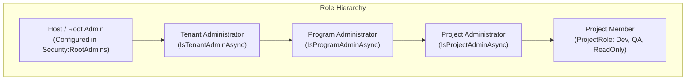

# 03. Security & Defense-in-Depth Model

> **Purpose**: Technical specification of BlazorFluent's multi-layered security controls, tenant isolation barriers, cryptographic seals, and authorization enforcement mechanisms.  
> **Who should read this**: Security architects, backend developers, and auditors reviewing compliance, zero-trust controls, and data protection boundaries.

---

## 🛡️ 1. Defense-in-Depth Architectural Overview

BlazorFluent operates under a strict **Zero Trust & Defense-in-Depth** model: no single layer failure can result in unauthorized access, privilege escalation, or cross-tenant data leakage.

```mermaid
graph TD
    subgraph Layer1 ["Layer 1: Edge & Identity Barrier"]
        Edge["HTTP Edge Middleware\n• Security Headers (CSP, HSTS, X-Frame-Options)\n• Fixed-Window Rate Limiting (10 req/min)\n• Antiforgery Token Validation"]
        Auth["Corporate Authentication\n• Azure AD / Entra ID (OIDC + PKCE)\n• HMAC-SHA256 Row Integrity Seal on Users\n• Active Date Window Verification\n• Mandatory Privacy Notice Agreement"]
    end

    subgraph Layer2 ["Layer 2: Ambient Context & Session Control"]
        Context["Fail-Closed ITenantContext\n• Ambient TenantId Resolution\n• Tenant Switching Validation (AllowedTenants)\n• Host Single-Source Verification"]
        Session["Live Session Watchdog\n• Idle Timeout & Max Lifetime Expiration\n• Remote Session Revocation Signal\n• Real-Time Circuit Freeze (<SessionRevokedModal />)"]
    end

    subgraph Layer3 ["Layer 3: Service-Layer Authorization Gates"]
        AuthZ["Domain Service Gates\n• Hierarchy AuthZ (Tenant, Program, Project Admin)\n• ProjectRole Verification (EnsureCanVisit / EnsureCanEdit)\n• Workflow Management RBAC (CanUserManageWorkflowAsync)"]
    end

    subgraph Layer4 ["Layer 4: EF Core Read & Write Interceptors"]
        Filters["Global Named Query Filters\n• QueryFilters.Tenant: e.TenantId == CurrentTenantId\n• QueryFilters.SoftDelete: !e.IsDeleted"]
        Interceptors["SaveChanges Interceptor Pipeline\n• Write Barrier: Verifies TenantId matches ambient context\n• TenantId Immutability: Block modification of existing TenantId\n• ProjectSecurityInterceptor: Validates write rights\n• Sensitive Keyword Masking in Audit Diffs"]
    end

    subgraph Layer5 ["Layer 5: Cryptography & Storage Protection"]
        Crypto["Data & Storage Encryption\n• Client-Side AES-256-GCM File Encryption\n• Per-Tenant HKDF-SHA256 Derived Keys\n• Data Protection Keyring Persisted to PostgreSQL\n• Webhook HMAC Verification with Constant-Time Comparison"]
    end

    Edge --> Auth
    Auth --> Context
    Context --> Session
    Session --> AuthZ
    AuthZ --> Filters
    Filters --> Interceptors
    Interceptors --> Crypto
```



---

## 🔑 2. Identity, Authentication & The Database Gate

### OnTokenValidated Backend Verification Gate
When a user authenticates via Azure AD / Entra ID, the application does **not** immediately issue an authenticated session cookie. Instead, ASP.NET Core invokes the database validity gate:

```csharp
options.Events.OnTokenValidated = async context =>
{
    var dbContext = context.HttpContext.RequestServices.GetRequiredService<AppDbContext>();
    var email = context.Principal?.FindFirst(ClaimTypes.Email)?.Value;

    var user = await dbContext.Users
        .AsNoTracking()
        .FirstOrDefaultAsync(u => u.Email == email && !u.IsDeleted);

    // 1. User existence & active check
    if (user is null || !user.IsActive)
    {
        context.Fail("User account is inactive or unprovisioned.");
        return;
    }

    // 2. Temporal date validity window
    var now = DateTime.UtcNow;
    if (now < user.StartDateUtc || now > user.EndDateUtc)
    {
        context.Fail("User access window has expired or is not yet active.");
        return;
    }

    // 3. HMAC-SHA256 Row Integrity Seal verification
    if (!user.VerifyRowIntegritySeal(integritySecret))
    {
        context.Fail("SECURITY VIOLATION: User record integrity seal mismatch! Database tampering detected.");
        return;
    }

    // 4. Record active session in identity.UserSessions...
};
```

### HMAC-SHA256 Row Integrity Seal
To prevent unauthorized privilege modifications or date tampering directly inside PostgreSQL (e.g., rogue DBA or SQL injection), `UserEntity` contains a cryptographic signature:
- **Protected Fields**: `UserId`, `Email`, `IsActive`, `StartDateUtc`, `EndDateUtc`, `UserType`.
- **Seal Computation**: Computes an HMAC-SHA256 hash using the secret configured in `Security:IntegritySecret`.
- **Fail-Closed Protection**: If a database record is modified without recomputing the valid HMAC seal, authentication immediately aborts, redirects to `/auth-error`, and logs a high-severity security incident in `audit.AuditRecords`.

### Minimal Auth Error View (`/auth-error`)
When authentication fails, users are redirected to `/auth-error`. The page intentionally renders a minimal, sanitized message:
`"Access Denied: Please contact your IT administrator."`
No stack traces, tenant IDs, or underlying reason codes are ever exposed to the client.

---

## 🏢 3. Multi-Tenant Isolation & The Write Barrier

### The Fail-Closed `ITenantContext`
All tenant-scoped operations rely on `ITenantContext`. If code attempts to access tenant data while the ambient context is uninitialized, `ITenantContext` throws a fail-closed exception immediately:

```csharp
public string TenantId => _tenantId 
    ?? throw new SecurityException("CRITICAL: Attempted to access tenant resources without an active tenant context.");
```

### EF Core 10 Named Query Filters
Configured centrally in `AppDbContext`:
- Every `ITenantEntity` receives `builder.HasQueryFilter(e => e.TenantId == _tenantContext.TenantId || _tenantContext.IsHost);`.
- Every `ISoftDeletableEntity` receives `builder.HasQueryFilter(e => !e.IsDeleted);`.
- Because named query filters are used, developers can selectively bypass soft-delete filters using `.IgnoreQueryFilters(QueryFilters.SoftDelete)` while keeping multi-tenant isolation 100% active.

### `AuditableEntityInterceptor` Write Barrier
Even if a developer accidentally bypasses query filters, the `AuditableEntityInterceptor` physically blocks cross-tenant writes during `SaveChangesAsync`:

1. **Insert Barrier**:
   - Automatically populates `tenantEntity.TenantId = _tenantContext.TenantId`.
   - If an explicit `TenantId` is supplied on the entity and differs from `_tenantContext.TenantId`, throws a `SecurityException` unless the caller is verified host admin.
2. **Update Immutability Barrier**:
   - `TenantId` is declared **immutable**.
   - If an update changes `TenantId`, the interceptor marks the property as un-modified and rejects the change with a `SecurityException`.
3. **Delete Barrier**:
   - Verifies the entity being deleted belongs to the active tenant.

---

## 👑 4. Role Hierarchy & Service-Layer RBAC

Authorization in BlazorFluent is enforced at **both** the presentation layer and the service contract layer. Relying solely on UI `[Authorize]` attributes is strictly prohibited.



### Service-Layer Read & Write Gates
Domain services (`WorkflowService`, `TaskService`, `ProjectService`) evaluate permissions directly on method invocation:

```csharp
// Read Gate: Evaluates whether user can view tasks in project
await _projectAuth.EnsureCanVisitAsync(projectId, "GetTasksByProject");

// Write Gate: Evaluates whether user has edit role in project
await _projectAuth.EnsureCanEditAsync(projectId, "CreateTask");
```

### Centralized Workflow Governance RBAC
Workflow creation, editing, appending steps, and cancellation are restricted to verified administrators based on the workflow scope:

```csharp
public async Task<bool> CanUserManageWorkflowAsync(
    TaskLevel level, 
    Guid? programId, 
    Guid? projectId, 
    CancellationToken ct = default)
{
    if (CurrentUser.IsRootAdmin) return true;
    
    var tenantId = _tenantContext.TenantId;
    if (await _hierarchyAuth.IsTenantAdminAsync(tenantId, CurrentUser.UserId, ct)) 
        return true;

    if (level == TaskLevel.Program && programId.HasValue)
        return await _hierarchyAuth.IsProgramAdminAsync(programId.Value, CurrentUser.UserId, ct);

    if (level == TaskLevel.Project && projectId.HasValue)
        return await _hierarchyAuth.IsProjectAdminAsync(projectId.Value, CurrentUser.UserId, ct);

    return false;
}
```

---

## ⏱️ 5. Active Sessions, Revocation & Impersonation

### Real-Time Session Revocation & Circuit Freeze
Active user connections are recorded in `identity.UserSessions`. Administrators can view connected circuits at `/admin/sessions`.

When an administrator clicks **"Kill Session"**:
1. `IUserSessionService.RevokeSessionAsync(sessionId)` marks the session as revoked in PostgreSQL.
2. An atomic invalidation signal is broadcast via `HybridCache`.
3. The client's active Blazor circuit detects revocation via `<SessionRevokedModal />`.
4. The user interface freezes with an unclosable warning modal, and the SignalR WebSocket disconnects immediately.

### Operator Impersonation Guardrails
To assist troubleshooting, Root Admins can temporarily view the application as a specific user:
- **Maximum Lifetime**: Automatically expires after **60 minutes**.
- **Visual Alert**: Renders a persistent, full-width top warning banner (`<ImpersonationBannerComp />`).
- **Shadow Audit Trail**: Every entity created or modified during impersonation records:
  ```
  UpdatedBy = "user@company.com [Impersonated by admin@example.com]"
  ```

---

## 🔒 6. Cryptography, Storage & Web Security

### Client-Side File Ingestion Encryption
When files are uploaded via `/file-imports`:
- Files are encrypted in C# memory using **AES-256-GCM** before touching disk or blob storage.
- Encryption keys are dynamically derived per tenant using **HKDF-SHA256** based on the tenant ID and `Security:MasterEncryptionKey`.
- Guarantees zero-knowledge storage in cloud blob containers.

### Inbound Webhook Cryptography
All inbound webhook endpoints verify payloads via `IWebhookSignatureValidator`:
- Computes HMAC-SHA256 signatures over the raw request body.
- Compares signatures using constant-time comparison (`CryptographicOperations.FixedTimeEquals`) to eliminate timing side-channel attacks.

### HTTP Edge Security Headers
Injected by `SecurityHeadersExtensions` on every HTTP response:
- `Content-Security-Policy`: Restricts scripts, styles, and frames while permitting Blazor WebSocket (`wss:`) connections.
- `X-Frame-Options: SAMEORIGIN`: Blocks clickjacking attacks.
- `X-Content-Type-Options: nosniff`: Prevents MIME-type sniffing.
- `Referrer-Policy: strict-origin-when-cross-origin`: Protects query metadata.
- `Permissions-Policy: camera=(), microphone=(), geolocation=()`: Disables hardware APIs.

---

## 📝 7. Security Checklist for Every New Feature

When contributing new entities, pages, or services to this template, verify this checklist:

- [ ] **Multi-Tenancy**: Entity inherits `TenantAuditableEntity` or explicitly implements `IGlobalEntity`.
- [ ] **Tenant Immutability**: Entity never allows external mutations to `TenantId`.
- [ ] **Service Gates**: Service methods call `EnsureCanVisitAsync` / `EnsureCanEditAsync` or `CanUserManageWorkflowAsync`.
- [ ] **Query Tracking**: Queries use `.AsNoTracking()` by default; `.AsTracking()` is added only for modified entities.
- [ ] **Input Sanitization**: Free-text user inputs pass through `IInputSanitizer.SanitizeHtml()`.
- [ ] **Error Exposure**: Components never expose raw exception messages or stack traces; they render user-facing `ERR-XXXXXXXX` incident codes.
- [ ] **Audit Masking**: Fields containing sensitive credentials (`password`, `secret`, `key`) are masked during Level 2 JSON diff generation.
- [ ] **No Raw SQL**: Queries utilize EF Core LINQ. String interpolation in raw SQL is strictly prohibited.

---

## 🔗 Related Documentation

- [00. Overview & Glossary](00-Overview-and-Glossary.md) — Personas, routes, and domain glossary.
- [01. Getting Started Guide](01-Getting-Started.md) — Local setup, migrations, and troubleshooting.
- [02. Architecture Deep Dive](02-Architecture.md) — Layer boundaries, DI rules, and caching topology.
- [04. Task Hierarchy & Workflows](04-Task-Hierarchy-and-Workflows.md) — Workflow orchestration and wizard models.
- [05. UI Conventions & Fluent V5](05-UI-Conventions-Fluent-V5.md) — Component naming taxonomy and V5 guidelines.
- [06. How to Extend Recipes](06-How-To-Extend.md) — Step-by-step feature development recipes.
- [07. AI Agent Operating Rules](07-AI-Agent-Rules.md) — Operational guidelines for AI coding assistants.
