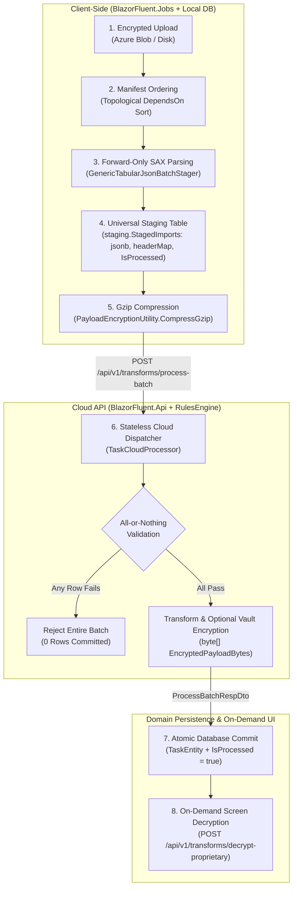
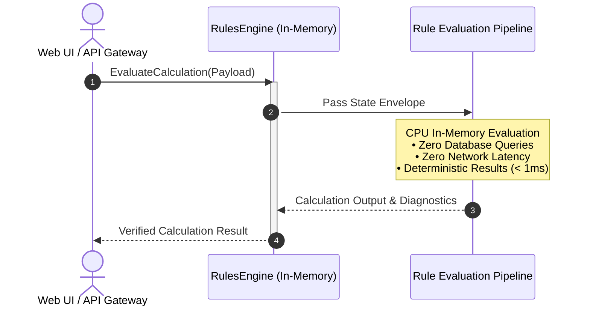
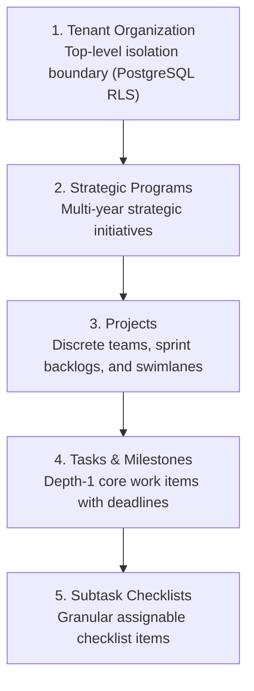

# 04. Enterprise Features & Subsystems

> **Target Audience**: Full-Stack Engineers, Solutions Architects, and Product Owners.  
> **Key Objective**: Comprehensive guide detailing the asynchronous batch file ingestion pipeline, the Enterprise Wizard RCL framework, the in-memory Rules Engine, and multi-level work management hierarchies.

---

## ⚡ 1. Hybrid Batch Processing & Universal Staging Subsystem

Traditional web uploads block HTTP request threads, parse directly into live transactional tables, risk cross-tenant pollution, and overwhelm databases with massive unstructured payloads. BlazorFluent introduces an enterprise-grade **Hybrid Batch Processing Framework** decoupling local streaming ingestion from stateless cloud processing:



### Architectural Principles

```
┌────────────────────────────────────────────────────────────────────────────────────────┐
│ 1. Local Schema Validation & Universal JSON Staging                                    │
│    • 100% of schema validation and SAX parsing executes locally in BlazorFluent.Jobs.  │
│    • Normalized JSON chunks are persisted to staging.StagedImports with jsonb payload. │
│    • Universal table replaces ad-hoc staging tables across all file formats.           │
│    • Explicit IsProcessed (bool), Status, and ProcessedAtUtc columns for auditability. │
└────────────────────────────────────────────────────────────────────────────────────────┘
                                    │
                                    ▼
┌────────────────────────────────────────────────────────────────────────────────────────┐
│ 2. Zero-Maintenance Dynamic Aliasing (HeaderMap)                                       │
│    • Every staged chunk embeds a self-describing headerMap (e.g. "c1": "Title").       │
│    • Payload size reduced by 40-70% via short keys and OmitNullValues = true.          │
│    • Deterministic UUID v7 RowId and 1-based RowIndex (Idx) for row-level tracing.     │
│    • Fixed 1,000-row chunking prevents RAM spikes during multi-megabyte uploads.       │
└────────────────────────────────────────────────────────────────────────────────────────┘
                                    │
                                    ▼
┌────────────────────────────────────────────────────────────────────────────────────────┐
│ 3. Pre-Ingestion Strategy Dispatcher & Declarative Templates                           │
│    • File templates defined in config/file-templates/*.json (e.g., TaskCsv, TaskExcel).│
│    • "generic-json" uses GenericTabularJsonBatchStager for standard tabular files.     │
│    • "custom:{ClassName}" resolves custom ICanonicalBatchStager implementations.       │
│    • Manifest-level DependsOn enforces topological execution order across files.       │
└────────────────────────────────────────────────────────────────────────────────────────┘
                                    │
                                    ▼
┌────────────────────────────────────────────────────────────────────────────────────────┐
│ 4. Stateless Cloud API & Strict All-or-Nothing Atomicity                               │
│    • Outbound requests signed with ephemeral S2S tokens via TenantAuthDelegatingHandler│
│      carrying masked claims (tid, tenant_id, cid, act) and zero PII.                   │
│    • POST /api/v1/transforms/process-batch receives Gzip-compressed chunk payloads.    │
│    • Evaluates domain rules strictly in-memory (RulesEngine) with zero database.       │
│    • All-or-Nothing: If any single row fails, the chunk fails with 0 rows committed.   │
│    • .NET 10 HybridCache (L1 RAM + optional L2 Redis) tracks transient batch metrics.  │
└────────────────────────────────────────────────────────────────────────────────────────┘
                                    │
                                    ▼
┌────────────────────────────────────────────────────────────────────────────────────────┐
│ 5. Proprietary Vault At-Rest Byte Encryption & On-Demand Screen Decryption             │
│    • Controlled by ProprietaryStorage:EncryptProcessedDataAtRest (default false).      │
│    • When true, processed domain fields are encrypted into byte[] EncryptedPayloadBytes│
│      [12-byte Nonce | 16-byte Tag | Ciphertext] using an API-exclusive master vault key│
│    • Plaintext values redacted to "[ENCRYPTED]" in local PostgreSQL storage.           │
│    • On-demand UI screen decryption via POST /api/v1/transforms/decrypt-proprietary.   │
└────────────────────────────────────────────────────────────────────────────────────────┘
                                    │
                                    ▼
┌────────────────────────────────────────────────────────────────────────────────────────┐
│ 6. Dual-Mode Host Execution & Strict Cross-Tenant Quarantine Guard                     │
│    • Runs in single-node mode inside BlazorFluent.Web (Jobs:EnableHostedListener=true) │
│      or in distributed scale mode via standalone BlazorFluent.Worker console host.     │
│    • Handlers enforce compound LINQ query scoping (f.TenantId == jobEvent.TenantId).   │
│    • Quarantine Guard: Aborts immediately if any staged file's TenantId mismatches.    │
└────────────────────────────────────────────────────────────────────────────────────────┘
```

### Declarative File Template Schema (`config/file-templates/*.json`)

Standard tabular files are configured declaratively with zero stager C# code:

```json
{
  "fileType": "TaskCsv",
  "displayName": "Project Tasks CSV Template",
  "format": {
    "formatType": "Csv",
    "delimiter": ",",
    "hasHeader": true,
    "headerRowIndex": 1,
    "dataStartRowIndex": 2
  },
  "stagingBatchStrategy": "generic-json",
  "maxRowsPerChunk": 1000,
  "omitNullValues": true,
  "dependsOn": [],
  "columns": [
    { "name": "Title", "targetProperty": "Title", "isRequired": true, "dataType": "String" },
    { "name": "Description", "targetProperty": "Description", "isRequired": false, "dataType": "String" },
    { "name": "Status", "targetProperty": "Status", "isRequired": false, "dataType": "Enum" },
    { "name": "Priority", "targetProperty": "Priority", "isRequired": false, "dataType": "Enum" },
    { "name": "DueDate", "targetProperty": "DueDate", "isRequired": false, "dataType": "DateTime" }
  ]
}
```

---

## 🧙 2. Enterprise Wizard Framework (`BlazorFluent.UI.Templates`)

A decoupled, reusable Razor Class Library (RCL) providing multi-step wizard templates and components built natively on **Microsoft Fluent UI Blazor V5**:


### Key Enterprise Features:
1. **Modal Popup Experience**: Runs smoothly as a modern dialog without full-page navigation.
2. **By-Reference State Preservation**: Wizard state (`TState`) is maintained in `WizardContext<TState>` throughout step transitions, preventing form input evaporation.
3. **Backdrop Lock**: Clicking outside the modal backdrop is locked to prevent accidental dismissal.
4. **Dirty Form Guard**: When `Context.IsDirty` is flagged, attempting to cancel displays an explicit confirmation dialog (*"Discard Unsaved Changes?"* vs *"Keep Editing"*).
5. **Step-by-Step Validation Gate**: The wizard cannot advance unless the current step's `OnValidateAsync` function passes cleanly.
6. **NuGet Ready**: Packable into a standalone `.nupkg` via `dotnet pack`.

---

## ⚡ 3. 100% In-Memory Rules Engine (`BlazorFluent.RulesEngine`)

For performance-critical financial, compliance, and regulatory calculations, `BlazorFluent.RulesEngine` executes pure in-memory calculation routines:



### Why In-Memory?
- **Sub-Millisecond Execution**: Complex rule pipelines execute in microseconds.
- **Zero Database Contention**: Frees the PostgreSQL database from executing heavy analytical triggers or math operations.
- **Stateless & Scalable**: Pure functional evaluation that scales horizontally across instances.

---

## 📊 4. Multi-Level Work Management & Task Subtype Hierarchy

BlazorFluent organizes enterprise work management across a structured hierarchy:



### Task Subtypes & Calendar Matrix
Tasks support enterprise subtypes tailored for specific operational needs:

| Subtype | Operational Focus | Calendar & Workflow Integration |
| :--- | :--- | :--- |
| **Milestone** | Major phase completion marker. | Displayed on Gantt and executive roadmap views with hard deadlines. |
| **Deliverable** | Concrete artifact requiring review. | Requires attachment upload and sign-off approval before completion. |
| **Governance Gate** | Compliance / audit gate. | Stage-gated; requires administrative sign-off before downstream tasks unlock. |
| **Operational Task**| Routine team backlog item. | Managed on multi-column Fluent UI swimlanes with subtask checklists. |
