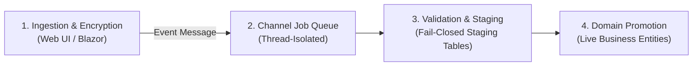
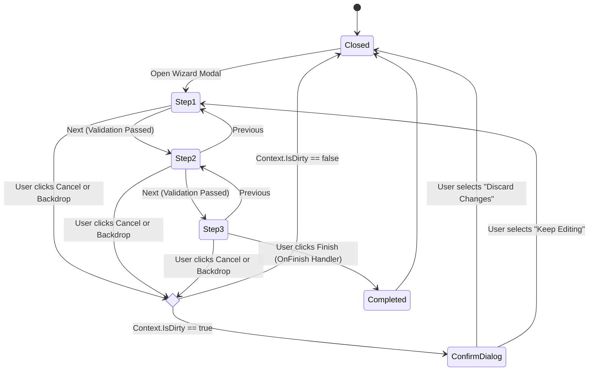
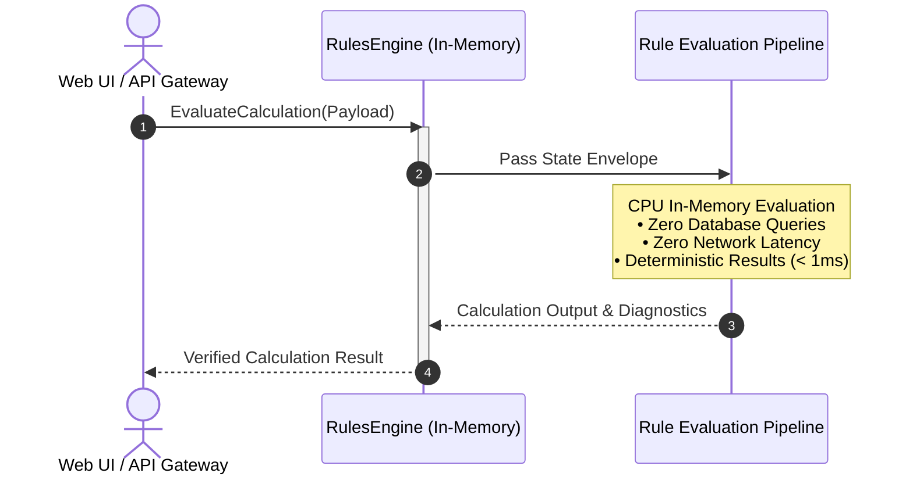
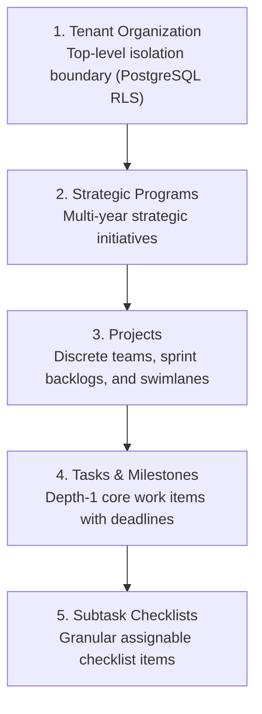

# 04. Enterprise Features & Subsystems

> **Target Audience**: Full-Stack Engineers, Solutions Architects, and Product Owners.  
> **Key Objective**: Comprehensive guide detailing the asynchronous batch file ingestion pipeline, the Enterprise Wizard RCL framework, the in-memory Rules Engine, and multi-level work management hierarchies.

---

## ⚡ 1. Asynchronous File Ingestion & Batch Subsystem

Traditional web uploads block HTTP request threads, parse directly into live transactional tables, and risk cross-tenant pollution. BlazorFluent introduces an asynchronous **4-stage decoupled batch ingestion pipeline**:



```
┌────────────────────────────────────────────────────────────────────────────────────────┐
│ 1. Zero-Knowledge Cryptographic Storage                                                │
│    • Hardware-accelerated AES-256-GCM authenticated stream encryption.                 │
│    • Per-tenant dynamic keys derived via HKDF-SHA256 (Tenant A cannot decrypt Tenant B)│
│    • Stored in tenant-partitioned blob directories (Local disk or Azure Blob Storage). │
└────────────────────────────────────────────────────────────────────────────────────────┘
                                    │
                                    ▼
┌────────────────────────────────────────────────────────────────────────────────────────┐
│ 2. Asynchronous Queue & Scope Isolation                                                │
│    • System.Threading.Channels in-memory bounded queue (ChannelJobEventQueue).         │
│    • Batch worker executes in an isolated IServiceScope per job.                       │
│    • Zero DbContext contention with active Blazor Server circuits.                     │
└────────────────────────────────────────────────────────────────────────────────────────┘
                                    │
                                    ▼
┌────────────────────────────────────────────────────────────────────────────────────────┐
│ 3. Abstract Tabular Validation Engine (Excel & CSV)                                    │
│    • Declarative models: [ImportSheet("Tasks")], [ImportColumn("Title", IsRequired)]   │
│    • Auto-validates: (a) Sheet existence, (b) Header row presence, (c) Required cells. │
│    • Fail-Closed: Any missing header or required cell aborts staging (0 records saved).│
└────────────────────────────────────────────────────────────────────────────────────────┘
                                    │
                                    ▼
┌────────────────────────────────────────────────────────────────────────────────────────┐
│ 4. Two-Class Feature Packaging & Zero-Plumbing DI                                      │
│    • Each business import target needs strictly 2 classes: Stager & Processor.         │
│    • Assembly reflection scanning auto-registers handlers with zero manual DI changes. │
└────────────────────────────────────────────────────────────────────────────────────────┘
```

### Two-Class Feature Packaging Example
To add a new bulk import target (e.g. Products, Employees, Tasks), a developer writes strictly **two classes**:
1. **The Stager Class**: Inherits `AbstractTabularStager<TStagingEntity>` and declares required sheet and columns via attributes.
2. **The Processor Class**: Inherits `AbstractImportProcessor<TStagingEntity>` and promotes validated staging rows into production domain entities inside a database transaction.

Reflection scanners in `BlazorFluent.Jobs` auto-discover and register both classes at startup.

---

## 🧙 2. Enterprise Wizard Framework (`BlazorFluent.UI.Templates`)

A decoupled, reusable Razor Class Library (RCL) providing multi-step wizard templates and components built natively on **Microsoft Fluent UI Blazor V5**:



### Key Enterprise Features:
1. **Modal Popup Experience**: Runs smoothly as a modern dialog without full-page navigation.
2. **By-Reference State Preservation**: Wizard state (`TState`) is maintained in `WizardContext<TState>` throughout step transitions, preventing form input evaporation.
3. **Backdrop Lock**: Clicking outside the modal backdrop is locked to prevent accidental dismissal.
4. **Dirty Form Guard**: When `Context.IsDirty` is flagged, attempting to cancel displays an explicit confirmation dialog (*"Discard Unsaved Changes?"* vs *"Keep Editing"*).
5. **Step-by-Step Validation Gate**: The wizard cannot advance unless the current step's `OnValidateAsync` function passes cleanly.
6. **NuGet Ready**: Packable into a standalone `.nupkg` via `dotnet pack`.

---

## ⚡ 3. 100% In-Memory Rules Engine (`BlazorFluent.RulesEngine`)

For performance-critical financial, compliance, and regulatory calculations, `BlazorFluent.RulesEngine` executes pure in-memory calculation routines:



### Why In-Memory?
- **Sub-Millisecond Execution**: Complex rule pipelines execute in microseconds.
- **Zero Database Contention**: Frees the PostgreSQL database from executing heavy analytical triggers or math operations.
- **Stateless & Scalable**: Pure functional evaluation that scales horizontally across instances.

---

## 📊 4. Multi-Level Work Management & Task Subtype Hierarchy

BlazorFluent organizes enterprise work management across a structured hierarchy:



### Task Subtypes & Calendar Matrix
Tasks support enterprise subtypes tailored for specific operational needs:

| Subtype | Operational Focus | Calendar & Workflow Integration |
| :--- | :--- | :--- |
| **Milestone** | Major phase completion marker. | Displayed on Gantt and executive roadmap views with hard deadlines. |
| **Deliverable** | Concrete artifact requiring review. | Requires attachment upload and sign-off approval before completion. |
| **Governance Gate** | Compliance / audit gate. | Stage-gated; requires administrative sign-off before downstream tasks unlock. |
| **Operational Task**| Routine team backlog item. | Managed on multi-column Fluent UI swimlanes with subtask checklists. |
