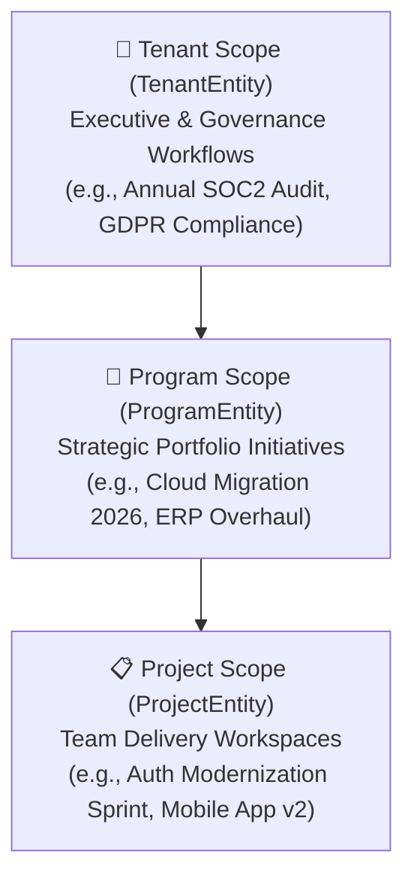
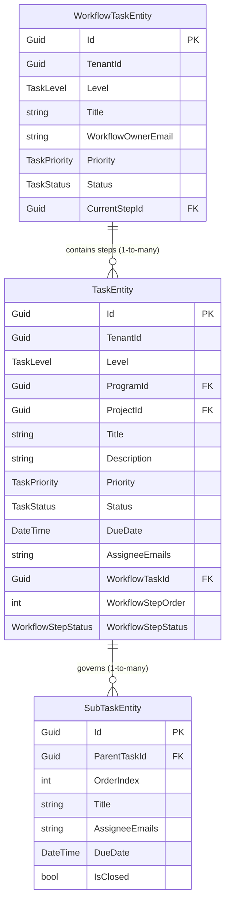
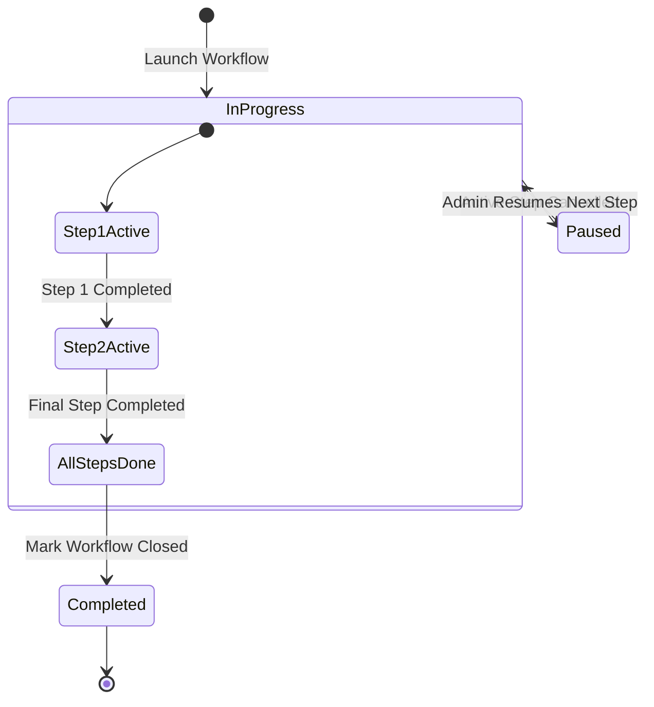

# 04. Task Hierarchy & Enterprise Sequential Workflows

> **Purpose**: In-depth functional and technical guide to BlazorFluent's work-management domain, including organizational scoping (Tenant/Program/Project), Task-SubTask hierarchy, sequential workflows, step ownership, and wizard templates.  
> **Who should read this**: Developers, domain engineers, and product owners working on business processes, stage-gated approvals, or work-tracking features.

---

## 🏛️ 1. Multi-Level Organizational Scoping

BlazorFluent structures work across three nested organizational levels:



Every work item and workflow explicitly declares its `TaskLevel` (`TaskLevel.Tenant`, `TaskLevel.Program`, or `TaskLevel.Project`).

---

## 📋 2. Tasks & Subtasks Architecture

Work management in BlazorFluent is organized into a clean, 2-level hierarchy:



### Invariant Rules
1. **Maximum Hierarchy Depth = 1**: A task (`TaskEntity`) contains subtasks (`SubTaskEntity`). A subtask can **never** contain child subtasks. This avoids infinite nesting and UI fragmentation.
2. **Discrete Ownership**: A parent task defines the primary deliverable; subtasks represent specific delegated checklist items assigned to individual team members.
3. **Soft-Delete Only**: Neither tasks nor subtasks are physically deleted from PostgreSQL. Calling `.Remove()` toggles `IsDeleted = true` via `AuditableEntityInterceptor`.

---

## ⚡ 3. Enterprise Sequential Workflows

### The Constant Workflow Owner Principle
In traditional task systems, when a task moves between departments, the overall ownership changes hands. This often leads to orphaned work, accountability vacuums, and missed deadlines.

BlazorFluent introduces the **Constant Workflow Owner** pattern:
- **`WorkflowOwnerEmail`**: A single person remains the workflow orchestrator from kickoff to completion.
- **Constant Follow-Up**: The workflow owner receives notifications at every step transition, monitors pipeline health, and addresses stalls.
- **Discrete Step Owners**: Individual steps are assigned to specialized Step Owners (`AssigneeEmails` on `TaskEntity`), who drive execution for that specific stage.
- **Delegated Team Members**: Step owners can add subtasks and assign them to team members without changing the workflow owner.

```mermaid
sequenceDiagram
    autonumber
    actor Orchestrator as Workflow Owner (Constant)
    actor Step1 as Step 1 Owner (Security Lead)
    actor Step2 as Step 2 Owner (QA Lead)
    participant Engine as WorkflowService
    participant Notif as INotifyService

    Note over Orchestrator,Engine: Workflow Launch
    Orchestrator->>Engine: Launches Workflow (Step 1 Active, Step 2 Pending)
    Engine->>Notif: Alerts Step 1 Owner ("Action Required: Step 1 Active")
    
    Note over Step1,Engine: Execution & Subtask Delegation
    Step1->>Engine: Adds Subtask & assigns to Security Engineer
    Step1->>Engine: Completes Step 1 Deliverables & signs off
    
    Engine->>Engine: Marks Step 1 Completed; Activates Step 2
    Engine->>Notif: Alerts Step 2 Owner ("Action Required: Step 2 Active")
    Engine->>Notif: Alerts Workflow Owner ("Milestone: Step 1 Completed")
```

---

## 🔄 4. Workflow State Machine & Step Lifecycles



### Step Cancellation, Pipeline Pausing & Resume
- **Audit Preservation**: Steps attached to a workflow **cannot be deleted**.
- **Cancellation**: If a step becomes obsolete, an administrator marks it as `Cancelled` with a mandatory cancellation reason.
- **Automatic Pausing**: If the cancelled step was the **currently active step**, the workflow immediately transitions to `TaskStatus.Paused`. Execution is halted to prevent unreviewed work.
- **Resume Action**: A verified administrator reviews the pipeline and clicks **"Resume Pipeline"** (`ResumePausedWorkflowAsync`), advancing execution to the next available step.

---

## 🛡️ 5. Admin-Only Workflow Designer & RBAC

Workflow design, editing, and step cancellations are protected by the server-side gate `CanUserManageWorkflowAsync`:

| Workflow Level | Required Role to Design / Edit |
|---|---|
| **Tenant Level** | Tenant Administrator (`IsTenantAdminAsync`) or Root SuperAdmin |
| **Program Level** | Program Administrator (`IsProgramAdminAsync`) or Tenant/Root Admin |
| **Project Level** | Project Administrator (`IsProjectAdminAsync`) or Tenant/Root Admin |

Non-administrators can view workflows and sign off on steps they own, but they cannot create workflows, reorder pipeline steps, or cancel steps.

---

## 🧰 6. Attaching Existing Tasks vs. Authoring Steps

When designing a workflow via `<CreateWorkflowWizardModal />`, administrators can:
1. **Author New Steps**: Provide title, step owner email, deadline, instructions, and initial subtasks.
2. **Attach Existing Tasks**: Search unassigned tasks matching the workflow's scope using `GetAvailableTasksForWorkflowAsync`. Existing tasks retain their task number, history, and subtasks while being incorporated into the sequential pipeline.

---

## 💻 7. Service Contracts & DTO Reference

Declared in `BlazorFluent.Core/Contracts/IWorkflowService.cs`:

```csharp
public interface IWorkflowService
{
    Task<WorkflowTaskEntity> CreateWorkflowAsync(CreateWorkflowReqDto request, CancellationToken ct = default);
    Task<WorkflowTaskEntity> CompleteStepAsync(CompleteWorkflowStepReqDto request, CancellationToken ct = default);
    Task<WorkflowTaskEntity> ReassignStepAsync(ReassignWorkflowStepReqDto request, CancellationToken ct = default);
    Task<SubTaskEntity> AddSubTaskToStepAsync(AddSubTaskToStepReqDto request, CancellationToken ct = default);
    Task<SubTaskEntity> ToggleSubTaskStatusAsync(ToggleSubTaskStatusReqDto request, CancellationToken ct = default);
    Task<IReadOnlyList<WorkflowTaskEntity>> GetWorkflowsAsync(WorkflowFilterDto filter, CancellationToken ct = default);
    Task<WorkflowTaskEntity?> GetWorkflowByIdAsync(Guid workflowId, CancellationToken ct = default);
    Task<WorkflowTaskEntity> EditWorkflowAsync(EditWorkflowReqDto request, CancellationToken ct = default);
    Task<WorkflowTaskEntity> CancelStepAsync(CancelWorkflowStepReqDto request, CancellationToken ct = default);
    Task<WorkflowTaskEntity> ResumePausedWorkflowAsync(ResumePausedWorkflowReqDto request, CancellationToken ct = default);
    Task<WorkflowTaskEntity> AppendStepAsync(AppendStepToWorkflowReqDto request, CancellationToken ct = default);
    Task<IReadOnlyList<TaskEntity>> GetAvailableTasksForWorkflowAsync(TaskSearchFilterDto filter, CancellationToken ct = default);
    Task<bool> CanUserManageWorkflowAsync(TaskLevel level, Guid? programId, Guid? projectId, CancellationToken ct = default);
}
```

---

## 🎨 8. UI Components & The Reusable Wizard Library

### 1. `WorkflowsDashboardPage` (`/workflows`)
The central operations screen offering:
- Summary KPI Cards: Active Workflows, Completed, Steps Awaiting Sign-Off, Delegated Subtasks.
- Scope Filter Tabs: *All Scopes*, *Tenant Governance*, *Program Strategic*, *Project Delivery*.
- Real-time search and status filters.
- Stepper feed rendering `<WorkflowStepperComp />`.

### 2. `WorkflowStepperComp` (`Components/Common/WorkflowStepperComp.razor`)
Visual card component displaying the active workflow track:
- Pipeline node progress bar with icons (`Icons.Filled.Size16.Checkmark`, `Play`).
- Active Step card highlighting the Step Owner and deadline via `<UserDateTime />`.
- Delegated subtask checklists with live checkbox toggles.
- Action buttons: **"Sign Off & Advance Step"**, **"Reassign Step Owner"**, **"Add Subtask"**, **"Cancel Step"**, **"Resume Pipeline"**.

### 3. Reusable Generic Wizard (`BlazorFluent.UI.Templates.Wizards`)
`FluentWizardModal<TState>` provides an accessible, decoupled multi-step wizard:

```razor
<FluentWizardModal TState="CreateWorkflowReqDto"
                   IsOpen="@IsOpen"
                   IsOpenChanged="@IsOpenChanged"
                   Title="Design Sequential Workflow"
                   InitialState="@_initialState"
                   OnFinish="@HandleFinishAsync"
                   OnCancel="@HandleCancel">
    <Steps>
        <WizardStep Title="Scope & Governance"
                    Summary="Scoping level & constant owner"
                    OnValidateAsync="@ValidateStep1Async">
            <!-- Step 1 Form Controls -->
        </WizardStep>

        <WizardStep Title="Steps & Subtasks"
                    Summary="Ordered tasks & delegated team members"
                    OnValidateAsync="@ValidateStep2Async">
            <!-- Step 2 Form Controls -->
        </WizardStep>

        <WizardStep Title="Review & Launch"
                    Summary="Final review before orchestrating">
            <!-- Step 3 Review UI -->
        </WizardStep>
    </Steps>
</FluentWizardModal>
```

#### Key Capabilities:
- **In-Memory State**: Form inputs bind directly to properties on generic `TState`.
- **Accidental Dismissal Lock**: Backdrop clicks do not dismiss the dialog; dirty changes require explicit confirmation.
- **Asynchronous Step Validation**: Advancing blocks until `OnValidateAsync` evaluates to `true`.

---

## 🔗 Related Documentation

- [00. Overview & Glossary](00-Overview-and-Glossary.md) — Personas, routes, and domain glossary.
- [01. Getting Started Guide](01-Getting-Started.md) — Local setup, migrations, and troubleshooting.
- [02. Architecture Deep Dive](02-Architecture.md) — Layer boundaries, DI rules, and caching topology.
- [03. Security Model](03-Security-Model.md) — Multi-tenant write barriers and role gates.
- [05. UI Conventions & Fluent V5](05-UI-Conventions-Fluent-V5.md) — Component naming taxonomy and V5 guidelines.
- [06. How to Extend Recipes](06-How-To-Extend.md) — Step-by-step feature development recipes.
- [07. AI Agent Operating Rules](07-AI-Agent-Rules.md) — Operational guidelines for AI coding assistants.
