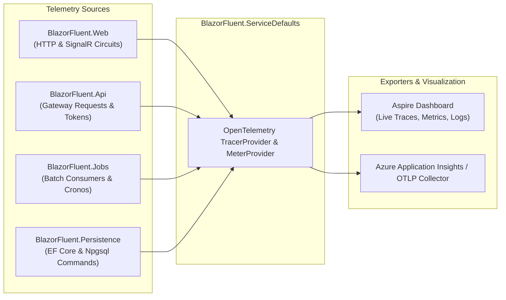
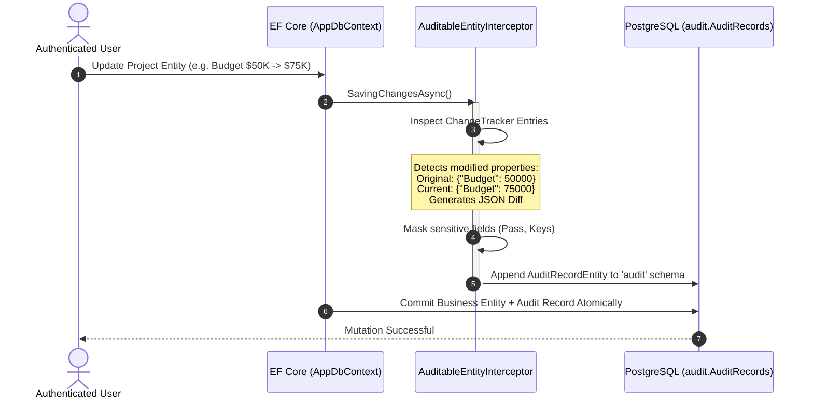

# 05. Observability & Reliability

> **Target Audience**: Site Reliability Engineers (SREs), Platform Engineers, Systems Architects, and DevOps Leads.  
> **Key Objective**: Comprehensive guide to cloud-native observability, distributed tracing with .NET Aspire and OpenTelemetry, structured Serilog logging, HybridCache architecture, and forensic audit diffs.

---

## 🔭 1. Cloud-Native Observability with .NET Aspire & OpenTelemetry

BlazorFluent integrates the **OpenTelemetry (OTel)** standard across all service layers, orchestrated seamlessly by `.NET Aspire`:



### Metrics & Traces Tracked:
- **Distributed Tracing**: End-to-end request tracing across Web, API Gateway, background workers, and PostgreSQL queries.
- **Circuit Lifecycle Metrics**: Real-time counters for active SignalR circuits, disconnections, and reconnections.
- **Batch Processing Metrics**: Queue wait times, batch execution duration, and staging row counts.
- **Database Query Diagnostics**: Command execution time, connection pooling stats, and interceptor execution duration.

---

## 📜 2. Structured Forensic Logging with Serilog

All logging utilizes strongly-typed structured logging via **Serilog**:
- **Correlation ID Tracking**: Every HTTP request and SignalR circuit carries a unique correlation ID (`CorrelationId`), stamped onto every subsequent log event and database audit record.
- **Automated Credential Masking**: Password hashes, bearer tokens, HMAC secrets, and encryption keys are scrubbed before writing to log sinks.
- **Production Sinks**: Supports console, file rolling logs, and OTLP network exporters.

---

## 🚀 3. Multi-Tier Surgical Caching (HybridCache)

BlazorFluent utilizes the **.NET 10 `HybridCache`** library to provide two-tier surgical caching:

```mermaid
flowchart TD
    Req[Service Query Request] --> L1{L1 In-Memory RAM\nCache Hit?}
    
    L1 -->|Yes (~0 ms)| Ret[Return Cached Object]
    L1 -->|No| L2{L2 Distributed Cache\n(Redis Hit?)}
    
    L2 -->|Yes (~1-2 ms)| UpdateL1[Populate L1 RAM] --> Ret
    L2 -->|No| DB[(PostgreSQL Database\nLayer 5 RLS)]
    
    DB --> ExecQuery[Execute SQL Query]
    ExecQuery --> WriteCaches[Atomically Populate L1 & L2]
    WriteCaches --> Ret
```

### Instant Live Cache Invalidation
When an administrator modifies a user's project role at `/tenancy/project-roles`:
1. The mutation is saved to PostgreSQL.
2. The service immediately invalidates the cache key `proj_role_{tenantId}_{userId}_{projectId}`.
3. The next user click re-evaluates the fresh role instantly without requiring circuit reconnects or re-logins.

---

## 🔍 4. Forensic Audit Record Diff Engine (`audit.AuditRecords`)

BlazorFluent enforces immutable audit logging via `AuditableEntityInterceptor`:



### Key Security & Compliance Properties:
- **Atomic Persistence**: Business entity changes and audit records are saved in the **exact same database transaction**. If the audit record fails to save, the business mutation rolls back completely!
- **Schema Isolation**: Stored in a dedicated PostgreSQL schema (`audit.AuditRecords`), allowing strict database permission separation.
- **Property-Level JSON Diffs**: Captures precisely what changed before and after, who changed it (`UserId`, `TenantId`), and when (`TimestampUtc`).

---

## 🩺 5. Health Checks & Readiness Probes

BlazorFluent registers standard ASP.NET Core health checks in `BlazorFluent.ServiceDefaults`:

| Endpoint | Probe Type | Monitored Subsystems |
| :--- | :--- | :--- |
| **`/health`** | Readiness Probe | PostgreSQL connection, Redis connection, and storage volume write access. |
| **`/alive`** | Liveness Probe | Basic process responsiveness and thread health. |

These endpoints integrate directly with container orchestrators (Kubernetes, Azure Container Apps, Docker Compose) for automated self-healing.
