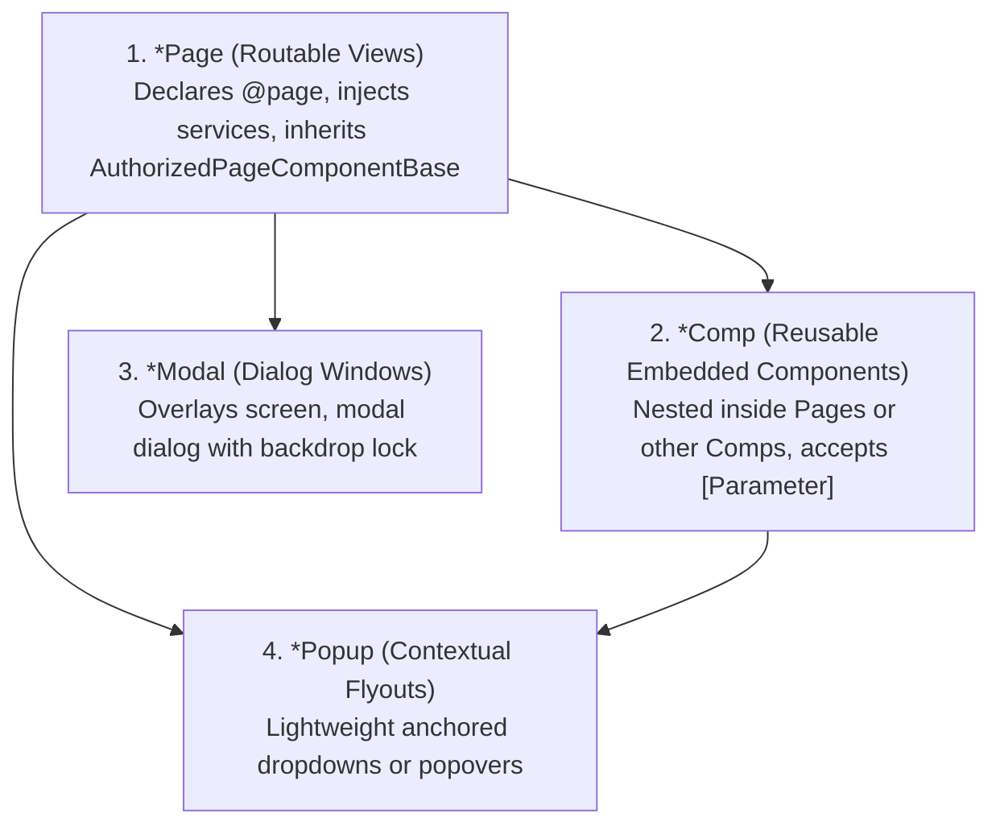

# 06. UI Conventions & Microsoft Fluent UI Blazor V5

> **Target Audience**: Frontend Engineers, Blazor Developers, UI/UX Specialists, and Code Reviewers.  
> **Key Objective**: Enforce the 4-tier Razor component taxonomy, ensure 100% compliance with Microsoft Fluent UI Blazor V5 (Microsoft Fluent 2 design language), and eliminate legacy V3/V4 anti-patterns.

---

## 📐 1. The 4-Tier Component Taxonomy

All Razor components in `BlazorFluent.Web` and `BlazorFluent.UI.Templates` strictly follow a 4-tier naming taxonomy:



| Suffix | Purpose | Key Rules & Conventions |
| :--- | :--- | :--- |
| **`*Page.razor`** | Routable top-level page views. | MUST declare `@page "/route"`. MUST inherit `AuthorizedPageComponentBase` if in `Pages/`. MUST define `MinimumVisitRole` and `MinimumEditRole`. |
| **`*Comp.razor`** | Reusable visual widgets and sub-components. | NEVER declare `@page`. Accept inputs via `[Parameter]`. Emit events via `EventCallback`. |
| **`*Modal.razor`** | Modal dialog windows. | Implement dialogs, confirmations, and wizards (e.g. `<FluentWizardModal>`). Provide backdrop locking. |
| **`*Popup.razor`** | Anchored flyouts and dropdown menus. | Positioned relative to anchor elements (e.g. user menu popover). |

---

## 🎨 2. Microsoft Fluent UI Blazor V5 Standards

BlazorFluent is built natively on **Microsoft Fluent UI Blazor V5**, which implements Microsoft's modern **Fluent 2 Design System**:

### Banned Legacy V3/V4 Patterns vs V5 Replacements:

| Deprecated / Banned Pattern | Compliant Fluent UI V5 Syntax | Notes |
| :--- | :--- | :--- |
| `Appearance="Appearance.Accent"` | `Appearance="ButtonAppearance.Primary"` | Enums are strongly typed in V5. |
| `Appearance="Appearance.Neutral"` | `Appearance="ButtonAppearance.Secondary"` | "Neutral" is deprecated. |
| `<FluentTextField>` | `<FluentTextInput>` | Renamed in V5. |
| `<FluentNumberField>` | `<FluentNumberInput>` | Renamed in V5. |
| `<FluentTextArea>` | `<FluentTextAreaInput>` | Renamed in V5. |
| `<FluentProgressRing>` | `<FluentProgressRing>` with `Value` | Renamed attributes in V5. |
| Manual inline CSS colors (`#0078D4`) | Fluent Design Tokens (`var(--accent-fill-rest)`) | Automatic light/dark theme adaptation. |

---

## 🧩 3. Reusable Enterprise UI Component Catalog

BlazorFluent includes a suite of reusable, production-tested components:

| Component | Category | Purpose | Location |
| :--- | :--- | :--- | :--- |
| **`<FluentSwimlaneBoardComp>`** | Visual Widget | Multi-column Kanban swimlane board for tasks and workflows. | `Components/Tasks/` |
| **`<WorkflowStepperComp>`** | Visual Widget | Interactive visual stepper showing real-time stage-gated workflow progression. | `Components/Workflows/` |
| **`<FluentWizardModal>`** | Reusable RCL | Modal multi-step wizard with validation gates and dirty form protection. | `BlazorFluent.UI.Templates` |
| **`<SessionRevokedModal>`** | Security Modal | Real-time circuit freeze overlay triggered when an administrator revokes a session. | `Components/Security/` |
| **`<AuditHistoryModal>`** | Audit Modal | Property-level before/after JSON diff viewer for forensic change tracking. | `Components/Audit/` |

---

## 🔍 4. Automated Compliance Verification (`verify-fluent-v5.ps1`)

To guarantee that no legacy or malformed Razor syntax enters the repository, run the automated verification script:

```powershell
pwsh scripts/verify-fluent-v5.ps1
```

The script performs a Roslyn AST scan across all `.razor` files, flagging any deprecated tags or attributes with exact line and column numbers.
