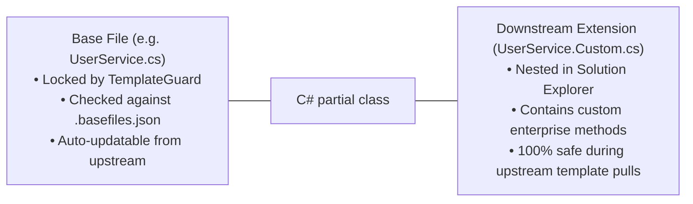

# 07. How-To-Extend & Developer Recipes

> **Target Audience**: Software Engineers and Full-Stack Developers building new business features, entities, or services.  
> **Key Objective**: Deliver copy-pasteable, end-to-end implementation recipes adhering strictly to Clean Architecture, Layer 5 RLS, and Fluent UI V5 conventions.

---

## 🍳 Recipe Catalog Index

1. [Recipe 1: Add a New Domain Entity & EF Core Mapping](#recipe-1-add-a-new-domain-entity--ef-core-mapping)
2. [Recipe 2: Add an Authorized Domain Service](#recipe-2-add-an-authorized-domain-service)
3. [Recipe 3: Author a Fluent UI V5 Role-Gated Page](#recipe-3-author-a-fluent-ui-v5-role-gated-page)
4. [Recipe 4: Create an Asynchronous Batch Importer](#recipe-4-create-an-asynchronous-batch-importer)
5. [Recipe 5: Author a Multi-Step Wizard with `<FluentWizardModal>`](#recipe-5-author-a-multi-step-wizard-with-fluentwizardmodal)
6. [Recipe 6: Add a Calculation Rule to `BlazorFluent.RulesEngine`](#recipe-6-add-a-calculation-rule-to-blazorfluentrulesengine)
7. [Recipe 7: Downstream Extension with TemplateGuard (`.Custom.cs`)](#recipe-7-downstream-extension-with-templateguard-customcs)

---

## Recipe 1: Add a New Domain Entity & EF Core Mapping

### Step 1: Create Entity in `BlazorFluent.Core/Entities/`
```csharp
namespace BlazorFluent.Core.Entities;

public class CustomerEntity : BaseEntity, ITenantScopedEntity, IAuditableEntity
{
    public Guid TenantId { get; set; }
    public string CompanyName { get; set; } = string.Empty;
    public string ContactEmail { get; set; } = string.Empty;
    public decimal AnnualContractValue { get; set; }
}
```

### Step 2: Configure Entity in `BlazorFluent.Persistence/Configurations/`
```csharp
namespace BlazorFluent.Persistence.Configurations;

public class CustomerConfiguration : IEntityTypeConfiguration<CustomerEntity>
{
    public void Configure(EntityTypeBuilder<CustomerEntity> builder)
    {
        builder.ToTable("customers", "core");
        builder.HasKey(c => c.Id);
        builder.Property(c => c.CompanyName).HasMaxLength(200).IsRequired();
        builder.Property(c => c.ContactEmail).HasMaxLength(256).IsRequired();
        
        // Tenant index for fast scoped queries
        builder.HasIndex(c => new { c.TenantId, c.CompanyName });
    }
}
```

### Step 3: Register in `AppDbContext.cs`
```csharp
public DbSet<CustomerEntity> Customers => Set<CustomerEntity>();
```

---

## Recipe 2: Add an Authorized Domain Service

### Step 1: Declare Contract in `BlazorFluent.Core/Contracts/`
```csharp
namespace BlazorFluent.Core.Contracts.Services;

public interface ICustomerService
{
    Task<List<CustomerEntity>> GetCustomersAsync(CancellationToken ct = default);
    Task<CustomerEntity> CreateCustomerAsync(CustomerEntity customer, CancellationToken ct = default);
}
```

### Step 2: Implement in `BlazorFluent.Persistence/Services/`
```csharp
namespace BlazorFluent.Persistence.Services;

public class CustomerService(AppDbContext db, ICurrentUser currentUser, ILogger<CustomerService> logger) : ICustomerService
{
    public async Task<List<CustomerEntity>> GetCustomersAsync(CancellationToken ct = default)
    {
        // Automatically scoped to currentUser.TenantId by EF Core Named Query Filter + PostgreSQL RLS
        return await db.Customers.AsNoTracking().OrderBy(c => c.CompanyName).ToListAsync(ct);
    }

    public async Task<CustomerEntity> CreateCustomerAsync(CustomerEntity customer, CancellationToken ct = default)
    {
        customer.TenantId = currentUser.TenantId;
        db.Customers.Add(customer);
        await db.SaveChangesAsync(ct);
        return customer;
    }
}
```

---

## Recipe 3: Author a Fluent UI V5 Role-Gated Page

Create `src/BlazorFluent.Web/Components/Pages/CustomersPage.razor`:

```razor
@page "/customers"
@inherits AuthorizedPageComponentBase
@inject ICustomerService CustomerService

<PageTitle>Customer Directory</PageTitle>

@if (!CanVisit)
{
    <FluentCard Style="padding: 24px; text-align: center;">
        <FluentIcon Value="@(new Icons.Regular.Size24.ShieldDismiss())" Color="Color.Error" />
        <FluentLabel Typo="Typography.H5">Access Denied</FluentLabel>
        <FluentLabel>You lack permissions to view customer directories.</FluentLabel>
    </FluentCard>
}
else
{
    <FluentStack Orientation="Orientation.Vertical" VerticalGap="16">
        <FluentStack Orientation="Orientation.Horizontal" HorizontalAlignment="HorizontalAlignment.SpaceBetween">
            <FluentLabel Typo="Typography.H4">Customers</FluentLabel>
            @if (CanEdit)
            {
                <FluentButton Appearance="ButtonAppearance.Primary" IconStart="@(new Icons.Regular.Size20.Add())" OnClick="OpenCreateDialog">
                    Add Customer
                </FluentButton>
            }
        </FluentStack>

        <FluentDataGrid Items="@_customers.AsQueryable()" ResizableColumns="true">
            <PropertyColumn Property="@(c => c.CompanyName)" Title="Company" Sortable="true" />
            <PropertyColumn Property="@(c => c.ContactEmail)" Title="Email" Sortable="true" />
            <PropertyColumn Property="@(c => c.AnnualContractValue)" Title="Contract Value" Format="C" Sortable="true" />
        </FluentDataGrid>
    </FluentStack>
}

@code {
    protected override ProjectRole MinimumVisitRole => ProjectRole.ReadOnly;
    protected override ProjectRole MinimumEditRole => ProjectRole.Dev;

    private List<CustomerEntity> _customers = new();

    protected override async Task OnInitializedAsync()
    {
        if (CanVisit)
        {
            _customers = await CustomerService.GetCustomersAsync();
        }
    }

    private void OpenCreateDialog() { /* Open modal */ }
}
```

---

## Recipe 4: Create an Asynchronous Batch Importer

Create two classes in `BlazorFluent.Jobs`:

### 1. The Stager Class:
```csharp
[ImportSheet("Customers")]
public class CustomerStager : AbstractTabularStager<CustomerStagingEntity>
{
    [ImportColumn("Company Name", IsRequired = true)]
    public string CompanyName { get; set; } = string.Empty;

    [ImportColumn("Email", IsRequired = true)]
    public string ContactEmail { get; set; } = string.Empty;
}
```

### 2. The Processor Class:
```csharp
public class CustomerImportProcessor(AppDbContext db, ILogger<CustomerImportProcessor> logger) 
    : AbstractImportProcessor<CustomerStagingEntity>
{
    public override async Task PromoteBatchAsync(List<CustomerStagingEntity> stagingRows, Guid tenantId, CancellationToken ct)
    {
        using var tx = await db.Database.BeginTransactionAsync(ct);
        foreach (var row in stagingRows)
        {
            db.Customers.Add(new CustomerEntity
            {
                TenantId = tenantId,
                CompanyName = row.CompanyName,
                ContactEmail = row.ContactEmail
            });
        }
        await db.SaveChangesAsync(ct);
        await tx.CommitAsync(ct);
    }
}
```

---

## Recipe 5: Author a Multi-Step Wizard with `<FluentWizardModal>`

```razor
@using BlazorFluent.UI.Templates.Wizards

<FluentButton Appearance="ButtonAppearance.Primary" OnClick="@(() => _isOpen = true)">
    New Onboarding
</FluentButton>

<FluentWizardModal TState="OnboardingState"
                   @bind-IsOpen="_isOpen"
                   Title="Employee Onboarding"
                   InitialState="@_state"
                   OnFinish="HandleFinishedAsync">
    <Steps>
        <WizardStep Title="Profile" OnValidateAsync="@ValidateStep1">
            <FluentTextInput Label="Name" @bind-Value="@_state.Name" Required="true" />
        </WizardStep>
        <WizardStep Title="Role">
            <FluentSelect TOption="string" Items="@_roles" @bind-Value="@_state.Role" />
        </WizardStep>
    </Steps>
</FluentWizardModal>

@code {
    private bool _isOpen = false;
    private OnboardingState _state = new();
    private List<string> _roles = new() { "Dev", "QA", "Admin" };

    private Task<bool> ValidateStep1() => Task.FromResult(!string.IsNullOrWhiteSpace(_state.Name));
    private async Task HandleFinishedAsync(OnboardingState state) { /* Persist */ }
}
```

---

## Recipe 6: Add a Calculation Rule to `BlazorFluent.RulesEngine`

In `BlazorFluent.RulesEngine`:
```csharp
namespace BlazorFluent.RulesEngine.Rules;

public static class DiscountCalculationRule
{
    public static decimal CalculateNetContractValue(decimal grossValue, int tenureYears)
    {
        // 100% in-memory evaluation (< 1 microsecond)
        var discountPercent = tenureYears switch
        {
            >= 5 => 0.20m,
            >= 2 => 0.10m,
            _ => 0.00m
        };
        return grossValue * (1.0m - discountPercent);
    }
}
```

---

## Recipe 7: Downstream Extension with TemplateGuard (`.Custom.cs`)

When consuming this template in downstream client projects, **TemplateGuard** protects core base files from breaking template updates:



### Example: Extending a Service
In `src/BlazorFluent.Persistence/Services/UserService.Custom.cs`:
```csharp
namespace BlazorFluent.Persistence.Services;

public partial class UserService
{
    // Custom downstream method; never overwritten by base template updates
    public async Task SendCustomSmsAlertAsync(Guid userId, string message)
    {
        // Custom implementation
    }
}
```
