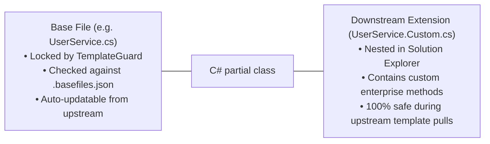

# 07. How-To-Extend & Developer Recipes

> **Target Audience**: Software Engineers and Full-Stack Developers building new business features, entities, or services.  
> **Key Objective**: Deliver copy-pasteable, end-to-end implementation recipes adhering strictly to Clean Architecture, Layer 5 RLS, and Fluent UI V5 conventions.

---

## 🍳 Recipe Catalog Index

1. [Recipe 1: Add a New Domain Entity & EF Core Mapping](#recipe-1-add-a-new-domain-entity--ef-core-mapping)
2. [Recipe 2: Add an Authorized Domain Service](#recipe-2-add-an-authorized-domain-service)
3. [Recipe 3: Author a Fluent UI V5 Role-Gated Page](#recipe-3-author-a-fluent-ui-v5-role-gated-page)
4. [Recipe 4: Create an Asynchronous Batch Importer](#recipe-4-create-an-asynchronous-batch-importer)
5. [Recipe 5: Author a Multi-Step Wizard with `<FluentWizardModal>`](#recipe-5-author-a-multi-step-wizard-with-fluentwizardmodal)
6. [Recipe 6: Add a Calculation Rule to `BlazorFluent.RulesEngine`](#recipe-6-add-a-calculation-rule-to-blazorfluentrulesengine)
7. [Recipe 7: Downstream Extension with TemplateGuard (`.Custom.cs`)](#recipe-7-downstream-extension-with-templateguard-customcs)
8. [Recipe 8: Onboard a New Tenant & Rotate License Keys](#recipe-8-onboard-a-new-tenant--rotate-license-keys)
9. [Recipe 9: Author a Dedicated Background Job for `BlazorFluent.Worker`](#recipe-9-author-a-dedicated-background-job-for-blazorfluentworker)

---

## Recipe 1: Add a New Domain Entity & EF Core Mapping

### Step 1: Create Entity in `BlazorFluent.Core/Entities/`
```csharp
namespace BlazorFluent.Core.Entities;

public class CustomerEntity : BaseEntity, ITenantScopedEntity, IAuditableEntity
{
    public Guid TenantId { get; set; }
    public string CompanyName { get; set; } = string.Empty;
    public string ContactEmail { get; set; } = string.Empty;
    public decimal AnnualContractValue { get; set; }
}
```

### Step 2: Configure Entity in `BlazorFluent.Persistence/Configurations/`
```csharp
namespace BlazorFluent.Persistence.Configurations;

public class CustomerConfiguration : IEntityTypeConfiguration<CustomerEntity>
{
    public void Configure(EntityTypeBuilder<CustomerEntity> builder)
    {
        builder.ToTable("customers", "core");
        builder.HasKey(c => c.Id);
        builder.Property(c => c.CompanyName).HasMaxLength(200).IsRequired();
        builder.Property(c => c.ContactEmail).HasMaxLength(256).IsRequired();
        
        // Tenant index for fast scoped queries
        builder.HasIndex(c => new { c.TenantId, c.CompanyName });
    }
}
```

### Step 3: Register in `AppDbContext.cs`
```csharp
public DbSet<CustomerEntity> Customers => Set<CustomerEntity>();
```

---

## Recipe 2: Add an Authorized Domain Service

### Step 1: Declare Contract in `BlazorFluent.Core/Contracts/`
```csharp
namespace BlazorFluent.Core.Contracts.Services;

public interface ICustomerService
{
    Task<List<CustomerEntity>> GetCustomersAsync(CancellationToken ct = default);
    Task<CustomerEntity> CreateCustomerAsync(CustomerEntity customer, CancellationToken ct = default);
}
```

### Step 2: Implement in `BlazorFluent.Persistence/Services/`
```csharp
namespace BlazorFluent.Persistence.Services;

public class CustomerService(AppDbContext db, ICurrentUser currentUser, ILogger<CustomerService> logger) : ICustomerService
{
    public async Task<List<CustomerEntity>> GetCustomersAsync(CancellationToken ct = default)
    {
        // Automatically scoped to currentUser.TenantId by EF Core Named Query Filter + PostgreSQL RLS
        return await db.Customers.AsNoTracking().OrderBy(c => c.CompanyName).ToListAsync(ct);
    }

    public async Task<CustomerEntity> CreateCustomerAsync(CustomerEntity customer, CancellationToken ct = default)
    {
        customer.TenantId = currentUser.TenantId;
        db.Customers.Add(customer);
        await db.SaveChangesAsync(ct);
        return customer;
    }
}
```

---

## Recipe 3: Author a Fluent UI V5 Role-Gated Page

Create `src/BlazorFluent.Web/Components/Pages/CustomersPage.razor`:

```razor
@page "/customers"
@inherits AuthorizedPageComponentBase
@inject ICustomerService CustomerService

<PageTitle>Customer Directory</PageTitle>

@if (!CanVisit)
{
    <FluentCard Style="padding: 24px; text-align: center;">
        <FluentIcon Value="@(new Icons.Regular.Size24.ShieldDismiss())" Color="Color.Error" />
        <FluentLabel Typo="Typography.H5">Access Denied</FluentLabel>
        <FluentLabel>You lack permissions to view customer directories.</FluentLabel>
    </FluentCard>
}
else
{
    <FluentStack Orientation="Orientation.Vertical" VerticalGap="16">
        <FluentStack Orientation="Orientation.Horizontal" HorizontalAlignment="HorizontalAlignment.SpaceBetween">
            <FluentLabel Typo="Typography.H4">Customers</FluentLabel>
            @if (CanEdit)
            {
                <FluentButton Appearance="ButtonAppearance.Primary" IconStart="@(new Icons.Regular.Size20.Add())" OnClick="OpenCreateDialog">
                    Add Customer
                </FluentButton>
            }
        </FluentStack>

        <FluentDataGrid Items="@_customers.AsQueryable()" ResizableColumns="true">
            <PropertyColumn Property="@(c => c.CompanyName)" Title="Company" Sortable="true" />
            <PropertyColumn Property="@(c => c.ContactEmail)" Title="Email" Sortable="true" />
            <PropertyColumn Property="@(c => c.AnnualContractValue)" Title="Contract Value" Format="C" Sortable="true" />
        </FluentDataGrid>
    </FluentStack>
}

@code {
    protected override ProjectRole MinimumVisitRole => ProjectRole.ReadOnly;
    protected override ProjectRole MinimumEditRole => ProjectRole.Dev;

    private List<CustomerEntity> _customers = new();

    protected override async Task OnInitializedAsync()
    {
        if (CanVisit)
        {
            _customers = await CustomerService.GetCustomersAsync();
        }
    }

    private void OpenCreateDialog() { /* Open modal */ }
}
```

---

## Recipe 4: Add a Batch File Import Target (Hybrid Batch Framework)

Under the Hybrid Batch Processing Framework, adding a new batch import target requires three declarative/stateless steps:

### 1. Register the File Type
Add the discriminator to `ImportFileType` in `BlazorFluent.Shared.DataListTypes.ImportTypes.cs`:
```csharp
public enum ImportFileType
{
    // ...
    CustomerCsv = 7
}
```

### 2. Create the Declarative JSON Template
Add `config/file-templates/CustomerCsv.json`. For standard tabular formats, set `"stagingBatchStrategy": "generic-json"`. Local schema validation, streaming SAX parsing, dynamic `headerMap` aliasing (`c1`, `c2`, ...), null value omission, and 1,000-row chunking into `staging.StagedImports` occur automatically:

```json
{
  "fileType": "CustomerCsv",
  "displayName": "Customer Ingestion CSV",
  "format": {
    "formatType": "Csv",
    "delimiter": ",",
    "hasHeader": true,
    "headerRowIndex": 1,
    "dataStartRowIndex": 2
  },
  "stagingBatchStrategy": "generic-json",
  "maxRowsPerChunk": 1000,
  "omitNullValues": true,
  "dependsOn": [],
  "columns": [
    { "name": "Company Name", "targetProperty": "CompanyName", "isRequired": true, "dataType": "String" },
    { "name": "Email", "targetProperty": "ContactEmail", "isRequired": true, "dataType": "String" }
  ]
}
```

> **For Complex Non-Tabular Imports**: Implement `ICanonicalBatchStager` in `BlazorFluent.Jobs` and set `"stagingBatchStrategy": "custom:CustomerCustomBatchStager"`.

### 3. Implement the Stateless C# Cloud Processor
Create a strictly typed processor inheriting `BaseCloudProcessor` in `BlazorFluent.RulesEngine/BatchProcessing/Processors/`:

```csharp
using BlazorFluent.Shared.Contracts.Engine.Transforms;

namespace BlazorFluent.RulesEngine.BatchProcessing.Processors;

public sealed class CustomerCloudProcessor : BaseCloudProcessor
{
    public override IReadOnlyCollection<string> SupportedFileTypes => ["CustomerCsv"];

    public override ProcessBatchRespDto ProcessChunk(
        Guid sessionId,
        Guid stagedImportId,
        int chunkIndex,
        string fileType,
        CanonicalStagedChunkPayload payload,
        IReadOnlyDictionary<string, string>? contextParameters)
    {
        var reverseMap = BuildReverseHeaderMap(payload.HeaderMap);
        var errors = new List<RowValidationErrorDto>();
        var processedRows = new List<ProcessedDomainRowDto>();

        foreach (var row in payload.Rows)
        {
            var company = GetCellValue(row, reverseMap, "CompanyName")?.Trim();
            var email = GetCellValue(row, reverseMap, "ContactEmail")?.Trim();

            if (string.IsNullOrWhiteSpace(company))
            {
                errors.Add(new RowValidationErrorDto(row.Idx, "CompanyName", "REQUIRED", "Company Name is required."));
            }

            if (string.IsNullOrWhiteSpace(email) || !email.Contains('@'))
            {
                errors.Add(new RowValidationErrorDto(row.Idx, "ContactEmail", "INVALID_EMAIL", "Valid email is required."));
            }

            processedRows.Add(new ProcessedDomainRowDto(
                SourceRowId: row.Id,
                RowIndex: row.Idx,
                TargetEntityType: "CustomerEntity",
                DomainProperties: new Dictionary<string, string?>
                {
                    ["CompanyName"] = company,
                    ["ContactEmail"] = email
                },
                IsEncryptedAtRest: false,
                EncryptedPayloadBytes: null));
        }

        // Enforce strict all-or-nothing atomicity:
        if (errors.Count > 0)
        {
            return new ProcessBatchRespDto(sessionId, stagedImportId, chunkIndex, false, payload.Rows.Count, [], errors);
        }

        return new ProcessBatchRespDto(sessionId, stagedImportId, chunkIndex, true, payload.Rows.Count, processedRows, []);
    }
}
```

Register the processor in `BlazorFluent.Api/Program.cs`:
```csharp
builder.Services.AddSingleton<BaseCloudProcessor, CustomerCloudProcessor>();
```

---

## Recipe 5: Author a Multi-Step Wizard with `<FluentWizardModal>`

```razor
@using BlazorFluent.UI.Templates.Wizards

<FluentButton Appearance="ButtonAppearance.Primary" OnClick="@(() => _isOpen = true)">
    New Onboarding
</FluentButton>

<FluentWizardModal TState="OnboardingState"
                   @bind-IsOpen="_isOpen"
                   Title="Employee Onboarding"
                   InitialState="@_state"
                   OnFinish="HandleFinishedAsync">
    <Steps>
        <WizardStep Title="Profile" OnValidateAsync="@ValidateStep1">
            <FluentTextInput Label="Name" @bind-Value="@_state.Name" Required="true" />
        </WizardStep>
        <WizardStep Title="Role">
            <FluentSelect TOption="string" Items="@_roles" @bind-Value="@_state.Role" />
        </WizardStep>
    </Steps>
</FluentWizardModal>

@code {
    private bool _isOpen = false;
    private OnboardingState _state = new();
    private List<string> _roles = new() { "Dev", "QA", "Admin" };

    private Task<bool> ValidateStep1() => Task.FromResult(!string.IsNullOrWhiteSpace(_state.Name));
    private async Task HandleFinishedAsync(OnboardingState state) { /* Persist */ }
}
```

---

## Recipe 6: Add a Calculation Rule to `BlazorFluent.RulesEngine`

In `BlazorFluent.RulesEngine`:
```csharp
namespace BlazorFluent.RulesEngine.Rules;

public static class DiscountCalculationRule
{
    public static decimal CalculateNetContractValue(decimal grossValue, int tenureYears)
    {
        // 100% in-memory evaluation (< 1 microsecond)
        var discountPercent = tenureYears switch
        {
            >= 5 => 0.20m,
            >= 2 => 0.10m,
            _ => 0.00m
        };
        return grossValue * (1.0m - discountPercent);
    }
}
```

---

## Recipe 7: Downstream Extension with TemplateGuard (`.Custom.cs`)

When consuming this template in downstream client projects, **TemplateGuard** protects core base files from breaking template updates:



```

---

## Recipe 8: Onboard a New Tenant & Rotate License Keys

### Step 1: Generate License Key on Tenant Onboarding
During tenant onboarding or key rotation, invoke `ITenantService.RegenerateTenantLicenseKeyAsync`:

```csharp
// In an Admin service or Onboarding Wizard step:
var newLicenseKey = await tenantService.RegenerateTenantLicenseKeyAsync(tenantId, ct);

// Reveal to the tenant administrator ONCE (never logged in plain text):
// "Your new 256-bit Tenant License Key is: " + newLicenseKey
```

### Step 2: Configure Keys in Host Configurations
Store the key in the tenant's WebApp / Worker configuration and in the Cloud ProcessAPI configuration:

```json
{
  "Tenants": {
    "tnt_alpha": {
      "LicenseKey": "<256-bit-base64-key-from-onboarding>"
    }
  }
}
```

---

## Recipe 9: Author a Dedicated Background Job for `BlazorFluent.Worker`

### Step 1: Define Job Event in `BlazorFluent.Core/Events/`
All background events must implement `IJobEvent` and carry an explicit `TenantId` and `CorrelationId`:

```csharp
namespace BlazorFluent.Core.Events.Invoicing;

public record InvoiceBatchJobEvent(
    string TriggerSource,
    string TenantId,
    string CorrelationId,
    string SenderOrigin,
    string SenderUserId,
    string SenderUserEmail,
    Guid InvoiceBatchId,
    Guid? ParentExecutionId = null) : IJobEvent
{
    public Guid EventId { get; init; } = Guid.CreateVersion7();
    public DateTime TimestampUtc { get; init; } = DateTime.UtcNow;
}
```

### Step 2: Implement Handler in `BlazorFluent.Jobs/Jobs/`
Batch handlers implement `IBatchJobHandler<TEvent>` and reside exclusively in `BlazorFluent.Jobs`:

```csharp
namespace BlazorFluent.Jobs.Jobs.Invoicing;

public class InvoiceBatchJobHandler : IBatchJobHandler<InvoiceBatchJobEvent>
{
    private readonly AppDbContext _dbContext;
    private readonly ILogger<InvoiceBatchJobHandler> _logger;

    public InvoiceBatchJobHandler(AppDbContext dbContext, ILogger<InvoiceBatchJobHandler> logger)
    {
        _dbContext = dbContext;
        _logger = logger;
    }

    public async Task HandleAsync(InvoiceBatchJobEvent jobEvent, CancellationToken cancellationToken)
    {
        // Enforce compound tenant scoping:
        var batch = await _dbContext.Invoices
            .Where(i => i.TenantId == jobEvent.TenantId && i.BatchId == jobEvent.InvoiceBatchId)
            .ToListAsync(cancellationToken);

        _logger.LogInformation("Processing {Count} invoices for tenant {TenantId}", batch.Count, jobEvent.TenantId);
        // Execute business logic...
    }
}
```

### Step 3: Deployment
- The job handler is **automatically discovered and registered** by `JobsExtensions.AddBackgroundJobs()`.
- Runs seamlessly inside `BlazorFluent.Web` (when `Jobs:EnableHostedListener = true`) or inside `BlazorFluent.Worker` (in distributed mode) with **zero code duplication**.

