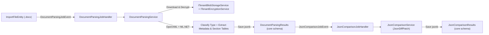

# 08 — Local ML.NET Document Parsing & JSON Comparison

## Overview
`BlazorEnterprise` provides **100% local** Word (`.docx`) document parsing and JSON comparison with **zero external LLM or cloud AI API calls**. All processing runs in-process inside `BlazorEnterprise.Jobs` / `BlazorEnterprise.Worker`, preserving strict multi-tenant isolation and blob encryption at rest.

---

## Architecture & Data Flow



---

## Components Implemented

### 1. Domain Entities & Validators (`BlazorEnterprise.Core`)
- **`DocumentParsingConfigEntity`**: Per-tenant ML.NET model path, parsing rules (`jsonb`), and minimum confidence threshold.
- **`DocumentParsingResultEntity`**: Stores extracted structured JSON (`jsonb`), classified `DocumentType`, and `ConfidenceScore` linked to `ImportFileEntity`.
- **`JsonComparisonResultEntity`**: Stores RFC 6902-style JSON diff (`DiffResultJson`) and summary counts (`SummaryMetricsJson`) comparing `SourceFileId` and `TargetFileId`.
- Companion `AbstractValidator<T>` validators in `DocumentParsingValidators.cs`.

### 2. Persistence (`BlazorEnterprise.Persistence`)
- `IEntityTypeConfiguration<T>` classes in `Configurations/DocumentParsing/` mapped to `core` schema (`jsonb` columns, tenant/project/document-type indexes, zero DB defaults per `TG027`).
- Registered `DbSet`s on `AppDbContext`: `DocumentParsingConfigs`, `DocumentParsingResults`, `JsonComparisonResults`.

### 3. Services & Background Jobs (`BlazorEnterprise.Jobs`)
- **`DocumentParsingService`** (`IDocumentParsingService`):
  1. Loads `ImportFileEntity` scoped by `ITenantContext.TenantId`.
  2. Downloads and decrypts the `.docx` stream via `ITenantBlobStorageService` + `ITenantEncryptionService`.
  3. Extracts paragraphs and `Description | Comment` section tables using `DocumentFormat.OpenXml`.
  4. Classifies document type (`PolicyCenter`, `ContactManager`, `ClaimCenter`, or `General`), extracts header metadata (`CustomerName`, `SourceVersion`, `TargetVersion`, `ProjectManager`), and computes a confidence score.
- **`JsonComparisonService`** (`IJsonComparisonService`):
  - Loads the latest `ExtractedDataJson` for both `SourceFileId` and `TargetFileId`, computes the diff via `JsonDiffPatch.Net`, and counts additions, deletions, and modifications.
- **Background Handlers** (auto-discovered by `JobsExtensions.cs`):
  - `DocumentParsingJobHandler` (`DocumentParsingJobEvent`)
  - `JsonComparisonJobHandler` (`JsonComparisonJobEvent`)

---

## Configuration (`appsettings.json`)
```json
"DocumentParsing": {
  "EnableMLParsing": true,
  "MinConfidenceThreshold": 0.75,
  "MaxDocumentSizeMB": 50
},
"JsonComparison": {
  "EnableDiffAnalysis": true,
  "MaxComparisonFileSizeMB": 100
}
```

---

## Next Steps (When Ready)
1. Generate the EF Core migration:
   ```powershell
   dotnet ef migrations add AddDocumentParsingTables -p src/BlazorEnterprise.Persistence -s src/BlazorEnterprise.Web
   ```
2. Build and run unit tests to verify.
