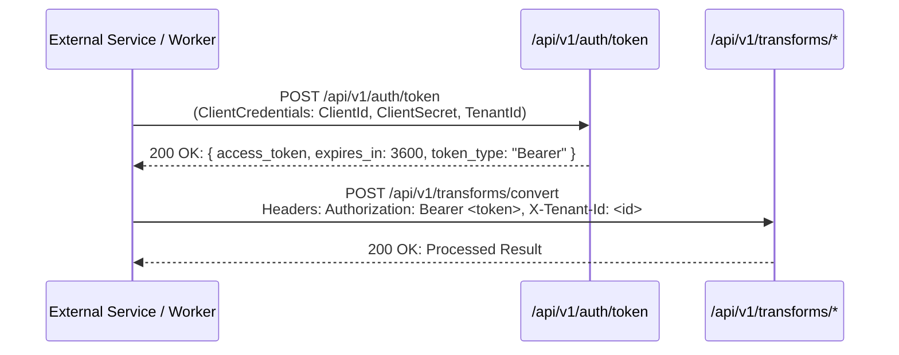

# 11. API Reference & Integration Guide

> **Target Audience**: Backend Engineers, Integration Developers, DevOps, and External Service Consumers.  
> **Key Objective**: Comprehensive specification of all Minimal API endpoints in `BlazorFluent.Api`, authentication protocols, token exchange, payload contracts, rate limiting, and webhook HMAC verification.

---

## 🌐 1. Architectural Role of `BlazorFluent.Api`

The `BlazorFluent.Api` project functions as an **autonomous, stateless compute engine and API gateway**. In accordance with [ADR 001: Stateless API Gateway Pattern](file:///c:/Users/cheri/source/repos/BlazorFluent/docs/adr/001-stateless-api-gateway-pattern.md), it:
- Strictly references `BlazorFluent.Shared` and `BlazorFluent.RulesEngine`.
- Has **zero dependencies** on `BlazorFluent.Persistence` or relational databases.
- Offloads CPU-intensive computations (DAG cycle detection, schedule calculation, bulk CSV/Excel transformations, and proprietary payload encryption/decryption) away from Blazor Server SignalR circuits.

---

## 🔐 2. Authentication & S2S Token Exchange

All `/api/v1/*` endpoints (except health probes and token endpoints) require a valid **Bearer JWT**.

### 2.1 Token Issuance Flow



### 2.2 S2S Token Exchange Request
```http
POST /api/v1/auth/token HTTP/1.1
Host: api.example.com
Content-Type: application/json

{
  "clientId": "service-worker-client-id",
  "clientSecret": "super-secure-client-secret",
  "tenantId": "11111111-1111-1111-1111-111111111111"
}
```

**Response**:
```json
{
  "accessToken": "eyJhbGciOiJIUzI1NiIs...",
  "tokenType": "Bearer",
  "expiresIn": 3600
}
```

---

## 🛡️ 3. Tenant Rate Limiting & Clearance Headers

The API enforces tenant-level rate limiting using ASP.NET Core `PartitionedRateLimiter`:
- **Policy Name**: `api-tenant`
- **Partition Key**: `X-Tenant-Id` header (falls back to client IP if omitted).
- **Quota**: 200 tokens per bucket, replenishing 50 tokens every 10 seconds.
- **Rate Limit Headers**:
  - `X-RateLimit-Limit`: Maximum burst capacity.
  - `X-RateLimit-Remaining`: Remaining tokens in window.
  - `Retry-After`: Seconds to wait when receiving `429 Too Many Requests`.

---

## 📋 4. Endpoint Reference Catalog

### 4.1 Authentication & Authorization Endpoints (`/api/v1/auth`)

| Endpoint | Method | Authorization | Description |
| :--- | :--- | :--- | :--- |
| `/api/v1/auth/authorize` | `POST` | Anonymous | Validates service credentials and returns authorization status. |
| `/api/v1/auth/token` | `POST` | Anonymous | Issues signed JWT bearer tokens for service-to-service communication. |

---

### 4.2 Administrative Endpoints (`/api/v1/admin`)

Requires `HostAdmin` or `RootAdmin` authorization.

| Endpoint | Method | Description |
| :--- | :--- | :--- |
| `/api/v1/admin/entitlements` | `GET` | Lists feature entitlements, tenant allocations, and tier limits. |
| `/api/v1/admin/entitlements` | `POST` | Grants or updates tenant entitlements and feature flags. |
| `/api/v1/admin/entitlements/{targetEmail}` | `DELETE` | Revokes administrative overrides for a target user email. |

---

### 4.3 Transforms & Batch Processing (`/api/v1/transforms`)

#### `POST /api/v1/transforms/convert`
Converts raw tabular data (CSV, JSON, TSV) between schemas according to configured mapping templates.

**Request Payload**:
```json
{
  "sourceFormat": "CSV",
  "targetFormat": "JSON",
  "payload": "Id,Name,Priority\n1,Task A,High\n2,Task B,Low"
}
```

#### `POST /api/v1/transforms/process-batch`
Executes canonical validation and promotion on Gzip-compressed staged chunks from `GenericFileImportBatchJobHandler`.

**Headers**:
- `Content-Encoding`: `gzip`
- `Content-Type`: `application/json`
- `X-Tenant-Id`: `<tenant-guid>`

#### `POST /api/v1/transforms/decrypt-proprietary`
Performs tenant-isolated batch decryption of encrypted task payloads without loading keys into the web UI process.

**Request Payload**:
```json
{
  "items": [
    {
      "recordId": "3fa85f64-5717-4562-b3fc-2c963f66afa6",
      "encryptedPayload": "AQIDBAUGBwgJCgsMDQ4PEA=="
    }
  ]
}
```

---

### 4.4 Analytics & Graph Algorithms (`/api/v1/analytics`)

#### `POST /api/v1/analytics/dag-cycles`
Detects circular dependencies in task/milestone graphs using Tarjan's strongly connected components algorithm before persisting dependency changes.

**Request Payload**:
```json
{
  "edges": [
    { "sourceId": "guid-task-1", "targetId": "guid-task-2" },
    { "sourceId": "guid-task-2", "targetId": "guid-task-3" }
  ]
}
```

**Response**:
```json
{
  "hasCycles": false,
  "cycles": []
}
```

---

### 4.5 Health Probes & Diagnostic Endpoints

| Endpoint | Method | Auth | Response |
| :--- | :--- | :--- | :--- |
| `/` | `GET` | Anonymous | Service metadata, environment, active correlation ID. |
| `/healthz` | `GET` | Anonymous | Full subsystem readiness health check (200 OK / 503 Unhealthy). |
| `/alive` | `GET` | Anonymous | Liveness probe indicating process responsiveness. |

---

## 🔏 5. Webhook HMAC Signature Verification

Incoming webhooks and Teams adaptive notifications validate authenticity using HMAC-SHA256:

```csharp
public static bool VerifyWebhookSignature(string payload, string signatureHeader, string secret)
{
    using var hmac = new HMACSHA256(Encoding.UTF8.GetBytes(secret));
    var hash = hmac.ComputeHash(Encoding.UTF8.GetBytes(payload));
    var computedSignature = Convert.ToHexString(hash);
    return CryptographicOperations.FixedTimeEquals(
        Encoding.UTF8.GetBytes(computedSignature),
        Encoding.UTF8.GetBytes(signatureHeader));
}
```

---

*Related Documentation*:
- [02. Architecture & Project Structure](file:///c:/Users/cheri/source/repos/BlazorFluent/docs/02-Architecture-and-Project-Structure.md)
- [03. Security Model & Defense-in-Depth](file:///c:/Users/cheri/source/repos/BlazorFluent/docs/03-Security-Model-and-Defense-in-Depth.md)
- [ADR 001: Stateless API Gateway Pattern](file:///c:/Users/cheri/source/repos/BlazorFluent/docs/adr/001-stateless-api-gateway-pattern.md)
