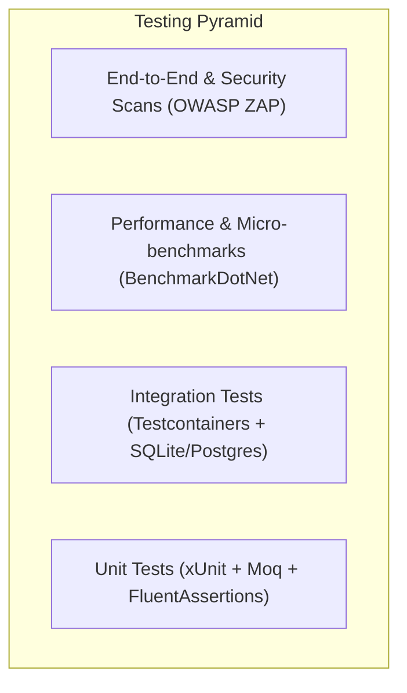

# 14. Testing Standards & Strategies Guide

> **Target Audience**: Quality Assurance (QA) Engineers, Software Engineers, and Security Reviewers.  
> **Key Objective**: Comprehensive guide to unit testing, integration testing, performance benchmarking, and automated security scanning in BlazorFluent.

---

## 🧪 1. Testing Pyramid & Taxonomy



### 1.1 Test Project Map

| Test Project | Scope / Layer | Primary Focus |
| :--- | :--- | :--- |
| `tests/BlazorFluent.Core.Tests` | Domain & Security | Entity validation, HMAC verification, tenant isolation rules, API filters. |
| `tests/BlazorFluent.Persistence.Tests` | Data Access | EF Core queries, query filters, migration extensions, interceptors. |
| `tests/BlazorFluent.Infrastructure.Tests` | External Services | Email/Teams notification senders, token issuers, blob storage. |
| `tests/BlazorFluent.Jobs.Tests` | Background Processing | Queue listeners, batch stagers, canonical data transforms, kill switches. |
| `tests/BlazorFluent.Web.Tests` | Presentation & UI | Circuit lifecycle handlers, authentication state providers, UI helpers. |
| `tests/BlazorFluent.Benchmarks` | Micro-benchmarks | Keyset pagination, AES-GCM streaming encryption, compilation performance. |

---

## 🏷️ 2. Unit Testing Conventions

### 2.1 Test Method Naming Standard
All unit tests follow the canonical pattern:
`MethodUnderTest_Scenario_ExpectedOutcome`

**Example**:
```csharp
[Fact]
public async Task ProcessJobEventAsync_WhenTenantIdIsEmpty_AbortsFailClosedWithoutCreatingScope()
{
    // Arrange, Act, Assert
}
```

### 2.2 Assertion Standards
Tests strictly utilize `FluentAssertions` for readability and descriptive failure reporting:
```csharp
result.IsSuccess.Should().BeTrue();
result.Data.Should().NotBeNull();
result.Data!.Title.Should().Be("Normalized Task Title");
```

---

## 🐳 3. Integration Testing with Testcontainers

For database-dependent integration tests requiring native PostgreSQL capabilities (e.g., Row Level Security, JSONB operators):

```csharp
public class PostgresFixture : IAsyncLifetime
{
    private readonly PostgreSqlContainer _container = new PostgreSqlBuilder()
        .WithImage("postgres:16-alpine")
        .WithDatabase("blazorfluent_test")
        .WithUsername("postgres")
        .WithPassword("test_secret_123")
        .Build();

    public string ConnectionString => _container.GetConnectionString();

    public Task InitializeAsync() => _container.StartAsync();
    public Task DisposeAsync() => _container.DisposeAsync().AsTask();
}
```

---

## ⚡ 4. Micro-benchmarking with BenchmarkDotNet

Micro-benchmarks located in `tests/BlazorFluent.Benchmarks` benchmark hot paths (keyset pagination vs offset pagination, chunked streaming AES encryption vs in-memory arrays):

### 4.1 Running Benchmarks (Human Developer Only)
```bash
dotnet run -c Release --project tests/BlazorFluent.Benchmarks
```

### 4.2 Benchmark Guidelines
- Always execute under `Release` configuration.
- Mark methods with `[Benchmark]`.
- Use `[MemoryDiagnoser]` to track Large Object Heap (LOH) and Gen0/Gen1/Gen2 allocations.

---

## 🛡️ 5. Automated Security Scanning with OWASP ZAP

CI pipelines execute dynamic application security testing (DAST) using OWASP ZAP:
- **Baseline Scan**: Checks for missing security headers (`Strict-Transport-Security`, `X-Content-Type-Options`, `Cross-Origin-Opener-Policy`).
- **Authenticated Scan**: Tests authorization boundaries across tenants to confirm that non-host users cannot access `/api/v1/admin/*` or cross-tenant records.

---

*Related Documentation*:
- [03. Security Model & Defense-in-Depth](file:///c:/Users/cheri/source/repos/BlazorFluent/docs/03-Security-Model-and-Defense-in-Depth.md)
- [09. Coding Standards & Project Rules](file:///c:/Users/cheri/source/repos/BlazorFluent/docs/09-Coding-Standards-and-Project-Rules.md)
- [10. AI Agent Governance & Operational Rules](file:///c:/Users/cheri/source/repos/BlazorFluent/docs/10-AI-Agent-Governance-and-Operational-Rules.md)
