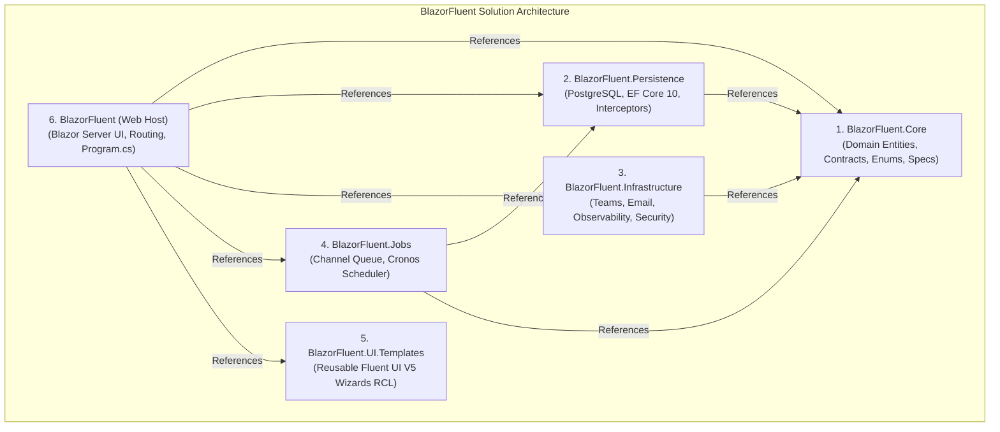

# Solution Architecture & Folder Structure Guide

> [!NOTE]
> For the comprehensive, full-depth architecture reference—including DI scope governance, request pipelines, EF interceptor order, caching topologies, and background job channels—please consult:
> 👉 [**docs/02-Architecture.md**](file:///c:/Users/cheri/source/repos/BlazorFluent/docs/02-Architecture.md)

---

## 1. Solution Topology & Project Dependencies

The solution adheres strictly to **Clean Architecture** across 6 projects:

---

## 2. Project Responsibilities Summary

| Project | Responsibility | Key Namespaces / Artifacts |
| :--- | :--- | :--- |
| **`BlazorFluent.Core`** | Innermost domain ring. Entities, value objects, domain interfaces, enums, FluentValidation validators. | `Entities/`, `Contracts/`, `DataListTypes/`, `Validators/` |
| **`BlazorFluent.Persistence`** | Relational data persistence via EF Core 10 & PostgreSQL. Interceptors, migrations, domain data services. | `Data/AppDbContext.cs`, `Interceptors/`, `Services/`, `Migrations/` |
| **`BlazorFluent.Infrastructure`** | Outbound communications, security middleware, external notifications, forensic Serilog setup. | `Notifications/`, `Security/`, `Storage/`, `UI/` |
| **`BlazorFluent.Jobs`** | Channel-based background execution, cron scheduling (Cronos), async file imports. | `Listeners/`, `Schedulers/`, `Jobs/`, `Queue/` |
| **`BlazorFluent.UI.Templates`** | Decoupled Razor Class Library (RCL) providing generic enterprise UI patterns like multi-step wizards. | `Wizards/FluentWizardModal.razor`, `Wizards/WizardStep.razor` |
| **`BlazorFluent (Web)`** | Presentation layer (Blazor Server), routing, authentication state, composition root (`Program.cs`). | `Components/`, `Modules/`, `Layout/`, `Program.cs` |

---

## 3. Related Documentation

- [**00 — Overview & Domain Glossary**](file:///c:/Users/cheri/source/repos/BlazorFluent/docs/00-Overview-and-Glossary.md)
- [**01 — Getting Started**](file:///c:/Users/cheri/source/repos/BlazorFluent/docs/01-Getting-Started.md)
- [**02 — Full Architecture Specification**](file:///c:/Users/cheri/source/repos/BlazorFluent/docs/02-Architecture.md)
- [**06 — How to Extend (Developer Recipes)**](file:///c:/Users/cheri/source/repos/BlazorFluent/docs/06-How-To-Extend.md)
