# 🏛️ BlazorFluent Enterprise Documentation Portal

Welcome to the **BlazorFluent .NET 10 Enterprise Starter Kit** master documentation suite.

BlazorFluent is a production-grade, security-hardened SaaS foundation built on **.NET 10**, **Interactive Server Blazor**, **Microsoft Fluent UI Blazor V5**, **EF Core 10**, **PostgreSQL**, and **.NET Aspire Orchestration**.

```mermaid
flowchart TD
    Portal["📚 BlazorFluent Documentation Portal"]
    
    Portal --> Found["1. Foundation & Architecture"]
    Found --> D00["00. Overview & Executive Summary"]
    Found --> D01["01. Getting Started & Setup"]
    Found --> D02["02. Architecture & 11-Project Topology"]
    
    Portal --> Sec["2. Security & Compliance"]
    Sec --> D03["03. Security Model & Defense-in-Depth"]
    
    Portal --> Feat["3. Enterprise Subsystems"]
    Feat --> D04["04. Enterprise Features & Subsystems"]
    Feat --> D05["05. Observability & Reliability"]
    Feat --> D06["06. UI Conventions (Fluent UI V5)"]
    
    Portal --> Dev["4. Engineering & Operations"]
    Dev --> D07["07. How-To-Extend & Developer Recipes"]
    Dev --> D08["08. Operational Scripts & Tooling"]
    Dev --> D09["09. Coding Standards & Project Rules"]
    Dev --> D10["10. AI Agent Governance & Rules"]
    
    Portal --> Arch["5. Historical Archive"]
    Arch --> DHist["archive/ (Design History & Historical RFCs)"]
```

---

## 📚 Master Documentation Index

| Chapter | Document | Core Focus | Target Audience |
| :--- | :--- | :--- | :--- |
| **00** | [**Overview & Executive Summary**](file:///c:/Users/cheri/source/repos/BlazorFluent/docs/00-Overview-and-Executive-Summary.md) | Value proposition, enterprise capability matrix, personas, and domain mental model. | Enterprise Architects, CTOs, Tech Leads |
| **01** | [**Getting Started & Setup**](file:///c:/Users/cheri/source/repos/BlazorFluent/docs/01-Getting-Started-and-Environment-Setup.md) | Prerequisites, Aspire orchestration, dual-mode PostgreSQL (Native vs Docker), and config dictionary. | All Developers, DevOps Engineers |
| **02** | [**Architecture & Project Structure**](file:///c:/Users/cheri/source/repos/BlazorFluent/docs/02-Architecture-and-Project-Structure.md) | Complete 11-project solution topology, Clean Architecture boundaries, and hybrid cloud model. | Solutions Architects, Senior Engineers |
| **03** | [**Security Model & Defense-in-Depth**](file:///c:/Users/cheri/source/repos/BlazorFluent/docs/03-Security-Model-and-Defense-in-Depth.md) | 5-layer defense, PostgreSQL Native RLS, AES-256-GCM envelope encryption, and Auth Gateway. | Security Engineers, Compliance Officers |
| **04** | [**Enterprise Features & Subsystems**](file:///c:/Users/cheri/source/repos/BlazorFluent/docs/04-Enterprise-Features-and-Subsystems.md) | Hybrid Batch Processing (universal JSON staging, all-or-nothing cloud engine, vault encryption), Wizard RCL, and in-memory Rules Engine. | Full-Stack Engineers, Product Owners |
| **05** | [**Observability & Reliability**](file:///c:/Users/cheri/source/repos/BlazorFluent/docs/05-Observability-and-Reliability.md) | Aspire OpenTelemetry, distributed tracing, health checks, HybridCache, and forensic audit diffs. | SREs, Platform Engineers, Architects |
| **06** | [**UI Conventions (Fluent UI V5)**](file:///c:/Users/cheri/source/repos/BlazorFluent/docs/06-UI-Conventions-and-Fluent-V5.md) | 4-tier component naming taxonomy, Microsoft Fluent 2 design language, and AST compliance scanner. | Frontend Engineers, UI/UX Specialists |
| **07** | [**How-To-Extend & Developer Recipes**](file:///c:/Users/cheri/source/repos/BlazorFluent/docs/07-How-To-Extend-and-Developer-Recipes.md) | Copy-pasteable recipes: entities, services, pages, batch importers, wizards, rules, and `.Custom.cs`. | Developers building new features |
| **08** | [**Operational Scripts & Tooling**](file:///c:/Users/cheri/source/repos/BlazorFluent/docs/08-Operational-Scripts-and-Tooling.md) | Comprehensive catalog of all repository PowerShell scripts, parameters, and automation workflows. | DevOps, Release Engineers, Developers |
| **09** | [**Coding Standards & Project Rules**](file:///c:/Users/cheri/source/repos/BlazorFluent/docs/09-Coding-Standards-and-Project-Rules.md) | Human engineering team standards, Clean Architecture laws, captive dependency governance, and C# 13 idioms. | All Software Engineers, Reviewers |
| **10** | [**AI Agent Governance & Operational Rules**](file:///c:/Users/cheri/source/repos/BlazorFluent/docs/10-AI-Agent-Governance-and-Operational-Rules.md) | Strict operational constraints, safety checks, execution permissions, and plan-first rules for AI assistants. | AI Coding Agents, Prompt Engineers |

---

## 🗄️ Historical Documentation Archive

Historical planning documents and early architecture specifications are preserved for traceability:
- [`docs/archive/Design-History.md`](file:///c:/Users/cheri/source/repos/BlazorFluent/docs/archive/Design-History.md) — Comprehensive archive of early security RFCs, database schema evolution, and component benchmarks.
- [`docs/archive/Phase2-Hybrid-Cloud-Split-Plan.md`](file:///c:/Users/cheri/source/repos/BlazorFluent/docs/archive/Phase2-Hybrid-Cloud-Split-Plan.md) — Architectural roadmap for the on-premise vs Azure cloud split.