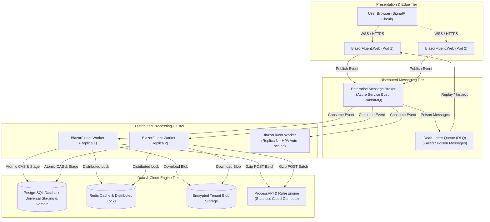
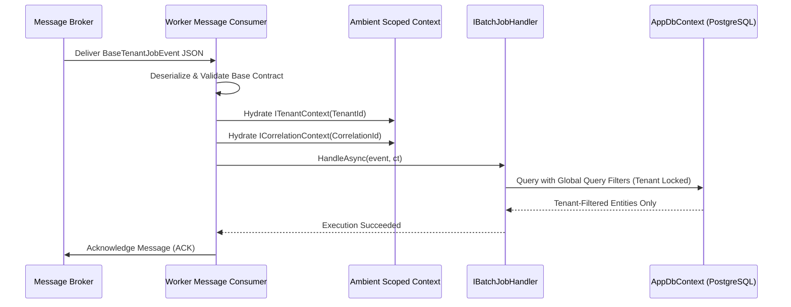
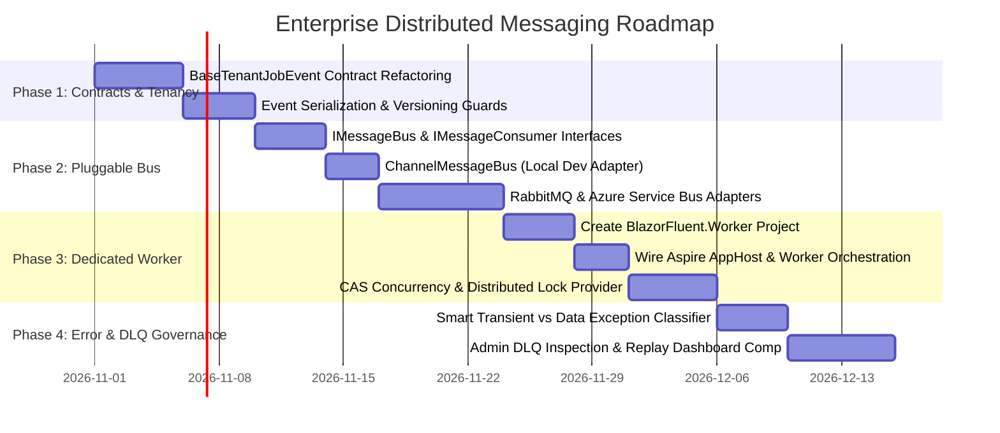

# 🚀 Enterprise Distributed Worker & Messaging Architecture Blueprint

> **Target Audience**: Enterprise Architects, Principal Systems Engineers, SREs, and Platform Tech Leads.  
> **Status**: Approved Architecture Blueprint & Implementation Roadmap.  
> **Scope**: Decoupling asynchronous batch ingestion, scheduled tasks, and heavy CPU processing from the interactive Blazor Server web host into a scalable, distributed worker cluster (`BlazorFluent.Worker`) backed by an enterprise message broker.

---

## Executive Summary

The BlazorFluent core architecture currently provides in-process bounded queueing via `System.Threading.Channels` (`ChannelJobEventQueue`) and localized background execution via `IHostedService` in `BlazorFluent.Web`. While optimal for single-node deployments and developer velocity, enterprise multi-node deployments (e.g., Kubernetes clusters, Azure Container Apps, or multi-VM load-balanced pools) require:
1. **Independent Resource Scaling**: Heavy OpenXML parsing, SAX streaming, and cloud batch encryption must never starve Blazor Server SignalR circuits of CPU or RAM.
2. **Guaranteed Delivery & Fault Tolerance**: Messages must survive web server restarts, pod evictions, and infrastructure failovers.
3. **Strict Tenancy Isolation & Concurrency Control**: Multi-tenant security context must travel across the wire without data bleed, and concurrent workers must never double-process identical files.
4. **Smart Error Governance**: Distinguishing transient network glitches from deterministic schema failures with automated Dead-Letter Queue (DLQ) routing and operator replay controls.

This document outlines the blueprint to evolve BlazorFluent to a **Tier-1 Enterprise Distributed Architecture**.

---

## 1. System Topology & Distributed Architecture



---

## 2. Core Architectural Pillars

### Pillar 1: Pluggable Message Bus Abstraction (`IMessageBus`)

To preserve zero-dependency local development while enabling cloud scale, the messaging infrastructure is abstracted behind a clean contract with multiple pluggable drivers:

```csharp
namespace BlazorFluent.Shared.Contracts.Messaging;

public interface IMessageBus
{
    Task PublishAsync<TEvent>(TEvent message, CancellationToken ct = default) 
        where TEvent : BaseTenantJobEvent;

    Task PublishBatchAsync<TEvent>(IEnumerable<TEvent> messages, CancellationToken ct = default) 
        where TEvent : BaseTenantJobEvent;
}
```

#### Provider Implementations:
1. **`ChannelMessageBus` (Default / Local Dev)**:
   - Uses `System.Threading.Channels` in-memory queue.
   - Zero external infrastructure required.
   - Ideal for developers, automated CI integration tests, and air-gapped demo instances.
2. **`AzureServiceBusMessageBus` (Cloud-Native Enterprise)**:
   - Uses Azure Service Bus Topics with Subscription Rules (`TenantId` and `EventType`).
   - Authenticates via Azure Managed Identity (zero stored secrets).
   - Built-in session FIFO processing and native Dead-Letter Queues.
3. **`RabbitMqMessageBus` (On-Premise / Self-Hosted Enterprise)**:
   - Uses Topic Exchanges (`blazorfluent.events.topic`) and durable fan-out queues.
   - Consumer acknowledgment (`basic.ack`) with dead-letter exchange (`DLX`).

---

### Pillar 2: Strict Security & Ambient Tenancy Context Contract

In accordance with our zero-trust multi-tenancy requirements, every distributed job event must implement an immutable base contract. Tenant isolation is not an optional configuration—it is enforced by the compiler:

```csharp
namespace BlazorFluent.Shared.Contracts.Messaging;

public abstract record BaseTenantJobEvent
{
    public Guid EventId { get; init; } = Guid.CreateVersion7();
    public required string TenantId { get; init; }
    public required string CorrelationId { get; init; }
    public required string SenderUserId { get; init; }
    public required string SenderUserEmail { get; init; }
    public required string SenderOrigin { get; init; }
    public DateTime CreatedAtUtc { get; init; } = DateTime.UtcNow;
    public Guid? ParentExecutionId { get; init; }
    public int RetryCount { get; init; } = 0;
}
```

#### Consumer Ambient Context Middleware:
Before passing an event to any handler (`IBatchJobHandler<T>`), the worker message consumer pipeline automatically hydrates the scoped runtime services:
1. Resolves `ITenantContext` and calls `SetTenant(message.TenantId)`.
2. Resolves `ICorrelationContext` and stamps `CorrelationId = message.CorrelationId`.
3. Pushes structured Serilog enrichment properties (`TenantId`, `CorrelationId`, `EventId`, `SenderEmail`).



---

### Pillar 3: Dedicated Worker Host (`BlazorFluent.Worker`)

A dedicated .NET 10 console worker microservice (`Microsoft.NET.Sdk.Worker`) hosts the long-running batch ingestion and scheduled job processors:

- **Resource Independence**: Interactive web users on `BlazorFluent.Web` maintain sub-50ms UI response times even when a 100,000-row Excel file is being processed.
- **Independent Autoscaling**: Configure Kubernetes Horizontal Pod Autoscaler (HPA) or Azure Container Apps KEDA scaler based on Queue Depth (e.g. scale worker pods from 1 to 20 when queue length exceeds 50 messages).
- **Graceful Shutdown**: Workers implement `IHostApplicationLifetime` to allow in-flight chunk transformations to finish before container termination.

---

### Pillar 4: Optimistic Concurrency & Idempotency Governance

To prevent double-processing when messages are redelivered or when multiple workers pull from the queue simultaneously:

#### 1. Compare-And-Swap (CAS) State Transition:
The worker claims processing ownership using an atomic PostgreSQL statement:
```sql
UPDATE imports."ImportFiles"
SET "Status" = 8, -- Processing
    "StepStage" = 'Processing',
    "Updated" = NOW()
WHERE "Id" = @ImportFileId 
  AND "TenantId" = @TenantId 
  AND "Status" IN (1, 6); -- Uploaded or StagingSuccess
```
*If rows affected is `0`, another worker has already acquired this file; the consumer immediately acks the message and aborts without duplicate processing.*

#### 2. Distributed Lock Lease:
Workers acquire a short-lived distributed lease in Redis or via PostgreSQL Advisory Locks (`pg_try_advisory_xact_lock`):
- Key: `lock:import:{TenantId}:{ImportFileId}`
- TTL: 5 minutes with heartbeat renewal during active chunk processing.

---

### Pillar 5: Smart Error Classification & Poison Message (DLQ) Governance

Not all errors should be retried. Wasteful retries of corrupted data consume CPU, clog queues, and delay valid jobs:

| Error Category | Examples | Retry Strategy | DLQ Action | Alerting |
| :--- | :--- | :--- | :--- | :--- |
| **Transient Errors** | Network timeout, HTTP 503 from Cloud API, DB connection blip, Redis lock acquisition failure. | **3x Exponential Backoff with Jitter** (2s, 8s, 32s). | Sent to DLQ only if all 3 retries exhaust. | Logged as Warning; no user alarm unless retries exhaust. |
| **Deterministic Data Errors** | Corrupted OpenXML binary, invalid column header, schema mismatch, unparseable date formats. | **Immediate Fail (0 Retries)**. | Bypasses retry loop; updates `ImportStatus.ValidationFailed`. | In-App & Email notification to uploader with error details JSON. |
| **Security / Auth Violations** | Invalid tenant signature, missing license key, tenant mismatch. | **Immediate Fail (0 Retries)**. | Moves message to Security DLQ; alerts SecOps. | High-Severity Security Alert logged to forensic audit trail. |

#### Dead-Letter Queue Management UI:
An enterprise Admin tab (`/settings/jobs/dlq`) provides tenant administrators with:
1. List of failed messages with full exception stack traces and original event payloads.
2. One-click **"Replay Message"** to requeue the message back into the active processing queue once downstream issues are resolved.
3. One-click **"Purge"** to permanently archive the dead letter.

---

## 3. Implementation Roadmap



### Phase Details:
- **Phase 1: Contracts & Tenancy (Weeks 1-2)**:
  - Migrate all domain job events (`FileImportBatchJobEvent`, `CatalogSyncJobEvent`, etc.) to inherit from `BaseTenantJobEvent`.
  - Enforce compile-time tenant stamping.
- **Phase 2: Pluggable Message Bus Abstraction (Weeks 2-3)**:
  - Implement `IMessageBus` and `ChannelMessageBus`.
  - Add optional `BlazorFluent.Infrastructure.Messaging.AzureServiceBus` and `RabbitMQ` packages.
- **Phase 3: Standalone Worker Host (`BlazorFluent.Worker`) (Weeks 4-5)**:
  - Scaffold `BlazorFluent.Worker` as an Aspire-orchestrated worker service.
  - Implement CAS database state machine and Redis distributed locking.
- **Phase 4: DLQ Governance & Admin Portal (Weeks 5-6)**:
  - Implement smart retry filter policy.
  - Deliver DLQ monitoring, alert dispatches, and operator message replay UI.

---

## 4. Conclusion & Enterprise Certification Matrix

With the completion of this roadmap, BlazorFluent satisfies the requirements for Tier-1 Enterprise deployments:

| Dimension | In-Process Channel (Current) | Distributed Worker Cluster (Blueprint) |
| :--- | :--- | :--- |
| **Max Concurrent Ingestion** | 5-10 files (bounded by web RAM) | 1,000+ concurrent files (horizontally scaled workers) |
| **Circuit Contention** | Shared CPU/RAM with Blazor Server | Complete physical isolation (0 impact on UI latency) |
| **Failure Recovery** | In-flight memory lost on crash | Durable broker queueing with DLQ and replay |
| **Tenant Isolation** | Scoped memory provider | Wire-level serialization with compile-time base contract |
| **Deployment Topology** | Single monolith container | Cloud-native multi-pod microservices (Web + Worker + Api) |
